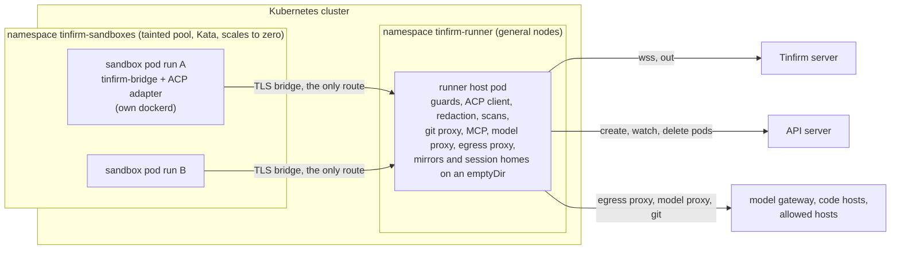
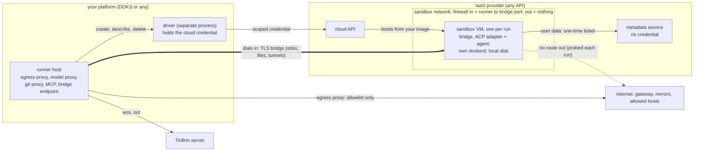
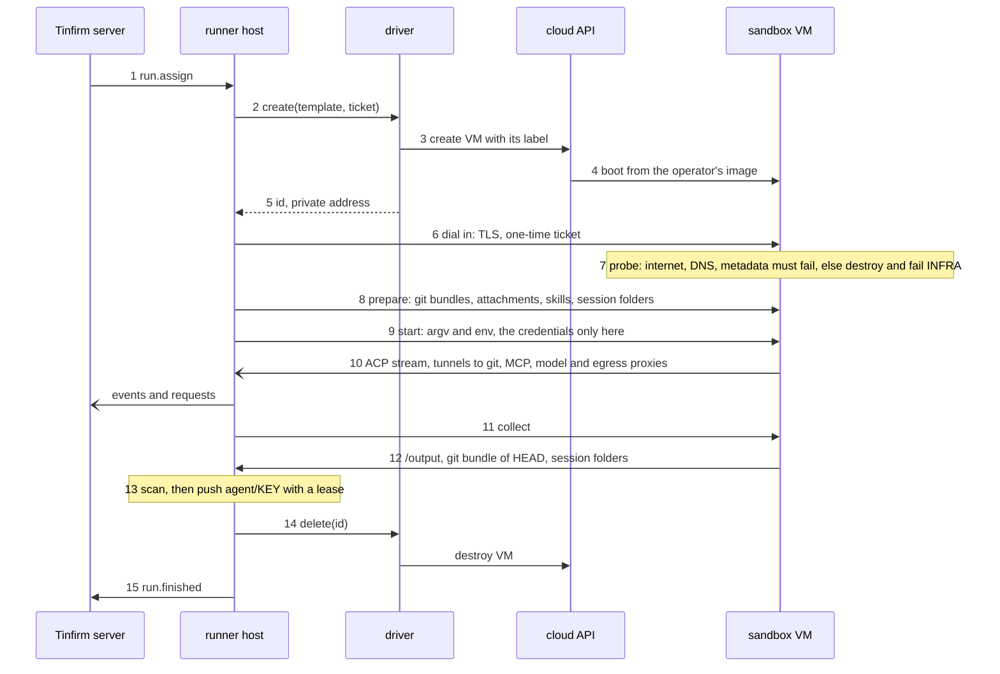
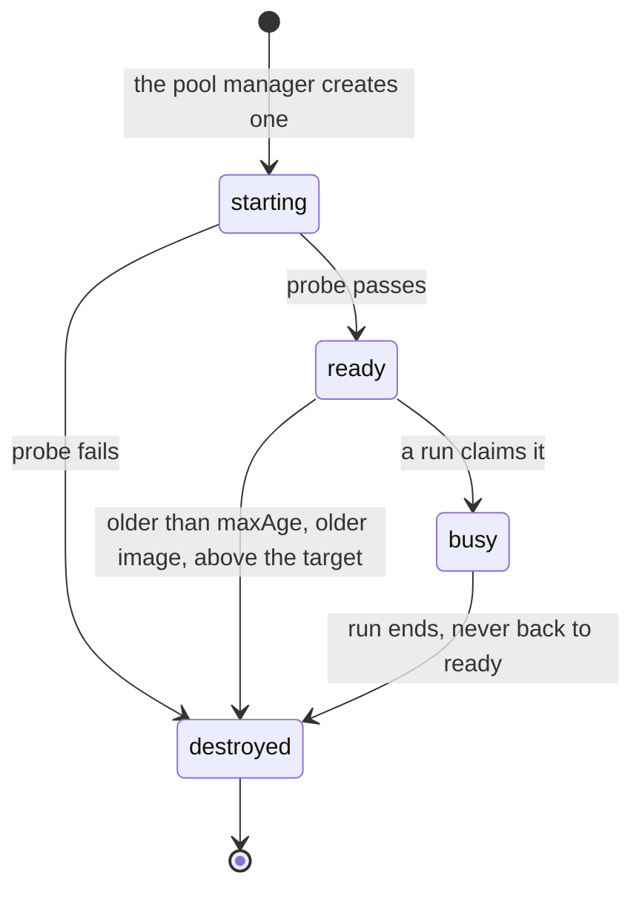

# Analysis: a Kubernetes runner next to the VM runner hosts

Status: analysis; the owner decided D1 to D12 on 2026-10-16 (§11) · 2026-10-15 · Owner: J. Balcar

The question: **can Tinfirm run its agents on Kubernetes, next to the VM runner hosts it has now, so that nothing is held while no agent works, with the same security as today?** This document covers what the VMs hold today and why, what a Kubernetes runner must keep, a design that keeps it, what changes in the security model, where it can run, what it costs, and the points the owner decides.

It reopens the question that [ADR-0025](../adr/0025-kata-sandbox-runtime.md) closed with one line: "Where a company's Kubernetes cluster allows no persistent volumes, the runner hosts stay VMs." [ADR-0006](../adr/0006-runner-hosts-and-isolation-tiers.md) had planned Kubernetes pods as the second executor from the start ("Tiers map to `runtimeClassName`"). No one has built it yet.

**Short answer: yes, as a second executor of the same runner host, not as a new runner.** The runner host runs as one small pod. Each run is a pod of its own in a locked-down namespace, under Kata Containers, on a node pool that scales to zero. There are three conditions:

1. **The sandbox bridge comes first.** Today the host connects to the sandbox through Docker attach and bind mounts of its own directories. A pod on another node can use neither. The bridge that [ADR-0002](../adr/0002-rust-runner-host-and-bridge.md) planned replaces both: one authenticated stream between the sandbox and its host. It needs no persistent volume, so it removes ADR-0025's reason for keeping VMs. It also closes two accepted risks on the VMs (R28, R36).
2. **The same security needs Kata, and Kata needs KVM, on the sandbox nodes.** On the VMs, the strong setting is one microVM per run with the agent's own Docker inside it (ADR-0025). On Kubernetes that is a `kata` RuntimeClass on nodes with `/dev/kvm`. A managed cluster such as DOKS cannot provide that, because DigitalOcean supports neither nested virtualisation nor a custom runtime on its managed nodes. DOKS can host the runner pod, but not sandboxes at today's security level. For those an operator needs an OKD or OpenShift cluster with Kata on KVM-capable workers, a managed cluster that offers nested virtualisation or Kata (GKE, AKS), or bare metal (§6). On DigitalOcean the equivalent is a Droplet per run, which the runner pod on DOKS creates and destroys (§6.1). On any other IaaS the same design works through a small driver per provider, held to one contract that the runner checks inside every VM (§6.2).
3. **The images need a registry.** Pods pull their images, but each VM builds its own locally and never pushes the ones that contain Claude Code. A private registry inside the deployment is the likely answer. It is the owner's call (D2).

Size: about 6 to 9 weeks for one engineer, and the bridge is about a third of that (§9). The server and the runner protocol do not change.

## 1. What runs today, and what it holds while idle

A runner VM ([deploy/ansible](../../deploy/ansible/README.md)) runs Docker Engine, Kata Containers with Cloud Hypervisor, the runner host as a systemd service (`run --sandbox-runtime kata --sandbox-docker`), the locally built runner images and the host's git mirrors. It runs up to `--max-concurrent-runs` sandboxes at once (default 2, the Ansible example 4). By default each sandbox has 4 GiB, 2 CPUs and 1024 pids, plus Kata's VM overhead, and its own dockerd runs inside the sandbox's limits.

The VM is sized for its peak and runs around the clock. With four slots at the defaults it needs about 8 vCPUs and 20 GiB all the time, whether or not an agent is working. That is the cost the question is about.

The host does more than start a container. Every step below assumes that the sandbox is on the same machine:

| Step | Today (Docker on the VM) | What breaks on Kubernetes |
|---|---|---|
| Clone | The host fetches its mirror (`mirrors/<key>.git`) with the git token, clones `workspaces/<runId>/<dir>` from it, and bind-mounts the folder at `/workspace` | The workspace has to reach a pod on another node |
| Attachments, skills | The host downloads them and bind-mounts them read-only (`/attachments`, the runtime's skill folder) | The same |
| Session home | `homes/<agentId>/<taskId>`, bind-mounted at `/home/agent`, kept so that the next turn can `session/load` | It has to outlive the pod |
| The agent's stdio (ACP) | Docker attach | There is no Docker |
| Git fetch, platform tools, model proxy, egress proxy | The host's listeners on the sandbox network's gateway | The pod needs a route to the runner pod |
| Credentials for the runtime | The container's environment, visible to whoever holds the Docker socket | A pod's environment is stored in etcd and shown to anyone who can read the pod |
| `/output`, git finalize | Read from the host's folders after the container stops: the files are scanned and saved, leftovers are committed, the commits are scanned, and the branch is pushed with a lease | The files must reach the runner before the pod is deleted |

## 2. What must stay the same

These are the properties a Kubernetes runner must keep, from ADR-0002, ADR-0006, [ADR-0007](../adr/0007-credentials-stay-in-deployment.md), ADR-0025, [ADR-0044](../adr/0044-sandbox-egress-proxy.md) and the [threat model](../threat-model.md) §5.6 and §5.7:

- **S1. The runner logic stays outside the sandbox.** This covers the guards, the redaction, the credential scans, the ACP client and the push (threat model 6.3).
- **S2. Each run gets its own sandbox.** When the agent has its own Docker, that sandbox is a microVM with its own kernel, and it never gets the host's devices (6.1, 6.9).
- **S3. No git credential, host token or gateway key enters the sandbox** (6.6, 7.3, 7.5).
- **S4. Egress leaves only through the host's proxy, to an allowlist.** The sandbox has no name resolution and no traffic to other sandboxes (7.1, ADR-0044).
- **S5. Limits and guards apply.** Memory, CPU and pids limits, the wall clock, the turn limit, the repeat limit and the inactivity limit (6.7).
- **S6. Everything that comes from the sandbox is untrusted.** Pushes and uploads are scanned, the push goes to `agent/<KEY>` with a lease, and `.git` is distrusted (7.5, 7.10).
- **S7. The runner connects out.** Neither the runner nor the sandbox needs an inbound port from outside (ADR-0006).
- **S8. A run is ephemeral.** Nothing of it survives except what the host keeps: the session home and the mirrors.

## 3. The design

### 3.1 Shape



The runner host binary gets a third executor, `Kubernetes`, beside `Docker` and the test-only `Local` (`runner/crates/tinfirm-runner-host/src/sandbox.rs`). It keeps everything else: the protocol, the guards, the proxies, the mirrors, the push and the redaction. To the server it is one more company runner host.

### 3.2 The runner pod

- One Deployment with one replica in its own namespace. Each registered host has one connection, and a second connection replaces the first (close code 4409), so one replica is one host. The strategy is `Recreate`.
- `run --executor kubernetes`. The host token and the config are read from a mounted Secret instead of `login`'s files. The data directory (mirrors, homes, skills cache, failed workspaces) is on an `emptyDir` with a size limit. Where the platform allows it, it can be on a volume instead. An OKD cluster may allow none, and none is needed: losing it costs only time (the mirrors are fetched again, and a resumed turn falls back to `NO_SESSION` and gets the full prompt).
- The pod runs under Pod Security `restricted`: non-root, no capabilities, a read-only root filesystem. It runs on general nodes and never on the sandbox pool (§3.7).
- Its requests are small, about 0.1 CPU and 256 to 512 MiB (to be measured). Git fetches and gc of the mirrors are its only peaks.

### 3.3 The sandbox pod

- One pod per run, `tinfirm-run-<runId>`, labelled with the run and the host, as the containers are today. It has one container and no init containers. It is not owned by any controller.
- `runtimeClassName: kata` (or the class name the operator configures, which must start with `kata`, as the rule of ADR-0025 says). The RuntimeClass carries the node selector and tolerations of the sandbox pool, and an `overhead`, so that the scheduler counts the VM.
- **Without the agent's own Docker:** user 1000, `drop: [ALL]`, `allowPrivilegeEscalation: false`, seccomp `RuntimeDefault` (Pod Security `restricted`), the same as today's container.
- **With the agent's own Docker:** `privileged: true` under a Kata handler that has `privileged_without_host_devices = true`. That is the containerd CRI and CRI-O option that ADR-0025 could not use under Docker, and on Kubernetes it is the standard way. Kubernetes cannot express what the Docker executor does instead (empty masked paths without a user namespace), so the option is required here. The runner refuses `--sandbox-docker` unless the class is a `kata` one. At start it also runs a probe pod and refuses if the probe sees a block device that is not the VM's own, because a handler without the option would hand the VM the node's disks.
- Requests equal limits (4 GiB, 2 CPUs by default; under Kata this sizes the VM), plus an `ephemeral-storage` limit that covers the dockerd loop disk and the emptyDirs. Kubernetes has no per-pod pids limit in the pod spec, so the bridge sets `RLIMIT_NPROC` before it starts the adapter. Under Kata, a fork bomb fills only its own VM.
- `automountServiceAccountToken: false` and a service account without permissions. `dnsPolicy: None` with a nameserver on which nothing answers, as today.
- `cluster-autoscaler.kubernetes.io/safe-to-evict: "false"`. The cluster autoscaler also never removes a node because of a pod that no controller owns, so scale-down never kills a run.
- `/workspace`, `/home/agent`, `/attachments`, `/output` and the skill folders are `emptyDir`s, or the VM's own disk. Because the runner no longer reads the workspace in place, the workspace can live on a disk inside the VM, which ADR-0025 suggested in case virtio-fs proved slow for Maven and npm.
- **The pod spec holds no credential** (§3.4).

### 3.4 The bridge

`tinfirm-bridge` is the bridge of ADR-0002: a static musl binary of a few MB in the base image, started by `tinfirm-sandbox-entrypoint`.

- **The pod spec holds only** the runner's address (an IP and a port, so no DNS), the run id, a one-time ticket of 32 random bytes and the SHA-256 of the runner's TLS certificate.
- **The bridge connects out** over TLS 1.3 (rustls, which the runner already uses), pins the certificate and presents the ticket once. The runner then binds the session to a key that exists only in the memory of the two processes, and reconnects use that key. A ticket read later from the pod spec, an event or an audit log opens nothing.
- **One connection carries several streams:** control; the adapter's stdin, stdout and stderr; tar streams in both directions; and TCP tunnels.
- **The sequence:** connect → `prepare` (files in, §3.5) → `start` (argv and environment; the run's credentials travel only here, never through the Kubernetes API) → ACP → `collect` (files out) → `stop`.
- **Tunnels.** In the pod, the bridge listens on 127.0.0.1. With the agent's own Docker it also listens on that dockerd's bridge gateway, so that Testcontainers' containers reach the proxies. It forwards each connection as a stream to the runner, which hands it to a listener it already has: the git proxy, the MCP endpoint, the model proxy or the egress proxy. Their checks do not change. The sandbox's URLs become `http://127.0.0.1:<port>/<secret>/…`.
- **The runner is gone for 25 s:** the bridge stops the agent (SIGINT, then SIGTERM), as ADR-0002 specifies.
- **The bridge is not trusted.** It runs where the agent can be root (with the agent's own Docker). The runner treats everything the bridge sends as it treats an agent-controlled bind mount today, with the same limits, scans and redaction. The bridge is a transport, not a guard.

The Docker executor can use the bridge too (D6). This puts the platform tools behind an authenticated stream instead of a secret in a plain-HTTP URL (R28), and later lets a restarted host take its runs back (R36).

### 3.5 Files in and out

| What | In (`prepare`) | Out (`collect`) |
|---|---|---|
| Repositories | The runner clones each repository from its mirror as today and sends the clone as a tar stream; its `origin` is the tunnelled git proxy. No token enters the pod | The runner's git steps run in the sandbox: the WIP commit (`WIP: uncommitted changes from run <id>`, with hooks off) and a bundle of `HEAD` without the commits the runner's clone has. The runner fetches the bundle into that clone, which the agent never reached (fsck on, with a size cap), and runs the checks it runs today: the credential scan of the outgoing commits, the ahead count, and the push of `agent/<KEY>` with `--force-with-lease`. The runner never runs git inside a `.git` that the agent wrote, which is stricter than today |
| Attachments, skills | tar streams from the runner, which downloads, checks and unpacks them as today; the files are owned by root and read-only for uid 1000 | — |
| Session home | The runtime's session folders (`~/.claude`, Codex's sessions, pi's and OpenCode's state) as a tar stream from `homes/<agentId>/<taskId>` | The same folders as a tar stream, stored back there. Caches such as `~/.m2` and `~/.npm` stay out; the package mirrors serve them |
| `/output` | — | A tar stream. The runner unpacks it into `workspaces/<runId>/output`, refusing links, devices, absolute paths and `..`, then saves the files as it does today (at most 200 files of 100 MiB each, each scanned) |

An eviction during a turn (a node upgrade) sends SIGTERM to the pod. The bridge then runs `collect` within the pod's grace period, as the host's SIGTERM path pushes work in progress today.

### 3.6 Network

- **Sandbox namespace:** a NetworkPolicy that denies all ingress and all egress to every pod (`podSelector: {}`), with one exception: TCP to the runner pod's bridge port. Nothing else is open: no DNS, no API server, no cloud metadata, no other pod. This replaces today's `internal: true`, `enable_icc=false` and the black-holed resolver.
- **The egress proxy is always on with this executor (D4).** Without it, the sandbox would need an egress rule to `0.0.0.0/0`, which this executor never writes. Open egress (R24) therefore has no equivalent on Kubernetes. The allowlist logic stays in the runner, unchanged.
- **The runner pod's egress:** the server, the code hosts, the model gateway, and port 443 to the internet for the allowed hosts. The cluster's private ranges are closed unless the operator sets `--egress-allow-private`, which the proxy already enforces.
- **Fail closed.** At start, and then periodically, the runner starts a probe pod in the sandbox namespace that tries to reach a public address, kube-dns, the API server and the metadata address. If any connection succeeds, `run` refuses to start. Without this check, a cluster whose CNI ignores NetworkPolicy would quietly give the sandboxes open egress.
- **Encryption:** the bridge is TLS, so the traffic between nodes carries nothing in clear. Today that traffic never leaves the machine.
- **One residual risk of ADR-0044 goes away.** On the VMs, a sandbox can reach every service of the VM that listens on the gateway address (SSH, exporters). The runner pod answers only on its bridge port.

### 3.7 Kubernetes guard rails

- **The runner's RBAC**, in the sandbox namespace only: `pods` create, get, list, watch and delete, and `pods/log` get. No `exec`, no `attach`, no Secrets. Cluster-wide, it may only get `runtimeclasses`, to check the handler. Today the runner holds the Docker socket, which is root on the VM (threat model 6.2, R10).
- **A ValidatingAdmissionPolicy** (Kubernetes 1.30 or later) on the sandbox namespace enforces the rules even against a compromised runner pod:
  - the runtime class is one of the allowed ones, and `privileged` only goes with a `kata` class;
  - no `hostPath`, `hostNetwork`, `hostPID`, `hostIPC` or `hostPort`;
  - no service account token and no environment from Secrets;
  - images only from the configured registry, by digest;
  - `dnsPolicy: None`, and the pool's toleration.

  On OKD the same rules apply, plus an SCC for the sandbox service account: privileged only when the agent has its own Docker.
- **Pod Security** on the namespace: `privileged` when sandboxes carry their own Docker, which only the admission policy's Kata rule makes safe; otherwise `restricted`.
- **A ResourceQuota** on the namespace caps CPU, memory and pods. It is the cost ceiling.
- **A dedicated sandbox pool**, tainted and labelled. The runner pod and every other workload stay off it. If a VM escape reaches a node, the kubelet's credentials there can read only the objects of pods bound to that node (NodeRestriction), and sandbox pods carry no secret.

### 3.8 Images

- **The runner host image** (the musl binary and git) has no Claude Code in it, so it can be published from the release workflow next to the binaries (`deploy/release/runner-musl.Dockerfile`).
- **The sandbox images:**
  - `images build` gains `--push <registry>`. The build runs where there is a Docker daemon: a CI runner of the deployment or a builder machine.
  - The Kubernetes runner names the images by digest, and checks their `dev.tinfirm.image-spec` label in the registry against its binary ([ADR-0062](../adr/0062-runner-host-rebuilds-its-images.md)). It refuses a stale image instead of rebuilding it.
  - Only the build can write to the registry. The nodes pull with a read-only secret.
- **Claude Code:** We do not redistribute the Claude Code binary: runner images with Claude Code are built on the runner host at install time. A private registry that serves only the deployment's own nodes is arguably still that. It is the owner's decision (D2). The other option, installing Claude Code at the start of each pod, adds network time and an external dependency to every run.

### 3.9 Scale to zero and start times

- **While idle:** one runner pod and no sandbox node. Optionally (D5), a few ready sandboxes and some spare node room, by schedule (§6.3).
- **When a run arrives:** the pod waits for a node, and the cluster autoscaler adds one (minutes). The node pulls the image, which is large: it carries Node, the JDK, Maven, Gradle, Python and Docker Engine. Then Kata boots, dockerd starts and the bundle arrives through the bridge. The first run after an idle period therefore waits minutes. Later runs on a warm node start about as fast as on a VM, plus the bundle transfer. A DaemonSet that pre-pulls the images on new sandbox nodes, and a registry in the same region, shorten the cold start. Step 4 measures it.
- **Slots:**
  - `--max-concurrent-runs` stays the ceiling, and Tinfirm's setting still lowers it. D12 proposes no fixed maximum of 16 for this executor.
  - The quota and the pool's maximum size are the real bound. A pod the quota refuses rejects its run with `NO_FREE_SLOT`, so that the server tries another host.
  - A pod that is waiting for a node keeps its run in `Starting`, with heartbeats, until a start timeout (proposal: 10 minutes). The run then fails with `INFRA` and "no sandbox node became available".
- **Scale-down** never removes a node that has a running sandbox (§3.3).

### 3.10 Upgrades, drains, leftovers

- **The runner pod:** a `preStop` hook runs `tinfirm-runner-host drain`. `terminationGracePeriodSeconds` is set to the longest run the operator allows. After that, SIGTERM cancels the remaining runs and pushes their work in progress, as today.
- **Sandbox pods** are evicted by node upgrades only. The bridge's `collect` on SIGTERM saves what it can, and the run fails as an interrupted run does today.
- **Leftovers:** at start, the runner deletes the pods with its label that belong to no live run, as it removes containers today.

## 4. Security, control by control

| Control today (VM, Kata, own Docker) | Kubernetes executor | Result |
|---|---|---|
| One sandbox per run; a Kata microVM with its own kernel | One pod per run under a `kata` RuntimeClass on KVM nodes; the admission policy refuses any other class | Same, once the nodes have KVM |
| The agent's own Docker only under Kata; never the host's devices | `privileged` only with `privileged_without_host_devices`, which the runner checks with a probe pod and the admission policy enforces | Same, enforced twice |
| uid 1000, no capabilities, `no-new-privileges` without own Docker | Pod Security `restricted` | Same |
| Memory, CPU and pids limits | Requests equal limits; `ephemeral-storage` added; pids through `RLIMIT_NPROC` and the VM | Same; disk is now limited too |
| The guards, redaction, scans and push stay outside the sandbox | The same code in the runner pod, on other nodes | Same |
| No git credential, host token or gateway key in the sandbox | The same, and no credential in the pod spec, etcd, events or audit logs: the bridge delivers them | Same |
| Egress through the proxy is opt-in; open otherwise (R24) | The proxy is always on; default-deny NetworkPolicy; the runner refuses to start if the probe pod gets out | Better, if the CNI enforces policies (the probe checks) |
| Services on the VM's gateway address are reachable (ADR-0044) | The runner pod answers only on the bridge port | Better |
| Platform tools over plain HTTP, guarded by a secret in the URL (R28) | Only through the authenticated TLS bridge | Better |
| A host restart loses its runs (R36) | The bridge buffers for 25 s; taking runs back after a restart becomes possible | Better later (§10) |
| The Docker socket is root on the VM (6.2) | Pod create and delete in one namespace, bounded by the admission policy | Better |
| Traffic between sandbox and host stays on one machine | It crosses nodes, inside TLS | Same |
| A VM escape lands on a dedicated runner VM (R22) | It lands on a sandbox node inside the cluster: the kubelet's identity, the cluster's network and its VPC | Weaker, unless the sandbox pool is isolated (§5); a cluster of its own for the sandboxes is equal |
| Images are built locally and never pushed | A private registry, images by digest | New supply-chain surface (§5) |

## 5. New things to defend

These rows go into the threat model with the ADR:

- **The Kubernetes API is part of the boundary.** Whoever can create pods in the sandbox namespace, or change its NetworkPolicies, admission policy or RuntimeClass, can open what this design closes. That includes cluster admins and the GitOps controller. The namespace's RBAC belongs in the review of every change.
- **Pod specs are widely visible.** Pod specs, events and audit logs are read by more people and tools than `docker inspect` on one VM. Nothing secret goes there (§3.4).
- **The CNI enforces egress.** A CNI that ignores NetworkPolicy gives open egress. The probe pod (§3.6) turns that into a refusal to start.
- **A VM escape lands inside the cluster:** on a node with a kubelet identity, in the cluster's VPC, where on DOKS the operator's managed database may also listen. Mitigations: a dedicated pool, NodeRestriction, no secrets on those nodes, a node firewall on the pool that closes the VPC except the control plane, and the database's trusted sources narrowed to the general pool. The strongest option is a cluster of its own for the sandboxes, with the runner pod in it, because the bridge needs the runner and its sandboxes in one cluster (S7).
- **A swapped image would run in every sandbox.** Mitigations: digests, write access only for the build, and signatures (cosign) as a later step.
- **The bridge is a new parser of untrusted input** (frames, tar streams, bundles) in the runner. It needs limits per stream, must refuse links and devices, and needs fuzz tests.

## 6. Where it can run

| Platform | Runner pod | Sandboxes at today's security (Kata and own Docker) | Scale to zero |
|---|---|---|---|
| DOKS (DigitalOcean Kubernetes) | Yes | **No.** DigitalOcean does not support nested virtualisation (staff say it may work on some Intel hosts, slowly), and its managed nodes take no custom runtime | The DOKS autoscaler can scale a pool to zero (GA in 2025), but here that is useful only at the `container` tier |
| OKD or OpenShift | Yes, with emptyDirs only (no persistent volume needed) | Yes, when workers have KVM (bare metal, or VMs with nested virtualisation, as a runner VM that runs Kata needs) and Kata is installed: OpenShift sandboxed containers on OCP, the upstream Kata operator or kata-deploy on OKD (to check). Without KVM: peer pods, one VM per pod through vSphere or libvirt (to check on OKD) | Depends on the cluster's machine sets. With peer pods nothing is held between runs |
| GKE Standard | Yes | A node pool with nested virtualisation, plus kata-deploy. Standard clusters only, without node auto-provisioning; such pods need `privileged` | Yes |
| AKS | Yes | Pod Sandboxing (Kata, `kata-vm-isolation`). To check: whether it allows the privileged containers that the agent's own Docker needs | Yes |
| Bare metal or k3s on the operator's own hardware | Yes | Yes | No real saving: the machines stay on |

### 6.1 On DigitalOcean

DOKS can host the runner pod but not Kata. Three designs keep the runner pod on DOKS (checked 2026-10-15).

**Option A (proposed): a Droplet per run.** The runner pod gets a fourth executor, `Droplet`, beside `Kubernetes`:

- **One fresh Droplet per run.** For each run the runner creates a Droplet from a private snapshot that already holds Docker Engine, the runner images and the bridge. When the run ends, the runner destroys it. A Droplet is never reused. The Droplet itself is the VM, so no Kata is needed: the agent is root with its own Docker inside it, as inside a Kata VM today. The boundary is DigitalOcean's hypervisor instead of a Kata VM nested in a runner VM. An escape no longer reaches a runner VM that holds other runs, the mirrors and the tokens. This is stronger than today, and the `privileged_without_host_devices` question disappears.
- **Network.** The Droplets sit in a VPC of their own, peered with the cluster's VPC (peering has been GA since December 2024, within one team), and carry the tag `tinfirm-sandbox`. A Cloud Firewall on that tag:
  - allows inbound traffic only from the cluster's nodes, to the bridge port;
  - has **no outbound rule** apart from UDP 67, the DHCP that Droplets from custom images need. Cloud Firewalls block everything not allowed, on the public and the VPC interfaces alike, and they are stateful.

  The runner therefore dials in to the bridge, and the reply traffic of that connection is the Droplet's only network. It is the counterpart of §3.6: no DNS, no other Droplet, no database, and egress only through the runner's egress proxy over the bridge.
- **Fail closed.** At start, and before each run, the runner reads the firewall through the API and refuses to start unless the firewall has exactly these rules on that tag. On a new Droplet, before the agent starts, the bridge also tries to connect out and reports the result. A Droplet that gets out is destroyed and its run fails with `INFRA`.
- **The bridge and the files are the same as in §3.4 and §3.5, with one difference: the direction.** The runner connects to the Droplet's VPC address. The user data holds the runner's certificate fingerprint and a one-time ticket. Anything in the Droplet can read the user data from the metadata service, so it holds nothing secret. The credentials still travel only over the bridge.
- **Images.** A snapshot is a private disk image of the operator's DigitalOcean team. It is not pushed to a registry, which comes closest to "built on the runner host" (D2). A release builds the snapshot again (for example with Packer), and the label check of ADR-0062 stays.
- **Cost.** While idle, only the runner pod and the snapshot's storage. Droplets have been billed per second since 2026-01-01 (at least 60 s or $0.01). A run of 30 minutes on `s-4vcpu-8gb` ($48 a month) costs about 4 cents.
- **Start time.** Creating and booting the Droplet, then starting dockerd. DigitalOcean publishes no figure, and community reports of large snapshots range up to 10 to 20 minutes, so this has to be measured first. Ready Droplets hide the wait (§6.3).
- **New things to defend:**
  - **The runner needs a DigitalOcean API token.** Custom scopes are GA (`droplet:create`, `droplet:read`, `droplet:delete`, `tag:*`, `firewall:read`), but they are per resource type. A token that may delete Droplets can probably delete any Droplet of the team, the cluster's own nodes included (to check). A team of its own would contain the token, but VPC peering does not cross teams, so the bridge would have to use public addresses. The first version stays in the operator's own team (D8), with these guards in the runner's code; the move to a team of its own is later work:
    - the token has only the scopes above, and those for the snapshot and the account (the Droplet limit);
    - the runner deletes a Droplet only by its id, after reading it and checking that it carries `tinfirm-sandbox` and the runner's own tag; it never deletes by tag, and it refuses any Droplet with a tag of the cluster (`k8s:…`);
    - every create and delete is logged with the Droplet's id and counted in a metric;
    - the token is a Kubernetes Secret that only the runner pod mounts, and is rotated.
  - **The team's Droplet limit** must cover the most concurrent runs, the ready Droplets included. The runner reads it at start and refuses a higher `--max-concurrent-runs` (D12).
- **Size:** the bridge (step 1 of §9) plus the Droplet executor: the API client, the lifecycle, the firewall and VPC checks, the snapshot build, leftover cleanup by tag, and a start timeout. That is about 2 to 3 weeks, in place of steps 2 and 3, so about 5 to 7 weeks in all. The sandboxes need no Kubernetes RBAC, admission policy or NetworkPolicy (the Cloud Firewall takes that role). The runner pod is an ordinary Deployment.

**Option B: a gVisor pool on DOKS.** The pods of §3, on a tainted pool that scales to zero, under gVisor (`runsc`).

- DigitalOcean offers no gVisor, so our own privileged DaemonSet would register `runsc` in containerd on that pool. Nodes would stay tainted until it has, and it would install again on every new node after an upgrade. That is a configuration DigitalOcean does not support.
- gVisor documents Docker inside its sandbox (all capabilities, an emptyDir at `/var/lib/docker`). Its GKE tutorial supports only host networking there, so Testcontainers' port mappings have to be tested.
- It is the cheapest option: several sandboxes share a node, the pool scales to zero, and the start is as in §3.9. File-heavy builds run slower under gVisor.
- **It is a step down.** gVisor is a kernel in user space, not a VM: the `gvisor` tier of ADR-0006, one below `microvm`. ADR-0025's rule that the agent's own Docker needs Kata would have to change.

**Option C: tiers by agent.** Agents that need no Docker (analysts, finance, testers without Testcontainers) run as `restricted` pods on DOKS under gVisor (Option B without the agent's own Docker), and development agents run on Option A. This needs an agent setting ("needs Docker") and a server that routes by tier, which it cannot do yet (Q21).

**Not options:**

- **Kata on DOKS.** Droplets have no supported nested virtualisation, and managed nodes take no custom runtime.
- **One sandbox per DOKS node** (a privileged pod alone on its node). A cluster node is not a sandbox. Root on it reaches the CNI agent's and the DaemonSets' credentials and can switch off its own NetworkPolicy, and the node goes back into the pool afterwards.
- **Kata peer pods with a DigitalOcean provider.** The cloud-api-adaptor has no DigitalOcean provider, and its shim would have to be installed on managed nodes. Option A is the same idea without Kata.
- **Hosted sandboxes** (Fly Machines, E2B and the like). They give a microVM per run, but the work and its data leave the deployment (ADR-0007: no vendor cloud), and the egress control is theirs.

| | Boundary | Agent's own Docker | While idle | Start | Supported by DigitalOcean | Size |
|---|---|---|---|---|---|---|
| A. Droplet per run | A VM per run (DigitalOcean's hypervisor) | Yes, as today | Runner pod, snapshot | Droplet boot (to measure); warm pool | Yes | 5 to 7 weeks |
| B. gVisor pool | A kernel in user space, shared node | Yes, rule changed; networking to test | Runner pod | Node scale-up, image pull | No (our own installer) | 6 to 8 weeks |
| C. Tiers | B for agents without Docker, A for the others | Only on A | Runner pod | Fast on B | Partly | A, then B, plus server routing |

The bridge and the runner's in-cluster mode are the same for A and for §3, so building A for DigitalOcean first leaves the Kubernetes executor of §3 for OKD or OpenShift at about 2 to 3 more weeks.

### 6.2 Any provider: one contract, a driver per provider

Option A must not become a DigitalOcean feature. An operator on AWS, Azure, Hetzner, OpenStack, vSphere or Proxmox must get the same security. The way to do that is to split what is the same everywhere from what differs, and to **check the security at run time instead of trusting the setup**.

**Three executors, each portable in its own world.** All three share the runner host, the bridge, the proxies, the guards and the scans. The runner itself can run anywhere: as a pod, as a container or under systemd.

| Executor | Portable across | Where it fits |
|---|---|---|
| Docker with Kata on a KVM machine (today) | Any machine with `/dev/kvm` | Bare metal; VMs with nested virtualisation: GCP, Azure, AWS C8i/M8i/R8i since February 2026, VMware, Proxmox |
| Kubernetes pods with a VM runtime class (§3) | Any conformant cluster with Kata or peer pods; only the class name differs | AKS Pod Sandboxing; GKE or EKS node pools with nested virtualisation and kata-deploy; OpenShift sandboxed containers, including peer pods on AWS, Azure, vSphere and libvirt; on-premises clusters with KVM |
| A VM per run through a driver (§6.1) | Any IaaS with an API, including those without nested virtualisation | DigitalOcean, Hetzner Cloud, Linode, Scaleway, OVHcloud, OpenStack, vSphere, Proxmox, libvirt |

**The contract of a sandbox VM.** Every provider must give this, and the runner checks it:

- **C1.** A fresh VM per run, from the operator's image. It is destroyed when the run ends and never reused.
- **C2.** No cloud identity: no instance role, managed identity or service account. The metadata service hands out no credential.
- **C3.** No outbound network except the replies to the runner's connection: no public route, no NAT, no DNS.
- **C4.** Inbound traffic only from the runner, and only to the bridge port.
- **C5.** Nothing secret in user data or metadata: only the runner's certificate fingerprint and the one-time ticket.
- **C6.** A network of its own, apart from the operator's other networks and databases.
- **C7.** The driver's credential reaches only the sandboxes' own account, project or resource group.

**Checked, not trusted.** The same words mean different things from one provider to the next:

| Provider | Outbound default of its firewall | Cloud identity to switch off | Narrowest credential |
|---|---|---|---|
| DigitalOcean | No outbound rule: everything denied | None | Team-wide scopes; a team of its own (D8) |
| Hetzner Cloud | No outbound rule: everything **allowed**. One outbound rule turns the rest into deny | None | Per project: a project of its own |
| AWS | A new security group allows all egress until that rule is removed | The instance profile, through the metadata service (IMDS) | IAM conditions on the sandbox tag, or an account of its own |
| GCP | An implied rule allows all egress; it needs a deny rule | The default service account and its token in the metadata server | A project of its own |
| Azure | The NSG rule `AllowInternetOutBound` | A managed identity | A resource group of its own |
| OpenStack | New security groups allow egress | None by default | A project of its own |
| vSphere, Proxmox, libvirt | Whatever the port group or bridge allows | None (user data comes on a config drive or through guestinfo) | A folder or pool with its own role |

A driver that copied the DigitalOcean setup to Hetzner word for word would open the network. Two checks therefore apply on every provider:

- **Inside each VM, before the agent starts,** the bridge probes the network: a public address, DNS, the credential paths of every known metadata service (AWS, GCP, Azure), other private ranges, and ports of the runner other than its own. Any connection that succeeds destroys the VM and fails its run with `INFRA`. The probe is the same everywhere, the same one as §3.6's probe pod.
- **At start,** the runner asks the driver to describe the effective rules, identity and network of its template, and refuses to start if they break the contract. This is defence in depth, and it catches drift in the operator's setup.

**The driver** is a separate program that the runner starts and talks to over stdio (JSON-RPC, like a git credential helper). It does five things:

- `create(template, userData, labels)`
- `describe(id)`: the state and the addresses
- `delete(id)`: only VMs it created
- `list(label)`: leftovers
- `verify(template)`

There are three reasons for a separate program:

- **The provider SDKs and their release cycles stay out of the Rust runner.**
- **The privilege split.** The driver holds the cloud credential and the runner does not. The driver creates only from templates it is configured with, and deletes only what carries its label. It can also run as a pod of its own, so that a compromised runner can only ask for a sandbox or end one.
- **Operators can write a driver for an in-house cloud** without forking the runner.

The runner selects the driver in its configuration, for example `executor: vm`, `driver: tinfirm-vm-hetzner`, `template: sandbox-4c8g`, `connect: private`, `warm: 1`.

**Connecting.** The runner always dials in to the sandbox, so the sandbox never needs an outbound rule, on any provider.

- **Private** (the default): the runner and the sandboxes share a network, through the same VPC, peering or a VPN.
- **Public:** the sandbox gets a public address that accepts connections only from the runner's egress addresses, over the TLS bridge with the pinned certificate and the ticket. This mode is for a sandbox account that cannot be peered (a DigitalOcean team of its own) or a runner at another provider.

The boundaries of a VM per run, on any provider:



A run, step by step. The credentials enter the VM only at step 9, over the bridge:



**Images.** One recipe for every provider: Debian, Docker Engine, the runner images and the bridge. It has no cloud agent that holds credentials, and cloud-init only reads the user data. We build it once as a disk image (qcow2) and import it through each provider's custom-image API (DigitalOcean, AWS, GCP, OpenStack Glance, vSphere and Proxmox templates), or build it with Packer. Hetzner Cloud takes no upload, so there it is a snapshot of a server. The bridge reports the image's spec digest when it connects, and the runner refuses a VM from an outdated image, as ADR-0062 does for containers. The image is built in the operator's own account, so the Claude Code binary is not redistributed.

**What we ship per provider:** the driver; a reference OpenTofu module that creates the sandbox network, the firewall, the image and the narrow credential; and a pass of the **conformance test**. The test is provider-independent and runs against a real account each night: create, the probe from inside finds nothing open, the metadata holds no credential, delete, and `list` comes back empty. A driver that does not pass it is not supported.

**Drivers without writing each one.**

- **GitLab Runner's fleeting plugins** (MIT; official ones for AWS, GCP and Azure, community ones for vSphere and DigitalOcean) scale an instance group that the operator defines (an AWS Auto Scaling group, a GCP managed instance group, an Azure scale set). Network and identity then live in the operator's template, which the probe and `verify` check. A driver that hosts these plugins (the go-plugin protocol over gRPC) would bring three clouds at once. The runner deletes each instance after its one run, as GitLab's `max_use_count = 1` does. The cost is a dependency on GitLab's plugin interface (D9).
- **On Kubernetes, peer pods** give a VM per pod on AWS, Azure, GCP, IBM Cloud, vSphere and libvirt with no driver of ours, where the cluster can install them.
- **Not:** Terraform or OpenTofu run per run (slow, with state that names every sandbox), or Cluster API and Karpenter (they make Kubernetes nodes, and a node is not a sandbox).

**Size.** The driver interface and the DigitalOcean driver are Option A's 2 to 3 weeks. Each further driver, with its module and a conformance pass, takes about 3 to 5 days. A fleeting host takes 1 to 2 weeks.

### 6.3 Ready sandboxes: a start in seconds

**Built for the VM executor** ([ADR-0098](../adr/0098-ready-vms.md)), with these changes to the proposal below: every VM comes from the pool, so a cold start is a claim that waits for a VM; a pool serves one runtime (`--pool-runtime`), since there is no image with every runtime yet; the VM's egress proxy listener is in its settings from the start and refuses everything until the run that claims it binds its rules; `headroom` is one ready VM per N busy ones; a failed create pauses the pool's own creates; the metrics are a status the host keeps (served ready and cold, the 90th percentile of the cold starts), for §6.4's report. Tinfirm's count (§6.4) is built too ([ADR-0099](../adr/0099-pool-settings.md)). The Kubernetes executor and the providers' stopped tier are not built.

This applies to the Kubernetes executor (§3) and to the VM executors (§6.1, §6.2).

**What a ready sandbox is.**
- It has done steps 2 to 7 of a run without a run: it is created and booted, its bridge is connected and its probe has passed.
- It holds no run data and no secret. Those arrive only when a run claims it, over the bridge (§3.4).
- Nothing about a run is in the pod spec or the user data, so any ready sandbox can take any run of its shape.
- A claimed sandbox never goes back to the pool. It is destroyed after its run, like any other (C1).

**The pool manager** lives in the runner, above the executors, so B and C share it. An executor only creates, lists and deletes. The manager keeps a target number of ready sandboxes:

`target = min(max(scheduled count, ⌈busy × headroom⌉), maxReady, pool size − busy)`, where ready and starting sandboxes together aim at the target. Ready sandboxes count against the pool size, so a pool full of busy ones keeps none ready.

- **Refill.** Every claim creates a replacement at once.
- **Burst.** When no sandbox is ready, the runner creates one for the run (a cold start). The run takes whichever sandbox becomes ready first: its own or a replacement.
- **Scale down.** Ready sandboxes above the target for 10 minutes are destroyed, so the end of a schedule window scales the pool down by itself.
- **Recycle.** A ready sandbox older than `maxAge` (proposal: 6 hours), or from an image older than the runner's own (ADR-0062), is destroyed and replaced. The probe runs again at claim, a cheap check that the firewall has not drifted since the sandbox started.
- **Shapes.** A pool holds one shape: one size and one image. For one pool to serve every agent, its image carries every runtime (Claude Code, Codex, pi, OpenCode), and `start` picks the one to run. A run of another size starts cold, or gets a pool of its own.
- **Capacity.** The pool size is the host's number of concurrent runs: `desiredMaxConcurrentRuns` under the ceiling `--max-concurrent-runs` (ADR-0016). The dispatcher therefore does not change. A run that would go past the pool size is rejected with `NO_FREE_SLOT`, and the server tries another host.



Admins set the pool size and the schedule in Tinfirm (§6.4). The host's operator keeps the ceilings and the tuning on the host:

```yaml
pool:
  maxReady: 4        # the most ready sandboxes Tinfirm may ask for; 0 turns the pool off
  headroom: 0        # one more ready sandbox per N busy; 0 is off
  maxAge: 6h
  coolDown: 10m
  leadTimeMax: 30m   # how early a window may start filling
```

The pool size's ceiling is the existing `--max-concurrent-runs`.

**On Kubernetes (B), two layers.**
- Ready pods save the Kata boot, dockerd's start and the image pull. They sit on the sandbox pool, so they keep nodes up.
- Spare room for the refills comes from placeholder pods of a low PriorityClass, the cluster autoscaler's overprovisioning pattern. A new sandbox pod preempts a placeholder at once, and the autoscaler adds a node for the evicted placeholder in the background.
- A pod's state (`tinfirm.dev/state: ready | busy`) is a label, so a restarted runner knows its pool. The runner then needs `patch` on pods in the sandbox namespace, and the admission policy allows an update to change only that label.

**At a provider (C), a cheaper tier where stopped VMs cost only their disk.**
- AWS, GCP and Azure (once a VM is deallocated) charge a stopped VM for its disk only. AWS Auto Scaling's warm pools are built on this.
- A stopped sandbox starts at claim: slower than a running one (tens of seconds, to be measured), but faster than a new one.
- It connects its bridge only at that start, so its one-time ticket is still unused and authenticates it once, as in §6.1.
- DigitalOcean and Hetzner bill a stopped server like a running one, so there the pool holds running VMs only.

**Security.** The contract does not change:
- A ready sandbox has never run an agent and holds nothing of a run.
- It accepts only the runner (C4) and has no route out (C3).
- The pool belongs to its runner host, which serves one company (threat model 5.6).

A ready sandbox adds cost while it waits, not exposure.

**Cost, as an example.** Two ready `s-4vcpu-8gb` Droplets on 22 working days of 11 hours cost about 2 × 242 h × $0.071 ≈ $35 a month, with none at night. On Kubernetes, two ready pods of 4 GiB and 2 CPUs hold about one node during those hours.

**Visible.**
- Metrics: ready, starting and busy sandboxes; claims served ready and claims served cold; the time from a claim to the agent's first ACP message.
- A run that started cold says so in its log.
- An alert fires when more than a fifth of the claims in working hours start cold, which means the target is too low.

**Expected starts** (step 4 of §9 measures them):
- From a ready sandbox, the start is the bundle transfer and the adapter's start: a few seconds. That is likely faster than today's VM, which boots a Kata VM and dockerd for every run.
- A cold start waits for the provider's boot or the node's scale-up: minutes.

**Size:** about 1 to 1.5 weeks on top of §9, for the pool manager, the schedule, recycling and the metrics. Each driver's stopped tier comes later.

### 6.4 Pool settings for admins

**Built** ([ADR-0099](../adr/0099-pool-settings.md)), with these changes to the proposal below: every replica evaluates the schedules of the pool hosts connected to it, not the worker, since a replica sends `host.config` only on its own connections; `hello` gains `pool {maxReady}` with the feature, and `hello.executors` does not gain `vm` yet; a host's slots are bounded at 1000 in protocol v2, its ceiling, desired and effective values alike; `host.pool.status` also goes once after each `host.config`; the card is a "Ready sandboxes" section of the host's card on the Runner hosts page, with the schedule in a dialog, and the week a strip of 7 days shaded by the count, with each day's start marked from the browser's zone data.

OWNER and ADMIN change a host's pool size and its ready sandboxes in Tinfirm, without a restart. The host's operator sets ceilings on the host that no setting can pass. This is ADR-0016's model ("ceilings on the machine, settings in Tinfirm") applied to the pool.

**What admins set.** The settings exist on a company host whose executor has a pool: one that lists `sandbox.pool` in `hello.features` (B and C, not the Docker executor).

| Setting | Meaning | Range |
|---|---|---|
| Pool size | The most sandboxes the host has at once: busy, ready and starting together. It is the host's `desiredMaxConcurrentRuns` (ADR-0016), so it is also how many runs the host takes at once | 1 to the host's ceiling |
| Ready outside the schedule | How many sandboxes wait ready when no window applies, for example 1 or 0 | 0 to the pool size |
| Windows | Up to 14 weekly windows, each with days of the week, a start time, an end time and a count. A window whose end is before its start ends the next day. Where windows overlap, the higher count applies. A window may name a zone of its own, for teams in several zones | Count 0 to the pool size |
| Time zone | An IANA zone, which the windows' times are in; summer time follows it. Required once there is a window. The form proposes the admin's own zone | As for a trigger's schedule |

An example, as the API takes it: at most 8 sandboxes; Monday to Friday from 08:00 to 18:00, two wait ready; at all other times, one (or none, with `readyDefault: 0`).

```json
{
  "desiredMaxConcurrentRuns": 8,
  "pool": {
    "zone": "Europe/Prague",
    "readyDefault": 1,
    "windows": [
      { "days": ["MON", "TUE", "WED", "THU", "FRI"], "from": "08:00", "to": "18:00", "ready": 2 }
    ]
  }
}
```

The ready sandboxes count against the 8: with 7 busy, one waits; with 8 busy, none.

**Time zones** (D5).

- A schedule is always in local time of a named zone, never in UTC or in the server's zone: "08:00" in `Europe/Prague` is 08:00 there in winter and in summer.
- The server evaluates it with `java.time` and the JDK's zone rules, as for trigger schedules. A time that the change to summer time skips (02:30 on that Sunday) moves forward by the gap; a time that the change back repeats takes its first occurrence. A window over that night is an hour shorter or longer.
- A window with a zone of its own is evaluated in that zone; where windows overlap, the higher count still applies.
- The card shows the times in the pool's zone and says so ("times in Europe/Prague"). Where the viewer's zone differs, it adds their own time ("08:00 Prague, 02:00 your time"). The week strip comes from the server's `week`, so the browser does no zone arithmetic.
- The evaluator's tests cover both summer time changes in `Europe/Prague` and `America/New_York`, an overnight window across each, and windows in two zones.

**The operator's ceilings on the host** have the last word on the cloud bill:

- `--max-concurrent-runs` (exists) bounds the pool size; for these hosts without the fixed maximum of 16 (D12).
- `pool.maxReady` (new; default 4; 0 turns the pool off) bounds every count.
- The tuning stays on the host (§6.3): `maxAge`, `coolDown`, `headroom` (off by default) and `leadTimeMax`.
- The effective value is `min(setting, ceiling)`. A setting above its ceiling is kept and applies up to the ceiling, as in ADR-0016.

So a compromised or mistaken server cannot raise the cost above what the operator allows.

**The server evaluates the schedule.**

- The worker evaluates each pool host's schedule every minute, with `java.time` and the zone rules the trigger schedules already use. When the result changes, it sends `host.config`.
- The host gets numbers, not rules. It needs no time zone database, and the API's preview and the host cannot disagree.
- `host.config` gains `pool: { readyTarget, next: { readyTarget, at } }`. With `next`, the host:
  - fills a window early by its own measured cold start (the 90th percentile of its last 20, at most `leadTimeMax`), so the count is there when the window opens;
  - follows that one change by itself if it cannot reach the server at that moment.
- After 15 minutes without a server connection, the host lets its ready sandboxes go: without the server, no run can arrive.
- A draining host keeps none ready.
- `config_version` increases with every change of a setting and with every change of the evaluated target. ADR-0016 already increases it with every change of the desired state.

**What the host reports.**

- `host.config.applied` gains `pool: { readyTarget, maxReadyCeiling }`, the effective values.
- A new frame, `host.pool.status` (host → server, on change, at most every 10 s), carries `ready`, `starting`, `busy`, the 90th percentile of the cold starts, and the claims of the last 24 hours, served ready and served cold.
- Both are additive to protocol v2, and only for a host that lists `sandbox.pool`. `hello.executors` gains `kubernetes` and `vm`.

**API** (ADR-0013, OpenAPI first).

- `PATCH /api/companies/{companyId}/runner-hosts/{runnerHostId}` gains `pool` (the table above) and `clearPool`. The pool size stays `desiredMaxConcurrentRuns`.
- The same people may change it as today: OWNER and ADMIN for a company host, and 403 for a member.
- Refusals:
  - a personal host, or a host without the feature: `409 RUNNER_HOST_POOL_UNSUPPORTED`;
  - an unknown zone, a window without a zone (its own or the pool's), a window without days or with the same start and end, a count above the pool size, or more than 14 windows: `400 VALIDATION_FAILED`.
- `RunnerHost` gains `pool`, null without the feature. It holds:
  - the settings and the ceiling `maxReadyCeiling`;
  - the current target and until when it holds, and the next change;
  - `week`: the change points of the next 7 days, computed by the server like a trigger's `nextFirings`, so that the UI draws the week without time zone rules of its own;
  - the host's last pool status.
- Audit: `runner_host.updated` with `changed: pool`, and the old and new values. Changes of the evaluated target are not audited, because they follow from a setting that was.

**Data.** Migration `V0xx__runner_host_pool.sql`; `runner_host` stays a tenant table as before. It gains:

- `pool_zone`, `pool_ready_default` and `pool_windows` (`jsonb`, at most 14 windows, checked by the API), all null until an admin sets them;
- `pool_max_ready_ceiling`, from `hello`;
- `pool_status` (`jsonb`) and `pool_status_at`, from `host.pool.status`.

**UI.** A "Sandbox pool" card on the company host's page shows:

- the pool size, with "up to 12 on this host" from the ceiling;
- the ready sandboxes outside the schedule;
- the windows: day chips, a start, an end and a count, with a preset "working days 08:00 to 18:00";
- the time zone;
- the week, as a strip of 7 days by 24 hours shaded by the count, and a line such as "Now 2 ready until 18:00, then 1";
- live counts: ready, starting and busy now; the last 24 hours' runs started ready and started cold; the 90th percentile of the cold starts;
- a note where a count is above the operator's ceiling: "applies up to 4 on this host".

**Size:** about 1.5 to 2 weeks on top of §6.3:

- the server, about a week: the migration, the API, the validation, the evaluator and its preview, the minute ticker, the protocol fields and the audit;
- the card, 3 to 4 days;
- the host's side, 2 to 3 days: the pool fields, the lead time and `host.pool.status`.

**Not now:** days off (public holidays), one-off overrides ("keep 4 ready until Friday"), and a forecast from past claims in place of a fixed schedule.

### 6.5 Session bundles in S3-compatible storage (D3)

**Built** ([ADR-0097](../adr/0097-session-bundles.md)), with these changes to the proposal below: gzip instead of zstd (the server's scan reads gzip already, and neither side needs a native library); at most 32 MiB compressed and 64 MiB unpacked, the scan's own limit; the server holds an upload in memory (at most 4 at once) instead of a multipart stream, since the scan reads all of it; the host downloads from a fixed path of the run, so `run.assign.sessionBundle` carries no URL; `run.finished.sessionBundle` adds `FAILED`; a run that reports a session without storing its bundle drops the earlier one; the S3 adapter is tested against a fake S3 API, not MinIO in Testcontainers.

A sandbox per run keeps nothing after its run, and the runner pod keeps its data on an `emptyDir`. The runtime's session folders (§3.5) are therefore lost when the pod restarts, and they never reach another host, a deployment's VM hosts included. The next turn then starts a new session (`NO_SESSION`): it works, but it costs more tokens and the agent loses what it read. The [session-resume review](2026-10-07-session-resume.md) names server-side bundles as the only fix for runners that come and go, and the design before the restart planned them in object storage. A bundle helps a deployment's VM hosts at once as well: a turn can resume on any company host.

**What is stored.**

- At the end of a run, the host packs the runtime's session folders, the allowlist of §3.5 (`~/.claude`'s project sessions, Codex's `sessions`, pi's and OpenCode's state, no caches), as a zstd-compressed tar. Proposal: at most 64 MiB compressed; a larger one is not stored.
- One bundle per conversation and agent: the newest. The previous one is deleted once the new one is committed.

**Where.**

- A bucket in any storage that speaks the S3 API: DigitalOcean Spaces, for example, or on OKD and OpenShift an S3 of the cluster's own (OpenShift Data Foundation's object gateway, Ceph RGW, MinIO), which needs no persistent volume in the cluster. The settings are an endpoint, a region, a bucket and path-style addressing.
- For Compose and the tests, a file system store behind the same port; the S3 adapter's tests run against MinIO in Testcontainers.
- Without a configured store, bundles are off and the hosts keep their own homes, as today.

**Only the server reaches the bucket.**

- Runner hosts keep reaching only the server ([PLATFORM.md](../PLATFORM.md), ADR-0059). The host uploads the bundle to the server when the run ends and downloads it when the next run starts, over HTTPS with the run's token, as it does attachments.
- The server streams it to the bucket (a multipart upload) without holding it in memory. Presigned URLs would spare the server the traffic, but they would open a new egress from every host and hand out bearer URLs; not now.
- The server's key reaches that one bucket only (Spaces has had keys per bucket since December 2024), and is a Kubernetes Secret like the server's other settings.

**Encrypted before it leaves the server.**

- Each bundle gets a fresh data key: AES-256-GCM in chunks, so that it streams, with the data key wrapped by the vault's master key as the vault wraps secrets (`TINFIRM_VAULT_KEYS`). The bucket holds ciphertext only; the provider's encryption at rest comes on top.
- The object's name is a random UUID, with no company, agent or conversation in it. The bucket is private.

**Checked as untrusted.** The bundle was written in the sandbox, where the agent can be root.

- On upload, the server checks the size and scans the content for the values of the company's vault secrets, as it does files. A bundle with a match is not stored, and the next turn starts new.
- On restore, the host checks the SHA-256 and unpacks with the rules of `/output`: relative paths only, no `..`, no links that leave the home, no devices, caps on the files and the bytes, and only into the allowlisted folders of the same runtime. A bundle goes only to a run of the same conversation and agent.

**Data and protocol.**

- A tenant table `session_bundle` (row-level security): the company, the conversation, the agent, the runtime and the session id; the object's name, its size, the SHA-256 of the content, the wrapped data key and its key id; the run that wrote it and when. Unique per conversation and agent.
- `hello.features` gains `session.bundle`. For such a host, `run.assign` gains `sessionBundle: {url, sha256, size}` when a bundle exists for the conversation, the agent and the runtime, and `run.finished` reports whether the host stored one (`stored`, `too_large`, `refused`, `none`). Other hosts keep today's homes. `resumeOutcome` does not change.
- People get no API to it. Only the host of a run of that conversation reads it.

**Lifetime.** Each run's bundle replaces the last. A bundle goes with its conversation, and 30 days after the conversation's last turn (proposal; a company setting later). A sweeper deletes objects without a row, and a lifecycle rule on the bucket deletes objects older than 37 days as a backstop.

**Which hosts.** Company hosts. A member's personal host (ADR-0007) keeps its homes on the member's machine, as today.

**Size:** about 1.5 to 2 weeks:

- the server, about a week and a half: the storage port with its S3 and file system adapters, the streaming encryption, the table, the two endpoints, the protocol fields, the sweeper and the tests;
- the host, 2 to 3 days on top of §3.5's streams.

A new dependency: the AWS SDK for Java v2's S3 client, which works with Spaces, Ceph and MinIO through an endpoint override. It needs an ADR.

## 7. Alternatives

- **Elastic VM runner hosts.** Keep the VM design and the code as they are, and create and delete runner VMs from a golden image as the queue changes. The signal is the runs waiting for a host (`RUNNER` / `QUEUED`, [CONVENTIONS](../CONVENTIONS.md) §14.7, "Waiting on"), exposed as a metric, and each VM drains before it is deleted. This gives the same security by construction for about 1 to 2 weeks of work, with no bridge. It is coarser: a whole VM per few slots, a VM boot per scale-up, no sharing with other workloads, and one integration per hypervisor or cloud API. It is the fastest way to cut the idle cost if the Kubernetes path waits, but it does not help an operator who wants to run on OKD.
- **The runner as a sidecar in the sandbox pod.** Rejected. A pod is one network namespace and, under Kata, one VM. The agent would share the VM with the guards, the scans and the git token, and the pod's egress would be the runner's.
- **A Tinfirm operator with a `Run` custom resource.** Rejected for now. It would duplicate or split the runner host's guarded logic (about 45,000 lines of Rust), and the run specs would sit in etcd.
- **[kubernetes-sigs/agent-sandbox](https://agent-sandbox.sigs.k8s.io/docs/getting_started/overview/)** (`Sandbox`, `SandboxTemplate`, `SandboxClaim`, `SandboxWarmPool`). Not now: the API is alpha (`v1alpha1`), and it is built around a stateful pod with persistent storage. Its warm pools would fit the bridge design later, because a warm pod holds nothing of a run until the bridge gives it one. The executor should build the pod spec in one place so that it can switch later.
- **Kubernetes attach (`pods/attach` through the API server) instead of a bridge.** Rejected. The stdio would pass through the API server and the kubelet for runs of up to 24 hours, a reconnect would lose the stream, the runner would need `pods/attach`, and the files and listeners would still need another way.
- **The `container` or `gvisor` tier on DOKS.** Possible for agents that need no Docker and read no untrusted content (ADR-0006's guidance), but it is not the same security, so it is not proposed as a replacement for the VMs.

## 8. What it changes in the code

| Where | Change |
|---|---|
| `runner/crates/tinfirm-bridge` (new) | The sandbox side of the bridge; a static musl binary in the base image |
| `sandbox.rs` | `Executor::Kubernetes` beside `Docker` and `Local`; the pod spec built from `SandboxSpec` |
| `run.rs` | The file steps go behind the executor: bind mounts for Docker, bridge streams for Kubernetes (`prepare_dirs`, `clone_all`, `collect_output`, `finalize_git`) |
| `git_proxy.rs`, `mcp.rs`, `model_proxy.rs`, `egress_proxy.rs` | They also accept connections from the bridge's tunnels; their checks stay the same |
| `main.rs`, `config.rs` | `run --executor kubernetes`; config and credentials from mounted Secrets; the Docker-only checks skipped; the probes (§3.3, §3.6) |
| `images.rs` | `images build --push`, and the label check against the registry |
| `host.rs` | Leftover cleanup by label; `hello.features` per executor (`run.skills` works on both) |
| `deploy/helm/tinfirm-runner` (new) | The runner Deployment, the service accounts, RBAC, the sandbox namespace, NetworkPolicies, the admission policy, the quota and the PDB |
| The server and the protocol | Nothing. Optional later: show the executor and the tier (Q21) |
| Docs | An ADR, the threat model (§5), the runner README and an operations guide |

New dependencies: kube-rs and k8s-openapi. ADR-0002 already lists kube-rs.

## 9. Size and order

| Step | What | Size |
|---|---|---|
| 1 | The bridge: frames, the sandbox binary, the host side and the tunnels. The Docker executor uses it behind a flag, which closes R28 | 2 to 3 weeks |
| 2 | The Kubernetes executor, the in-cluster mode and the Helm chart; CI on kind at the `container` tier | 2 to 3 weeks |
| 3 | Kata parity: the RuntimeClass, the agent's own Docker, the egress and host-device probes; a trial next to VM runner hosts on the platform of D1 | 1 to 2 weeks |
| 4 | Scale to zero in operation: the autoscaler, the placeholder, the pre-pull, a dashboard and alerts; measured start and build times | About 1 week |
| 5 | Ready sandboxes (§6.3): the pool manager, the schedule, recycling and the metrics; each driver's stopped tier later | 1 to 1.5 weeks |
| 6 | Pool settings for admins (§6.4): storage, API, the server's schedule evaluation, protocol fields, the host page's card | 1.5 to 2 weeks |
| S | Session bundles in S3-compatible storage (§6.5, D3) | 1.5 to 2 weeks |

The total is about 6 to 9 weeks; 7 to 10 with step 5; 9 to 12 with step 6; 10.5 to 14 with the session bundles.

**The order after D1.** Step 1, then the Droplet executor with the driver protocol (§6.1, §6.2; 2 to 3 weeks) in place of steps 2 and 3, then the session bundles, so that turns which move between VM hosts and hosts of the new executor keep their session; then steps 4 to 6 on DigitalOcean. Steps 2 and 3 follow for OKD or OpenShift, at about 2 to 3 weeks, since the bridge and the in-cluster mode are shared.

**Status (2026-10-16).** Step 1 is built (ADR-0095; `run --sandbox-bridge`, opt-in, for the Docker executor and the local test executor): the bridge carries the adapter's stdio and `start`, the tunnels to the host's listeners, which then bind loopback (R28), and the files of §3.5 in place of every mount. The local end-to-end tests run a second time with every run over the bridge. Left of it: a check on a real VM with Docker and Kata, and taking runs back after a restart of the host (R36), which §10 leaves for later. The Droplet executor is built too ([ADR-0096](../adr/0096-a-vm-per-run.md); `run --executor vm`): the driver protocol of §6.2, DigitalOcean's driver with the guards of §6.1 and D8, the host that dials the bridge in the VM, the probe from inside, `vm-boot` in the VM, and the snapshot's recipe; the local end-to-end tests run a third time with a VM per run through a fake driver. Left of it: a check on a real DigitalOcean account (the boot time, the metadata service and DHCP under the firewall, the probe from a Droplet) and the conformance test (D10). Step 5's ready VMs are built for it too ([ADR-0098](../adr/0098-ready-vms.md); `--pool-*`), and step 6's pool settings ([ADR-0099](../adr/0099-pool-settings.md)): an admin sets the schedule on the host's card, the server evaluates it and sends the host the count now and its next change, and the card shows the host's report. Left of them: a check of the counts and the cold starts on a real DigitalOcean account. The session bundles are built ([ADR-0097](../adr/0097-session-bundles.md); `TINFIRM_SESSION_BUNDLES_STORE`): every v2 host of this version lists `session.bundle`, so a turn resumes its session on any company host, a VM per run included. Left of them: a check against a real bucket (Spaces, MinIO). Step 1 is useful on its own, and steps 2 and 3 can overlap. A deployment's VM hosts keep running throughout: the Kubernetes runner registers as one more company runner host, and the server sends runs to whichever host has a free slot.

## 10. What it leaves out

- **Subscription credentials** (Claude Pro/Max, ChatGPT Plus/Pro). They belong to a member's personal host (ADR-0007), and a cluster runner is a company host. It refuses runner credentials and takes company model credentials only, through the gateway (D7), so no provider key or host API key enters a pod.
- **Taking runs back after a runner restart.** The bridge makes it possible, and it is the next step after this work. Built since (ADR-0101): a restarted host takes back its runs on the bridge, saves their work and session, and ends them; continuing the turn in place is still left out.
- **Session bundles** are not left out: §6.5, built (ADR-0097). Without a configured store, homes stay with the runner and are lost when its pod moves, so the next turn falls back to `NO_SESSION`.
- **Warm pools** and **several runner replicas** (one registered host per replica).

## 11. For the owner to decide

**Decided by the owner on 2026-10-16:**

| # | Decision | Answer |
|---|---|---|
| D1 | Where do the sandboxes run? | On DigitalOcean: the runner pod on DOKS and a Droplet per run (§6.1, Option A), not sandbox pods on DOKS. On OKD or OpenShift: Kata pods on KVM workers (§3). The Droplet path comes first (§9) |
| D2 | Where do the images with Claude Code live? | Never in a public registry. On DigitalOcean: a private snapshot of the sandboxes' team (§6.1). On Kubernetes: a private registry that serves only the deployment's nodes |
| D3 | Where an agent's session lives between turns | Session bundles in S3-compatible storage, reached through the server and encrypted with the vault's keys (§6.5), so that a turn keeps its session when it moves between hosts; without a configured store, the runner keeps the homes as today |
| D4 | The egress proxy on Kubernetes | Always on, with no option to turn it off |
| D5 | A new pool host's settings before an admin sets any (§6.4) | No ready sandboxes and no windows, so admins opt in; the form offers the preset "working days 08:00 to 18:00: 2 ready" in the admin's own time zone. The schedule is always in a time zone and follows its summer time (§6.4, "Time zones"). Raise the counts when more than a fifth of the claims in working hours start cold |
| D6 | The bridge for the Docker executor too | Yes; it is step 1 and closes R28 on the VMs |
| D7 | Model access on Kubernetes and on Droplets | LiteLLM, through the server's model relay ([ADR-0059](../adr/0059-litellm-budgets-and-the-model-proxy.md)): the runner's model proxy holds the run's one-run token, and no LiteLLM key, provider key or host API key enters a pod or a Droplet |
| D8 | Which DigitalOcean team the sandboxes and the runner's API token belong to (§6.1) | The operator's own team for a first version, with the runner's guards of §6.1: the narrowest scopes, deletes by id after a tag check only, never a Droplet of the cluster, every call logged. A team of its own, so that DigitalOcean enforces the boundary, is later work |
| D9 | Our own driver protocol, or GitLab's fleeting plugins (§6.2) | Our own five-call protocol, with DigitalOcean first; a fleeting host only when an operator on AWS, GCP or Azure asks |
| D10 | Which providers we support, and what "supported" means | Those whose driver passes the nightly conformance test; the contract (C1 to C7) is published, so that operators can bring their own driver |
| D11 | Who evaluates the pool's schedule (§6.4) | The server, which sends the host numbers and the next change; the host needs no time zone rules |
| D12 | A limit on a host's concurrent runs | No fixed maximum for a host whose executor creates a sandbox per run (`vm`, `kubernetes`): the operator's `--max-concurrent-runs` is the ceiling, which Tinfirm can lower but never raise (ADR-0016), and the runner refuses at start a ceiling above the provider's quota (DigitalOcean reports the team's Droplet limit). Each sandbox is billed, so a stuck queue, a bug that creates VMs in a loop or a compromised server must not start them without limit. The schemas keep 1,000 as a bound against invalid values; Docker hosts and credential pools keep 16. It amends ADR-0016 with step 6 |

## 12. Sources

- Tinfirm: [ADR-0002](../adr/0002-rust-runner-host-and-bridge.md), [ADR-0006](../adr/0006-runner-hosts-and-isolation-tiers.md), [ADR-0007](../adr/0007-credentials-stay-in-deployment.md), [ADR-0025](../adr/0025-kata-sandbox-runtime.md), [ADR-0044](../adr/0044-sandbox-egress-proxy.md), [ADR-0062](../adr/0062-runner-host-rebuilds-its-images.md), the [runner README](../../runner/README.md) ("What a run does", "v0 security shortcuts"), [threat model](../threat-model.md) §5.5 to §5.7 and §7, [deploy/ansible](../../deploy/ansible/README.md), `runner/crates/tinfirm-runner-host/src/sandbox.rs` and `run.rs`.
- DigitalOcean: [DOKS scale to zero, GA](https://docs.digitalocean.com/notes/2025/kubernetes-scale-to-zero-ga), [the autoscaling guide](https://docs.digitalocean.com/products/kubernetes/how-to/autoscale/), [nested KVM on Droplets (community)](https://www.digitalocean.com/community/questions/does-digitalocean-support-nested-kvm-now), [Droplet pricing (per-second billing)](https://docs.digitalocean.com/products/droplets/details/pricing/), [API token scopes](https://docs.digitalocean.com/reference/api/scopes/), [Cloud Firewalls quickstart](https://docs.digitalocean.com/products/networking/firewalls/getting-started/quickstart/), [VPC peering GA](https://www.digitalocean.com/blog/vpc-peering-ga), [creating Droplets from snapshots](https://docs.digitalocean.com/products/snapshots/how-to/create-and-restore-droplets/), [snapshot create times (community)](https://www.digitalocean.com/community/questions/how-do-i-stop-droplet-creation-request-if-its-status-is-in-progress).
- Object storage: [Spaces keys per bucket, GA (2024-12)](https://docs.digitalocean.com/notes/2024/per-bucket-keys-ga), [managing Spaces access](https://docs.digitalocean.com/products/spaces/how-to/manage-access/).
- gVisor: [Docker in gVisor](https://gvisor.dev/docs/tutorials/docker-in-gvisor), [Docker in GKE Sandbox](https://www.gvisor.dev/docs/tutorials/docker-in-gke-sandbox/).
- Other providers: [Hetzner Cloud firewalls FAQ](https://docs.hetzner.com/cloud/firewalls/faq/), [AWS nested virtualisation on virtual instances (2026-02)](https://aws.amazon.com/about-aws/whats-new/2026/02/amazon-ec2-nested-virtualization-on-virtual), [EC2 nested virtualisation guide](https://docs.aws.amazon.com/AWSEC2/latest/UserGuide/amazon-ec2-nested-virtualization.html), [GitLab Runner fleeting plugins](https://docs.gitlab.com/runner/fleet_scaling/fleeting/), [Docker Autoscaler executor (`max_use_count`)](https://archives.docs.gitlab.com/16.1/runner/executors/docker_autoscaler.html).
- GKE: [nested virtualisation](https://cloud.google.com/kubernetes-engine/docs/how-to/nested-virtualization). AKS: [Pod Sandboxing](https://learn.microsoft.com/en-us/azure/aks/use-pod-sandboxing), [considerations](https://learn.microsoft.com/en-us/azure/aks/considerations-pod-sandboxing).
- Red Hat: [OpenShift sandboxed containers, peer pods](https://www.redhat.com/en/blog/red-hat-openshift-sandboxed-containers-peer-pods-solution-overview).
- Kata Containers: [privileged containers and `privileged_without_host_devices`](https://github.com/kata-containers/kata-containers/blob/main/docs/how-to/privileged.md).
- Kubernetes: [Agent Sandbox (blog, 2026-03-20)](https://kubernetes.io/blog/2026/03/20/running-agents-on-kubernetes-with-agent-sandbox), [agent-sandbox overview](https://agent-sandbox.sigs.k8s.io/docs/getting_started/overview/).
