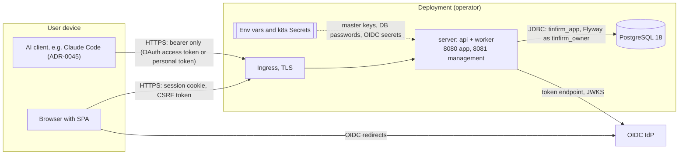
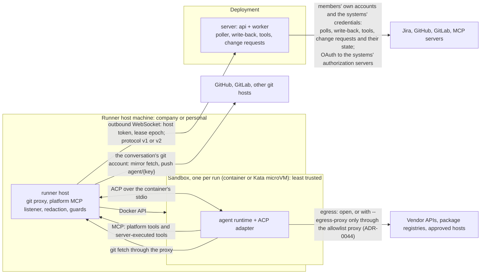
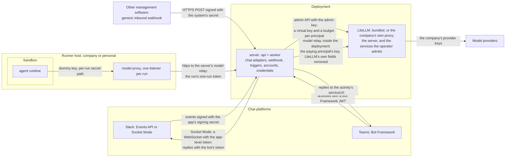

# Threat model

Scope: Tinfirm as built on `main` on 2026-10-19: the server, the web app, the runner host and its sandboxes, the company's systems, and the deployment. `main` runs the platform redesign of 2026-10-12 ([PLATFORM.md](PLATFORM.md), [ADR-0058](adr/0058-authority-from-the-audience.md), [ADR-0059](adr/0059-litellm-budgets-and-the-model-proxy.md)), built package by package and finished on 2026-10-13: principals and service accounts, systems with members' own accounts and the systems' credentials lent to groups and service accounts ([ADR-0072](adr/0072-system-credentials-lent-to-groups-and-service-accounts.md)), agents with versions and settings, conversations with fixed bindings, triggers (Jira Data Center and Cloud, GitHub, GitLab, schedules) with their polls and write-back, the chat systems (Slack, Teams) and the generic inbound webhook, LiteLLM bundled as the model gateway with a key and a budget per principal and the server as the runs' model relay, company and personal runner hosts, and governance (the audit, retention, holds, erasure, spend, kill switches, suspension, departures). Beside it run the MCP endpoint for people's AI clients, with Tinfirm's OAuth authorization server and personal access tokens ([ADR-0045](adr/0045-mcp-server-for-peoples-clients.md)); agent memory (ADR-0063) and skills (ADR-0064); the company's own services at the bundled LiteLLM's own port, where the operator admits them (ADR-0110, which removed ADR-0069's model port); and error reports to the vendor (ADR-0070). The design of 2026-10-05 ([ADR-0037](adr/0037-restart-on-the-platform-design.md), [archive/v2/PLATFORM.md](archive/v2/PLATFORM.md)) is history: its connections of three types, work items, jobs and threads, company and interactive agents, groups with rights on agents ([ADR-0049](adr/0049-agent-kinds-groups-and-personal-accounts.md)), the company's own account on a connection ([ADR-0051](adr/0051-connection-company-account.md)), shared accounts ([ADR-0052](adr/0052-shared-accounts.md)), model credentials, and the OPERATOR and VIEWER roles exist in no migration and no module. Rows written for that design keep their ids and say what replaced their subject; an asset that no longer exists is marked removed, with what replaced it. [ADR-0075](adr/0075-companies-and-sign-in-from-the-deployment.md) removed companies' own OIDC providers (ADR-0045): companies and their sign-in come from the deployment, the operator decides which issuers create users of which company, and A24, 3.11, 3.13 to 3.15 and Q24 are Removed or Closed.
Date: 2026-10-05, rewritten for the platform when the eight packages of [the archived PLATFORM.md §13](archive/v2/PLATFORM.md#13-build-order) were done ([restart log](reviews/2026-10-05-restart.md)); amended on 2026-10-08 for ADR-0049 and ADR-0051, on 2026-10-09 for ADR-0052, and on 2026-10-12 for the runner host's model proxy, for the platform redesign (ADR-0058, ADR-0059, then planned) and for the server as the model relay, with LiteLLM inside the deployment (the security review's row 21), and for a run's token bound to its runner host's own token (the package 2 contract's open point 6, 13.4); on 2026-10-16 for the bundled LiteLLM's model port for the company's services (ADR-0069, 13.7) and error reports to the vendor (ADR-0070, 5.15); on 2026-10-19 for the system as built on `main`: the redesign's rows given the status of their code, and the rows of the removed design rewritten for what replaced it; then for companies and their sign-in from the deployment (ADR-0075, 3.10 to 3.15); on 2026-10-27 for [the security review of that day](reviews/2026-10-27-security-review.md) and its fixes ([the record](reviews/2026-10-27-security-review-fixed.md)): the positions (§2.4), the lifetimes (§6.6) and the reveal as the invariant (§6.7); on 2026-11-06 for the model port's removal, with the company's services at LiteLLM's own port where the operator admits them (ADR-0110, 13.1, 13.7, R65); first written on 2026-09-26 for the M0 skeleton and the v1 runner design.
Sources: [PLATFORM.md](PLATFORM.md), [CONVENTIONS.md](CONVENTIONS.md) (§15 for the redesign's domain), [api/openapi.yaml](../api/openapi.yaml), the runner protocol schemas [`runner-v1.schema.json`](../protocol/runner-v1.schema.json) and [`runner-v2.schema.json`](../protocol/runner-v2.schema.json), the [runner host's README](../runner/README.md), and the [platform redesign](reviews/2026-10-12-platform-redesign.md) with its security review and the contracts of its packages ([1](reviews/2026-10-12-package-1-contract.md), [2](reviews/2026-10-12-package-2-contract.md), [3](reviews/2026-10-12-package-3-contract.md), [4](reviews/2026-10-12-package-4-contract.md), [5](reviews/2026-10-12-package-5-contract.md), [6](reviews/2026-10-12-package-6-contract.md), [R](reviews/2026-10-12-package-r-contract.md)).

Update this document in the same pull request when you change a trust boundary, an asset or a security control ([CONTRIBUTING §6](../CONTRIBUTING.md#6-commits-and-pull-requests)).

## 1. How to read this document

The method is: assets (§3), trust boundaries (§4), then STRIDE threats for each boundary (§5). §2.4 names the positions an adversary can hold and the control that holds each. §6 covers topics that cross boundaries. §7 lists accepted risks, and §8 lists open items. Row ids are stable: a row whose subject went away with the restart or the redesign says what replaced it.

References: **C§5** is CONVENTIONS section 5, **C§15.7** its section 15.7 (the redesign's domain), **C§14.9** its section 14.9 (the restart's domain of 2026-10-05; §14 binds code only where its head note says so: the outbound guard of §14.4, the MCP endpoint and OAuth server of §14.11; companies' own identity providers of §14.12 were removed by ADR-0075). **V1§15.3** is section 15.3 of the v1 conventions ([archive/v1/CONVENTIONS.md](archive/v1/CONVENTIONS.md)), which still describes the runner host, its protocol v1 and its sandbox. **PL§9** is section 9 of [PLATFORM.md](PLATFORM.md), the redesign. **PF§4.6** is section 4.6 of the design of 2026-10-05 ([archive/v2/PLATFORM.md](archive/v2/PLATFORM.md)), which rows written for it cite. **RH** is the runner host's [README](../runner/README.md). **API** is `api/openapi.yaml`. **RD§7** is Part 7 of the [platform redesign](reviews/2026-10-12-platform-redesign.md) (ADR-0058, ADR-0059), and **SR row 10** its security review's row 10. **K1§5** is section 5 of its [package 1 contract](reviews/2026-10-12-package-1-contract.md), and **I1** to **I10** are that contract's invariants (K1§4). **K2§6.1** is section 6.1 of its [package 2 contract](reviews/2026-10-12-package-2-contract.md), the server's model relay. The other packages' contracts are named in words (the package 5 contract, §5.2).

The platform redesign (ADR-0058, ADR-0059) is built: its assets, boundaries and rows describe the code on `main`, and §8 says how the points it left open (Q30 to Q40) were decided; Q36 is still open in part. Where a part of it is not built, the row says Planned and names what is missing.

STRIDE: **S** spoofing, **T** tampering, **R** repudiation, **I** information disclosure, **D** denial of service, **E** elevation of privilege.

| Status | Meaning |
|---|---|
| Built | The code has the control and its tests pass (the restart log records what was verified). |
| Planned | The design names the control (PLATFORM.md §14, an ADR, or a package contract), but it does not exist yet. |
| Operator | The operator, or the company's owners and admins, must configure the control. The docs describe how. |
| Accepted risk | We accept the residual risk. §7 gives the reason. |
| Open | No control is decided. §8 states the question. |
| Retired | The code no longer has the subject of an accepted risk; §7 says what replaced it. |
| Removed | The feature the row is about no longer exists; the row keeps its number and says what replaced it. |

## 2. System overview

### 2.1 The server and its clients

### 2.2 Runner hosts and the company's systems

The egress proxy (ADR-0044) is built and opt-in (`run --egress-proxy`), and so is the sandbox bridge (ADR-0095, `run --sandbox-bridge`), with its tunnels to the host's listeners (R28), and so is a VM per run through a driver (ADR-0096, `run --executor vm`), which the host dials over the bridge. A GitHub App and an MCP proxy are not built; §7 lists the risks they would remove (R24 to R28). The model gateway is LiteLLM, managed by Tinfirm with a key and a budget per principal and reached by the server, which relays the runs' model traffic to it, and by the company's services the operator admits (13.7); a run holds only a one-run token for the relay (ADR-0059, §2.3, 13.4).

Trust zones:

1. **Deployment:** server, PostgreSQL, configuration. The operator controls it. The companies of one instance are declared by this one operator, who vouches for all their admins (the companies of one group, or a company and its test companies): an instance never hosts companies that do not trust each other. What one company's admins can do to the instance's users across that line is accepted on that ground (R59 to R62), and its cheap checks are built anyway as hardening (17.2 to 17.4, 16.9).
2. **Runner host process.** A company host runs on a machine of the company and is registered by an admin. A personal host runs on a machine that one member controls and is registered by that member; it is present in every company the member belongs to, over one connection (ADR-0092). The server and a personal host trust each other only partly: the host holds subscription tokens that the server must never see, the server accepts from the host only data for the runs it assigned to it, and it assigns a personal host only runs its owner pays for whose workspace git accounts are all its owner's own (5.14).
3. **Sandbox.** An agent can be prompt-injected at any time. The design treats everything inside the sandbox as hostile.
4. **The company's systems** (Jira Data Center and Cloud, GitHub, GitLab, git hosts, MCP servers): Tinfirm trusts their answers as the company's data, under the account a conversation or a trigger binds there (a member's own account, A25, or a system's credential, A29), never as instructions. The people who write there are untrusted authors (TB9). The chat platforms (Slack, Teams) and the senders of the generic inbound webhook are systems too: they call Tinfirm, so their events are untrusted until their signature is checked (TB11, TB12), and their text is content (TB9).
5. **User devices and other external services.**
6. **The model gateway** (ADR-0059): LiteLLM, bundled in the deployment or the company's own proxy. It holds the company's provider keys and enforces each principal's budget; Tinfirm manages it with an admin key and relays the runs' model traffic to it with each paying principal's key (TB13). Only the server reaches its port unless the operator admits more: the bundled one sits inside the deployment's network (the Compose network `gateway`, with its port on the host's loopback for the operator; a ClusterIP Service that the NetworkPolicy opens to the server pods and the peers of `litellm.from`), and runner hosts reach only the server. The company's services the operator admits reach the same port, each with a LiteLLM key of its own (ADR-0110, 13.7).

### 2.3 Chats, the inbound webhook and the model gateway

All of this diagram is built: the chat adapters and the webhook (package 5), the server's model relay and the bundled LiteLLM (package 2), and the model proxy (always on, part of runner protocol 2, ADR-0109). The server sends a run a one-run token for its model relay in `run.assign` over TB5, never a LiteLLM key (5.10, 13.4), and the model proxy sends the run's model requests to the server, which the runner host already reaches. The company's own services that the operator admits to LiteLLM's port are not shown (13.7). The chat platforms and the webhook call Tinfirm, where the trackers are polled: they are the inbound surfaces that carry work from outside (8.1).

### 2.4 Positions

The rows of §5 name a boundary; this section names who stands at it. Each position is what someone can hold, what the design hands that position on purpose, and the control that holds it (the security review of 2026-10-27, §8.1 and §8.5, as its fixes left it). The companies of one instance share one operator, who vouches for all their admins (trust zone 1, §2.2, [ADR-0102](adr/0102-companies-on-one-instance.md)): "a company on a shared instance" is a position only within that rule.

| Position | What the design hands it on purpose | Where the design holds | What remains |
|---|---|---|---|
| Anonymous | The login page, the OAuth authorization server, the SAML ACS, and the webhook, chat, SCIM and runner endpoints behind their secrets | Every path before authentication checks a signature or a hash before it parses. Its denial of service is bounded: at most 8 password checks at once per replica, the email's attempt taken first (1.3); refused deliveries limited per address before the body is read, on the webhook and Slack (12.4, 11.1); the client metadata fetch held to 8 in flight and a bucket per address (10.27); a runner upload parsed only after its token (5.12); SCIM bodies at most 256 KiB (17.7) | Buckets per replica (Q43) |
| A MEMBER | Agents, triggers, their own accounts, a personal MCP server, a personal runner host (a machine the member controls that runs their own work), their budget, service accounts through groups | Data: a member reaches only their own conversations and accounts (6.5). Influence: a change of a shared agent's instructions or skills waits for each person's and each trigger author's acceptance with a diff where the ceiling can act (9.11, 1.30, [ADR-0103](adr/0103-shared-agent-changes-need-acceptance.md)); every open write of a trigger, with the author's own account or a lent credential, needs the author's acknowledgement, and the lender is told (8.12, R41, R43); a Viewer authors no trigger and uses no service account (8.36) | An editor's change within a ceiling that cannot act (R63); what others write where a trigger listens (R41) |
| The owner or an editor of a shared agent | The definition everyone who uses the agent acts by | As for a MEMBER: the version keeps the instructions and skills, and a change that can act is accepted per person (9.11) | R63 |
| An ADMIN | Every system, credential, lending, agent and trigger; the kill switches; the audit | Reassignment only of a trigger whose author left or lost a right, paused until the new author accepts it; an admin's edit on the author's behalf names none of the author's own accounts or MCP servers, and only the author accepts (8.36, H2) | The OWNER reads personal conversations (R42); an instance admin's reads (R4) |
| A company on a shared instance | Its own SCIM token, identity provider and admins | Accepted on the one-operator rule (§2.2, ADR-0102). Built anyway as hardening: a first sign-in binds a SCIM user only through the provider of the company whose SCIM created them, never an instance admin (17.4); SCIM deactivates on the instance only users it created (17.2); a SAML provider's entity ID is pinned and no two providers share one (16.9); a personal access token names its companies (10.1) | R59 to R62 |
| A trigger's author | What a company credential is exposed to, when the trigger listens where anyone writes | The author acknowledges every open write, own or lent; the lender's inbox says so the first time and the credential's and the service account's pages list such triggers (8.12, R41, R43) | R41 |
| Whoever writes where a trigger listens | Driving the agent with the trigger's accounts and budget, prompt injection included | The trigger's modes, team and acknowledgement (R41); the firing limit and the budget | R41 |
| A third-party system (an MCP server, a tracker) | Tool descriptions and results as a source of injection, and every argument the agent passes to its tools as a destination of data | A READ tool's arguments are capped and the system's trust class is shown on its page; the `ASK` on a class change is not built ([ADR-0104](adr/0104-tools-as-data-sinks.md)) | R64; Q42 |
| A company service the operator admits to the bundled LiteLLM | LiteLLM's own port: its model and pass-through routes with a LiteLLM key of its own, and, on the network, its admin routes (and its UI where it is on); in Compose, the stack's PostgreSQL behind its passwords; LiteLLM's own request fields, unfiltered | Nobody is admitted by default (`litellm.from`, the network `gateway`); the service's key, made with `key_type` `llm_api`, is refused on LiteLLM's management routes and holds its budget and models (13.1, 13.7) | R65 |
| Code in the sandbox | Execution in the container or VM; the platform listener; the egress allowlist; the git proxy | No escape and no credential (TB6, TB7). The model relay refuses every request that would have the provider run a tool, always (7.2, 13.4, R13; ADR-0108); the host's shared listener is bounded per peer, route and request, and an upload is refused by its size before it is read (7.15) | Hosts without `--egress-proxy` or `--sandbox-bridge` (R24, R28) |
| A runner host | Every run assigned to it: prompts, workspace git tokens, one-run model tokens | A personal host runs only its owner's work, checked at dispatch and again where the git tokens are revealed (5.14, §6.7); a company host is a tier-0 asset, installed hardened by the Ansible role (5.13, R34); its frames are rate-limited and capped (5.12) | A git token for the run's length (R27, R44, Q41); host tokens without expiry (§6.6) |
| Write access to a branch or the CI | Workflows that run with the repository's settings | The deploy keys are secrets of environments with deployment-branch rules, and none writes to a deployment repository: CI moves tags in the registry, which a deployment repository follows ([ADR-0107](adr/0107-a-deployment-repository-follows-the-registry.md)); signing and release jobs run on GitHub-hosted VMs or on a runner group of their own (`CI_RELEASE_RUNNER`); the release's and `rolling`'s `SHA256SUMS` are signed and verified before a host installs; every action is pinned by SHA (`.github/check-pins.sh`, 6.3) | The settings outside the code (Operator, [the record's §4](reviews/2026-10-27-security-review-fixed.md#4-settings-and-steps-outside-the-code)); `main`'s and `rolling`'s images unsigned, and the tags a deployment repository follows movable by a branch's workflow (R53) |
| An operator's own instances that follow `main` or `rolling` | The unsigned images of `main` and `rolling` | A host on auto-deploy installs only assets whose signed `SHA256SUMS` verifies, from a sandboxed unit (6.3, M13) | R53 |

## 3. Assets

| ID | Asset | Where it lives | Impact of compromise | From |
|---|---|---|---|---|
| A1 | Sessions | Cookie `TINFIRM_SESSION` in the browser; session rows in PostgreSQL (Spring Session JDBC) | Account takeover until the session ends | M0 |
| A2 | Local passwords | Argon2id hashes in PostgreSQL | Account takeover, reuse on other services | M0 |
| A3 | Vault master keys | `TINFIRM_VAULT_KEYS` in the server environment (Kubernetes Secret, Compose `.env`) | With a database copy: every secret value | M0 |
| A4 | Vault secrets | Ciphertext and wrapped data keys (DEKs) in PostgreSQL | API keys and tokens of every company | M0 |
| A5 | Audit integrity | Company chains and the instance chain in PostgreSQL | Loss of accountability; hidden attacks | M0 |
| A6 | Tenant data | PostgreSQL: companies, members and groups, principals, secret metadata, systems with their repositories and tool catalogues, accounts and credentials (no token), grants and lendings, agents with their versions, settings and memory notes, skills, triggers with their account tables, polls' snapshots and firings, conversations with their messages (chat messages included), bindings, decisions, files and outputs (their content is in the database; the only object storage is the session bundles', A42), runs and their events, chat events and webhook deliveries, spend. A conversation's subject is a reference to the issue or change request, not a copy of it. | Cross-company disclosure; disclosure of the company's issues and documents to people who could not read them at the source | M0; the domain: restart, then ADR-0058 |
| A7 | Database role credentials | `tinfirm_owner` and `tinfirm_app` passwords in Secrets | Direct data access; audit changes with the owner role | M0 |
| A8 | OIDC client secrets | Server environment | Impersonation of the client at the IdP | M0 |
| A9 | Subscription tokens | Its owner's personal runner host secret store; the sandbox environment during a run. A subscription, and a provider API key that a member keeps on their personal host (`ANTHROPIC_API_KEY`, `OPENAI_API_KEY`), exist only on a personal host and serve only its owner's runs (M5) | Use of the owner's Claude or ChatGPT plan, or spend on the owner's key; vendor enforcement against the owner | v0; personal hosts: ADR-0059 |
| A10 | Repository tokens | The token of the account a conversation binds on a code host (`GITHUB`, `GITLAB`, `GIT`): its person's own account (A25), a system's credential lent to one of their groups (A29, 8.35), or for a trigger's conversation its author's own account or the credential its service account borrows (8.36, 8.44). During a run also in `run.assign` and the runner host's memory (mirror fetch and push, R27); the server uses it to open change requests and read their state (purpose `change-request:{runId}`). GitHub and GitLab are one system for issues and code, so one account's token serves both. A GitHub App with 1-hour installation tokens is planned. | Write access to the company's repositories and, on GitHub and GitLab, their pull or merge requests; with a token whose scopes reach them (a classic `repo`, GitLab's `api`), the issues as well | v0; accounts of principals: ADR-0058 |
| A11 | Runner host tokens | A `tfr_` token returned once at registration (a company host by an admin, a personal host by its owner); its SHA-256 on the server, the token in the host's config directory (V1§14.1, V1§15.2); also sent with each relayed model request by every host of protocol 2, to the server's origin only (13.4) | Fake host: receives runs with their prompts, git tokens and one-run model tokens, sends forged events and requests | v0 |
| A12 | Run identity | The run id and lease epoch on the runner WebSocket; on the runner host, a per-run secret in the URL of the platform MCP listener, the git proxy and the run's model proxy (RH); the run's one-run token for the server's model relay (A30, 13.4). A run-scoped JWT is not built. | Platform requests and tool calls in the name of a run: questions, approvals, outputs, reads and writes of the company's systems with the conversation's accounts; model requests on its payer's budget | v0 |
| A13 | Source code and workspaces | Sandbox workspace volume; the runner host's mirrors; the company's repositories | Code theft, malicious changes | v0 |
| A14 | Budget | A budget per principal on the company's LiteLLM gateway (ADR-0059): each member's (a company default, overridden per person) and each service account's, set by admins; the company's own key's, for its platform calls (ADR-0065). A subscription, or a provider key on a member's personal host, is metered by its vendor only. | Financial loss | v0; per principal: ADR-0059 |
| A15 | Connection tokens (removed) | Removed with the connections (ADR-0058): no table or secret kind of a connection exists. A system holds no token of its own. A company credential on a system is A29 (`SYSTEM_CREDENTIAL`, or `SERVICE_ACCOUNT` for one that was a service identity's account before V049), a member's own account A25; a tracker's polls, write-back, test and tool calls use one of them (8.9, 8.10) | As A29 | restart (v1: tracker tokens); removed: ADR-0058 |
| A16 | Model credential keys (removed) | Removed with the model credentials (ADR-0059): no table or secret keeps a company's model key (`model_credential` does not exist), and none reaches a runner host. Every model access by key is a principal's LiteLLM key (A30), which never leaves the server; the company's own LiteLLM key for its platform calls (`MODEL_KEY_COMPANY`, ADR-0065) is kept as A30's are; the provider keys stay in LiteLLM (A31). A member's provider key on their own personal host is A9 | As A30 | v0; removed: ADR-0059 |
| A17 | Agent account tokens (removed) | Removed with agents' accounts (ADR-0058): an agent holds no credentials. The write-back writes with the trigger's account on its tracker, its author's own (A25) or the credential its service account borrows (A29), and a chat's bot is a credential on the chat system lent to a service account (A29) | As A25 or A29 | restart; removed: ADR-0058 |
| A18 | The company's content in flight | Issues, comments, attachments, chat messages, webhook bodies and search results Tinfirm reads: in conversations (a firing's subject and request, `EXTERNAL` comments and chat messages, a webhook's body), in prompts, and in the results of server-executed tools, which cross the runner host into the sandbox | Disclosure beyond the people who may read it at the source: to members, to the runner host, to the model provider, and out of an open sandbox | restart |
| A19 | Agent authority | Agents' ceilings (systems, tools and their modes, repositories, network hosts) with their versions and the version each person and each trigger's author accepted (1.30), the settings that narrow them, the shares that let groups and members use them, the triggers that give them work, and the approvals that widen a conversation (a repository, a host, a tool call). An agent holds no credentials: authority comes from the accounts a conversation binds and the trigger's table (A28) | An agent acting beyond what a person allowed: reading or writing where it should not, starting work for people who may not use it | restart; ceilings: ADR-0058 |
| A20 | OAuth signing key | The RSA private key of Tinfirm's authorization server, an instance secret in the vault (ADR-0045); its public half at `/oauth2/jwks` | Access tokens minted for any user at any company's MCP endpoint, within any scope, until the key is replaced | ADR-0045 |
| A21 | OAuth grants and refresh tokens | Instance-level tables `oauth2_authorization` and `oauth2_authorization_consent` (Spring's; the grant records its company); access and refresh tokens in the client's store on the person's machine (Claude Code: the keychain) | Acting as the person at the grant's company within its scopes: an access token for up to 1 hour, a refresh token for up to 30 days, until the grant is revoked | ADR-0045 |
| A22 | Personal access tokens | A `tfp_` token shown once; its SHA-256 in `api_token`; the token itself in the person's environment, scripts and CI secrets | Acting as the user, within the token's scope, at the companies the token names (every company of the user when it names none, as tokens made before migration V072), for at most 90 days from its creation or last renewal, until it is revoked; a password change, an admin's reset and leaving a named company revoke it with the user's OAuth grants; creating one needs the current password, or a sign-in less than 10 minutes old for a user without one | ADR-0045, C§5 |
| A23 | Client registrations | The pre-registered client list; the Client ID Metadata Documents the server fetches and caches by their HTTP headers; rows of `oauth2_registered_client` | Authorization codes sent to a redirect URI that is not the client's; a false name or domain on the consent page | ADR-0045 |
| A24 | Company OIDC provider secrets | Removed by [ADR-0075](adr/0075-companies-and-sign-in-from-the-deployment.md): companies' own OIDC providers and their client secrets (`IDENTITY_PROVIDER_CLIENT_SECRET`) are gone, deleted with `company_identity_provider` by `V052__companies_from_the_deployment.sql`. Every provider's client secret is now an instance provider's, in the deployment (A8) | — | ADR-0045, ADR-0075 |
| A25 | Members' own accounts | Vault secrets that a member owns (`MEMBER_ACCOUNT`, `secret.owner_user_id`): a personal token for a company system (a Jira PAT, an `email:api-token`, a GitHub or GitLab token, a git host's token, an MCP server's token), or the OAuth access and refresh tokens that Tinfirm obtained for the member; the row of `account` with the member's identity there (`external_id`; one account per principal per system, one principal per identity, I1, I2), no token; a member's link on a chat system (A33) and their accounts on their personal MCP servers; a pending `oauth_authorization_request` (a `state` kept as its SHA-256, 10 minutes). Revealed per call that acts as the member, never to a sandbox, and to a runner host only as a workspace's git credential (R27); deleted when the member disconnects or leaves (I8) and with the system | Acting as that member at the company's system, within the account's scopes: reading, and within the scopes writing, everything the member may there, until the member disconnects and the token is revoked at the system | ADR-0049; members' accounts: ADR-0058 |
| A26 | The company's own OAuth account on an MCP connection (removed) | Removed with the connections (ADR-0058): `CONNECTION_COMPANY_ACCOUNT` and `connection_company_account` do not exist. Its successor is a system's credential that an owner or admin signed in with OAuth (A29), whose grant is the signed-in person's (R39) | As A29 | ADR-0051; removed: ADR-0058, ADR-0072 |
| A27 | Shared accounts on connections (removed) | Removed (ADR-0058, ADR-0072): `CONNECTION_SHARED_ACCOUNT`, `connection_shared_account` and `connection_shared_account_group` do not exist. A group now uses a system's credential lent to it, `READ` or `WRITE` (A29, `account_grant`, 8.35), and only where its member holds no usable account of their own | As A29 | ADR-0052; removed: ADR-0058, ADR-0072 |
| A28 | Authority bindings | The rows that decide whom work acts for and with what (ADR-0058, K1§3): `principal` (`MEMBER` or `SERVICE`; `ACTIVE`, `SUSPENDED` or `LEFT`), `service_identity_user` (the groups that may use a service account), `account_grant` (a credential lent to a group), `service_account_credential` (the credential a service account borrows on a system, ADR-0072) and a credential's `enabled`, `agent_share` and `agent_member_share` (who may use an agent), a trigger's account table, payer and team, and a conversation's bindings (one account per system, fixed for its life) | Work that acts with an account or a budget its starter was not entitled to: a member acting as a service account or as another member, a grant that lends more than `READ`, a trigger that keeps running after its author lost the right | ADR-0058 |
| A29 | Systems' credentials | Vault secrets that the company owns and the credential manages (K1§3.6, ADR-0072): `SYSTEM_CREDENTIAL`, or `SERVICE_ACCOUNT` for one that was a service identity's account before V049, both managed (the Secrets API neither replaces them nor, while kept, deletes them). Each is the token, or the OAuth grant an admin obtained, of a company credential that a system holds: a row of `account` with no principal (`principal_kind` `SYSTEM`), a name and `enabled`, several per system; the chat bot's token, a Teams bot's password included, is one (I9). Revealed per use (a poll, a write-back, a tool call, a run's git, reading an MCP server's tools, the bot's posts), never to a sandbox, to a runner host only as a workspace's git credential, and never to a personal host (5.14); used by the groups it is lent to (`account_grant`, 8.35) and by the triggers of the service accounts that borrow it (`service_account_credential`, 8.36, 8.44) | Acting as the credential's user at the system, within the token's scope: everything its grants and lendings reach, for whoever holds the token, or the vault and its key | ADR-0058, ADR-0072 |
| A30 | LiteLLM keys per principal | One virtual key per principal (member or service account) with its budget, its models and the principal as metadata, created by Tinfirm through LiteLLM's admin API and kept as an internal secret of Tinfirm's vault (`MODEL_KEY_{principalId}`; the company's own key for its platform calls, `MODEL_KEY_COMPANY`, ADR-0065), never listed or reachable through the Secrets API; the principal never sees it, and it never leaves the server: the server's model relay adds it to each request it forwards to LiteLLM inside the deployment (K2§6.1). A run's `modelAccess` carries only a one-run token for the relay, stored hashed, bound to the run, its epoch and its host, and refused once the run is no longer active there or when it comes without that host's own token (13.4); the runner host's model proxy, always on in protocol 2, keeps the token in the host's memory, and the sandbox holds a dummy key | Model spend up to that principal's budget, on that principal's models, until the key is rotated or blocked; spend attributed to the wrong principal. A one-run token: model requests on its run's principal's budget, only while that run is active on its host | ADR-0059 |
| A31 | LiteLLM's admin key and the provider keys | The admin key Tinfirm uses for LiteLLM's admin API: the master key of a bundled gateway (a Secret of the deployment) or an admin key of the company's existing proxy, in Tinfirm's vault; the company's provider keys and model list in LiteLLM's configuration and database | Keys minted with any budget, budgets raised, spend logs read; with the provider keys, model spend at the providers without any budget | ADR-0059 |
| A32 | Inbound secrets of chat apps and webhooks | The Slack app's signing secret (`SLACK_SIGNING_SECRET`) and, for Socket Mode, its app-level token (`SLACK_APP_TOKEN`); each webhook system's secret, which Tinfirm generates (`WEBHOOK_SECRET_{HANDLE}`, `whsec_` and 32 random bytes; after a rotation the previous one is accepted for 24 hours): managed company secrets that the system keeps (the package 5 contract, §3.1). A Teams bot's password is the bot's credential (A29) | Events forged as any chat user or any sender: personal conversations started as a linked member, channel and webhook triggers fired with their accounts and budget; with Slack's app-level token, events received in Tinfirm's place | ADR-0058 |
| A33 | Chat identity links | A member's identity on each chat system: the `external_id` of their account there (a Slack user id, an Entra object id), on Teams from the member's Entra ID login (its `oid` and `tid`), else from the one-time sign-in link; one member per identity per system (I2) | A chat user acting as another member in direct messages to the bot: that member's accounts and budget, their personal conversations' content, approvals in their name | ADR-0058 |
| A34 | Agent memory notes | `agent_memory_note` (ADR-0063, C§15.18): what an agent kept of a person's or a trigger's work, one line each, about the owner in general, a system or a repository; in the prompt of the owner's conversations, in a system's first tool result of a run, in `recall`'s answers, and in the company's own key's requests when compacted (ADR-0065) | A note read where its owner's audience may not read it leaks what the owner's accounts read; a poisoned note steers the owner's later conversations; a note that holds a credential keeps it outside the vault | ADR-0063 |
| A35 | Not used. | | | |
| A36 | Error reports (ADR-0070, C§15.21) | `error_report`: the installation's errors, scrubbed when captured (types, frames, masked messages, log templates, route patterns, versions), and their delivery to the vendor's tracker; `error_reporting`: the mode an instance admin chose, the installation's random id, the delivery's state. The destination's DSN (`TINFIRM_ERROR_REPORTS_DSN`), whose key only sends events to one project | A word of the company's data left in a masked message reaching the vendor; the vendor learning the installation's errors and versions; a flood of reports | ADR-0070 |
| A37 | The licence signing keys (ADR-0077, C§15.24) | FLOWTIVO's Ed25519 private keys, outside this repository and every instance (`ee/tools/LicenceKeyTool.java keygen` writes a key encrypted with a passphrase, as encrypted PKCS#8); their public halves in the server's image, one file a key id (`ee/licence-public-keys/<key id>.pub`), the id named in each licence key. On an instance, the keys an instance admin entered, in `licence_key` (never returned by the API, never in the audit) | A forged key for any edition, seats and dates on every instance that trusts the key id; no customer data is exposed, and every instance stays verifiable offline against the public keys | ADR-0077 |
| A38 | The image signing key (ADR-0081) | FLOWTIVO's cosign private key and its password, secrets of the protected GitHub environment `release` only (`COSIGN_PRIVATE_KEY`, `COSIGN_PASSWORD`); its public half `docs-site/content/cosign.pub`, published at docs.tinfirm.com/cosign.pub | An image that verifies as FLOWTIVO's release, with an SBOM to match, at every customer who checks: a backdoored server or runner host image run on trust. There is no transparency log in which a misuse would show | ADR-0081 |
| A39 | The SAML service provider's private keys (ADR-0086) | `TINFIRM_AUTH_SAML_SP_CREDENTIALS_<KID>_KEY` in the server environment (a Kubernetes Secret, Compose's `.env`); their certificates in the published SP metadata | Forged `AuthnRequest`s in Tinfirm's name; with a captured encrypted assertion, its attributes read. Not a sign-in: an assertion must be signed by the IdP | ADR-0086 |
| A40 | SCIM tokens (ADR-0087) | The IdP's provisioning settings (Entra ID, Okta); `hex(sha256(token))` in `scim_token`, never the token | Whoever holds one creates, changes, suspends and removes the company's members, with any role but OWNER, down to the last active OWNER; reads their emails and names | ADR-0087 |
| A41 | Not used. | | | |
| A42 | Session bundles | The runtime's session folders of a conversation's agent between turns (ADR-0097): a gzip tar, at most 32 MiB, sealed with AES-256-GCM under a data key of its own, as an object named by a random UUID in the bundle store (a directory, or a private bucket of S3-compatible storage); the row of `session_bundle` (no content) with the data key wrapped under the vault's master key (A3); in plain text in the server's memory during an upload or a download, on the runner host, and in the next run's sandbox | What the agent read and did in the session: the company's code, issues, documents and tool results, beyond the conversation's audience; a planted session that steers the next turn | ADR-0097 |

## 4. Trust boundaries

| ID | Boundary | Channel | Authentication | From |
|---|---|---|---|---|
| TB1 | Browser and server | HTTPS through the ingress | Session cookie plus CSRF token | M0 |
| TB2 | Server and PostgreSQL | JDBC | Role passwords; TLS is an operator setting | M0 |
| TB3 | Server and OIDC IdP | Browser redirects (front channel); HTTPS to token and key endpoints (back channel) | Client ID and secret; signed ID token | M0 |
| TB4 | Operator platform and server | Environment variables, Kubernetes Secrets, management port 8081, image | Platform access control | M0 |
| TB5 | Server and runner host | Outbound WebSocket from the host, `/api/runner/v1/connect`; runner protocol v1 or v2, chosen by the host's `hello` (C§14.10); the attachments endpoint for the files agents save; the model relay under `/api/runner/v1/model/` (TB13) | Host token (`Authorization: Bearer`); lease epoch per run; the server sends a personal host only its owner's runs (5.14) | v0; protocol v2: restart; company and personal hosts: ADR-0058 |
| TB6 | Runner host and sandbox | Docker API (a `kata…` runtime for microVMs), or with `run --executor vm` a VM driver that creates and deletes a VM per run at the provider, and the bridge that the host dials there (ADR-0096); the container's stdio (ACP); the platform MCP listener and the git proxy on the host; for a run paid by a budget, the run's model proxy, always on (runner protocol 2) | The host creates the sandbox; a per-run URL secret on the listener (R28), which with `run --sandbox-bridge` is on the host's loopback and reached only through the sandbox's own bridge (ADR-0095); no credentials cross except a subscription token or a provider key of the host's own (R12, R25), and never the one-run relay token: the model proxy is always on, with no option to turn it off, a run whose listener cannot start fails, and `run` refuses to start where no listener could serve a sandbox | v0 |
| TB7 | Sandbox and the network | Open egress from the container, unless the runner host runs with `--egress-proxy` (ADR-0044): then the sandbox is on an internal network and reaches only the allowlist, through the host's proxy (R24); a VM per run (ADR-0096) has a firewall that lets nothing out, and the egress proxy, always on there, through its bridge | A subscription token or a host's own provider key that the runtime sends to its API; for a budget's run, a dummy key to the host's model proxy, and the sandbox needs no route to LiteLLM (ADR-0059) | v0; egress proxy: ADR-0044 |
| TB8 | Server and the company's systems | HTTPS at each system's origin through one outbound client and its guard (C§14.4, C§15.2): the Jira Data Center REST API v2, the Jira Cloud REST API v3, the GitHub REST API, the GitLab REST API v4, MCP servers (Streamable HTTP), Slack's Web API and the Bot Framework. Polls, the write-back outbox, a system's test, server-executed tool calls, an MCP server's catalogue, change requests and their state, the chat bot's posts, all with the account a conversation, trigger or poll binds. And the authorization servers of systems, with Tinfirm as the OAuth client of each system's Sign-in app (C§15.2, C§15.3): discovery documents, authorization, token, revocation and registration endpoints, and the "who am I" calls | Members' own accounts (A25) and the systems' credentials (A29), the Sign-in app's client secret (`SYSTEM_OAUTH_CLIENT_SECRET`); an MCP server set to need no account is called without a credential (8.43) | v0; connections: restart; systems, accounts and credentials: ADR-0058, ADR-0072 |
| TB9 | Untrusted content and the agent | Model context: a subject read from its system, a firing's request, comments imported from the source, chat messages, webhook bodies, people's messages, answers, tool results, files, repository content, memory notes, skills, other agents' output | None: content is data | restart |
| TB10 | A person's machine and its AI client, and the MCP endpoint and the authorization server | HTTPS through the ingress: `POST /api/companies/{companyId}/mcp` (stateless Streamable HTTP), `/oauth2/token`, `/oauth2/revoke`, `/oauth2/jwks` and the metadata endpoints; browser redirects through `/oauth2/authorize`, the login and the consent page; the server's fetch of client metadata documents through the outbound client (C§14.4) | Bearer only: an OAuth access token (a JWT whose `aud` is the company's endpoint) or a personal access token. No cookie, no CSRF; requests with an `Origin` header are refused | ADR-0045 |
| TB11 | Chat platforms and the server | Slack's Events API (HTTPS posts to `/api/chat/slack/{systemId}/events` and `…/interactions`) or Socket Mode (a WebSocket the server opens to Slack); the Teams bot endpoint (`/api/chat/teams/{systemId}/messages`, Bot Framework activities over HTTPS) and the replies to the activity's `serviceUrl`. Replies are posted with the bot's credential; a channel's history is read with an account of the trigger's table | Slack: the signing secret's HMAC over the timestamp and the body; Socket Mode: the app-level token. Teams: a Bot Framework JWT (signature, issuer, audience the bot's app id, `serviceUrl`, tenant). The chat user is the verified event's user id, mapped to a member through their account on the system (A33) | ADR-0058 |
| TB12 | The generic inbound webhook and the server | HTTPS posts from other management software (Azure DevOps, ServiceNow, Linear…) to the webhook system's URL, `/api/hooks/{systemId}`; a mapping of JSON Pointers from the body to the event's subject, actor and text | The system's secret (A32): a Standard Webhooks signature, or for a sender that cannot sign the secret in a header (12.1) | ADR-0058 |
| TB13 | The model gateway: the server and LiteLLM; the runner host and the server's model relay; the company's services the operator admits and LiteLLM | The server and LiteLLM, inside the deployment's network: LiteLLM's admin API (keys, budgets, models, spend logs) and its model API on its own port, to which the server relays the runs' requests, and which the company's services the operator admits call with LiteLLM keys of their own (ADR-0110). Runner hosts never reach LiteLLM: the model proxy sends the model API over https to the server's relay, under `/api/runner/v1/model/` (K2§6.1) | The server: LiteLLM's admin key (A31) for the admin API, the paying principal's virtual key (A30) for the model API. An admitted service: a LiteLLM key of its own. The host: the run's one-run token for the relay, and its own runner token; the sandbox only a dummy key behind the run's listener | ADR-0059, ADR-0110 |
| TB14 | Not used. | | | |
| TB15 | The server and the vendor's error tracker (ADR-0070) | HTTPS from a `worker` replica to the DSN's envelope endpoint, directly or through `TINFIRM_ERROR_REPORTS_PROXY`, only while the mode is `automatic`; and the download, which an instance admin sends by hand. The web app's errors reach the server first, same-origin (`POST /api/client-errors`) | The DSN's public key (`X-Sentry-Auth`) | ADR-0070 |
| TB16 | The server and a SAML identity provider (ADR-0086) | Browser redirects: the signed `AuthnRequest` (HTTP-Redirect) and the IdP's response posted to the ACS `/login/saml2/sso/{id}` (HTTP-POST); HTTPS from a `worker` replica to the IdP's metadata URL, or a mounted file | The IdP's XML signature, checked against its metadata's keys; Tinfirm's signed requests (A39); the browser binding cookie `TINFIRM_SAML` | ADR-0086 |
| TB17 | An identity provider's SCIM client and the server (ADR-0087) | HTTPS through the ingress to `/scim/v2/**`, from the IdP's cloud (Entra ID's provisioning service, Okta) or its on-premises agent | A company's SCIM token (A40), `Authorization: Bearer` | ADR-0087 |
| TB18 | Server and the bundle store | The S3 API over HTTPS to the bucket's endpoint (`TINFIRM_SESSION_BUNDLES_S3_*`), or a directory of the server's (ADR-0097); only the server reaches it, never a runner host | The server's key for that one bucket (SigV4); the store sees ciphertext and random names only | ADR-0097 |

## 5. Threats per boundary

### 5.1 TB1: browser and server

| ID | STRIDE | Threat | Mitigation | Ref | Status |
|---|---|---|---|---|---|
| 1.1 | S | An attacker steals the session cookie through XSS or on the network. | Cookie `TINFIRM_SESSION` is HttpOnly and `SameSite=Lax`. It is `Secure` when `TINFIRM_PUBLIC_URL` is https, and the server then sends HSTS. TLS ends at the ingress. | C§4, C§5 | Built; TLS: Operator |
| 1.2 | S | Session fixation: an attacker plants a session ID before the victim logs in. | Every login, local or OIDC, rotates the session ID. | C§5 | Built |
| 1.3 | S | Password guessing and credential stuffing on `POST /api/auth/login`. | Throttle per email and per client IP (an IPv6 client by its /64), answer `429 RATE_LIMITED`; the email's attempt is taken before the password is checked and given back when it is right, so parallel guesses cannot all pass while the first is hashed. Argon2id hashes; at most 8 run at once on a replica, and an attempt that finds no slot within half a second is answered `429 RATE_LIMITED`, so a flood of attempts, unknown emails included, cannot exhaust the pod's CPU. Minimum password length 12 for passwords that the API sets. Every failed login writes `auth.login.failed` to the instance chain. The throttle is in memory and counts per replica. | C§5, C§8, API | Built; per-replica counting: Accepted risk (R17) |
| 1.4 | S | Distributed stuffing over many IPs. Local accounts have no second factor. | Use an OIDC IdP with MFA for production users. Turn local accounts off with `TINFIRM_AUTH_LOCAL_ENABLED=false`. | C§4 | Accepted risk (R1) |
| 1.5 | S, D | An attacker sets `X-Forwarded-For` to avoid the per-IP throttle, or to throttle another client. | The server honours `X-Forwarded-For` only from peers that match `SERVER_TOMCAT_REMOTEIP_INTERNAL_PROXIES`. Unset, Tomcat's default (private ranges) applies. The Helm value `trustedProxies` defaults to loopback only, so the server trusts no proxy outside its own pod until the operator sets it to the ingress controller's pod network (L29 of the security review of 2026-10-27), and the chart never sets the variable empty, because an empty value trusts every peer. Once the operator names the ingress controller (`networkPolicy.ingress.controller`), the NetworkPolicy lets only it reach port 8080. Until then any source reaches the port, so a pod in the range `trustedProxies` names can set the client IP the throttle sees, and the install notes say so: the chart cannot know the cluster's controller, and a default that names one the cluster lacks leaves the server unreachable ([ADR-0090](adr/0090-a-chart-for-any-cluster.md)). | C§4, C§5, [helm guide](operations/helm.md) | Built; naming the controller, setting `trustedProxies` to its pod CIDR: Operator |
| 1.6 | D | An attacker locks out a known user with failed logins for that email. | The throttle is temporary. OIDC login is not affected. | C§5 | Accepted risk (R2) |
| 1.7 | T | CSRF: a hostile site makes the browser send a mutating request. | Every mutating request, login and logout included, must carry `X-XSRF-TOKEN` with the value of the `XSRF-TOKEN` cookie. `SameSite=Lax` is a second layer. | C§5 | Built |
| 1.8 | S | Login CSRF: a hostile site logs the victim in to the attacker's account. | Local login needs the CSRF token. The OIDC flow binds the browser with `state` and PKCE (Spring Security `oauth2Login`). | C§5 | Built |
| 1.9 | E | XSS in the SPA acts as the user. HttpOnly stops cookie theft, but a script can read `XSRF-TOKEN` and send requests. | Angular escapes template output. Every response carries a strict Content-Security-Policy: scripts only from the same origin, no inline scripts, `connect-src 'self'`, `object-src 'none'`. Also `X-Content-Type-Options: nosniff` and `Referrer-Policy: strict-origin-when-cross-origin`. Untrusted Markdown: 1.25. | C§5 | Built |
| 1.10 | E | IDOR: a user calls a company-scoped path with another company's ID. | Membership check in the service, RLS in PostgreSQL, 404 for non-members. The tenant isolation test (`TenantIsolationTest`) calls every company-scoped path in the API as a member of company A against company B; `CrossTenantBodyTest` covers what it cannot see: the paths without a company (a runner host's files, the model relay, the chat platforms' paths), the MCP endpoint, and another company's ids in bodies and queries. | C§6, C§7, C§10 | Built |
| 1.11 | E | A member raises their own role, or an ADMIN grants OWNER. | Four roles, OWNER, ADMIN, MEMBER and VIEWER (`CompanyRole`; OPERATOR is gone, ADR-0058; VIEWER from ADR-0077), in one authorization matrix: only an OWNER grants or removes OWNER (`MANAGE_OWNERS`). `409 LAST_OWNER` and `409 LAST_INSTANCE_ADMIN` keep at least one owner per company and one active instance admin. An OIDC provider bound to a company gives its new users MEMBER by default, or ADMIN or VIEWER, never OWNER: the server does not start with a provider's role OWNER (`AuthProperties`, [ADR-0075](adr/0075-companies-and-sign-in-from-the-deployment.md), 3.10). An instance admin under break-glass gets ADMIN's view and may appoint an OWNER, never demote or remove one (1.15). | C§6, RD§8 | Built |
| 1.12 | I | A non-member learns that a company exists. | Non-members get 404 on every company-scoped path, never 403. | C§6 | Built |
| 1.13 | I | User enumeration. Adding a member with an unknown email returns `404 USER_NOT_FOUND`. Login time can differ for known and unknown emails. | Only OWNER and ADMIN can add members. Login returns the same 401 in both cases. Equal timing for unknown emails is not in the contract. | C§6, API | Accepted risk (R3); timing: Open (Q4) |
| 1.14 | I | The API returns a secret value. | Values are write-only (`writeOnly` in the schema). No endpoint returns a value, a member's account or a system's credential included: they are references to vault secrets. A secret that Tinfirm maintains (`SecretMeta.managed`: a system's credential, `SYSTEM_CREDENTIAL` or `SERVICE_ACCOUNT`; a Sign-in app's client secret, `SYSTEM_OAUTH_CLIENT_SECRET`; a Slack app's signing secret and app-level token; a webhook's secret) is listed, with what maintains it, but its value cannot be replaced there (`400 VALIDATION_FAILED`): a pasted value would bypass the check of a token or break a grant; while it is kept it is not deleted there either (`409 SECRET_MANAGED`), nor is a company's own LiteLLM admin key. A member's own account secret and a principal's LiteLLM key are never listed and are `404` by id. | C§9, API | Built |
| 1.15 | I | An instance admin reads a company that they are not a member of. | Each access writes `admin.company.accessed` with the permission it used, and gives ADMIN's view: another person's personal conversation, its runs, decisions and files stay `404`, and OWNER-only permissions are refused but appointing an OWNER (C§6, C§15.13). A mandatory reason and an hour's access are planned (the package 6 contract, §5.10). An instance admin may set a local user's password, a company OWNER's included (the owner's decision Q7 of the security review of 2026-10-27): the reset is recorded as `member.password_reset_by_instance_admin`, naming the instance admin, in the chain of every company the user belongs to, beside `user.password.set` in the instance chain, and revokes the user's sessions, tokens and grants. | C§6, C§8, C§15.13 | Built; reason: Planned |
| 1.16 | S | A deactivated user keeps a live session. | A user with `active=false` cannot log in, and their sessions stop working. | C§5 | Built |
| 1.17 | R | A user denies an action. | Every mutating operation writes an audit event with the actor (C§8). Every tool call that reaches its system is `tool.called` with its conversation, run, system, tool, effect and mode, and the account, holder and grant it acted with (never its arguments or result); every turn is `run.started` with its payer and model access, and each assignment `run.assigned` with the host and its kind; every choice of authority is audited: a trigger's account table and payer (`trigger.accounts_changed`), grants and lendings (`grant.*`, `credential.lent`, `credential.withdrawn`), budgets, who may use a service account (`service_identity.users_changed`). A decision records who decided it, from a chat with the chat user and the member (`decided_via` `CHAT`). | C§8, C§15.7, K1§8 | Built |
| 1.18 | D | Large list requests overload the server or the database. | Cursor pagination, `limit` at most 200, no `OFFSET`, no unbounded queries. | C§7, API | Built |
| 1.19 | D | Request floods on the API. | Per-principal rate limits: the login throttle (1.3); the MCP endpoint's limit per credential and its hourly limit of a member's starts through AI clients (10.9, `McpRateLimiter`); the chat endpoints' rates per system and per chat user (11.3, `InboundLimits`); the webhook's deliveries per system and its refused deliveries per client address (12.4); client error reports per user (15.3). The web API has no general per-principal limit. | C§5, C§15.10, C§15.16, C§15.17 | MCP, chat, webhook and error report limits: Built; the web API: Planned |
| 1.20 | S | A stolen or forgotten session stays valid for a long time. | Idle timeout `TINFIRM_SESSION_IDLE_TIMEOUT` (default 8 hours). Absolute lifetime `TINFIRM_SESSION_MAX_AGE` (default 7 days), checked against the creation time on every request. Logout deletes the session in the database and clears the session and XSRF cookies. An open event stream (a run's, a conversation's) is not covered by the per-request check, so it holds the session it was opened with and, at every poll (every signal and keep-alive), ends once Spring Session no longer finds that session (logout, a password change, the idle timeout) or its absolute lifetime has passed, by the filter's own rule (`HttpSessionWatches`; `ConversationStreamTest`, `RunEventIntegrationTest`). | C§4, C§5 | Built |
| 1.21 | T | Clickjacking: a hostile site frames the UI. | CSP `frame-ancestors 'none'`. | C§5 | Built |
| 1.22 | I | A member adds a file that contains a credential to a conversation, and the agent, OWNER or a system reads it (a document the write-back attaches to a Jira issue). | One scan in the server before the file is stored (`AttachmentService`): vault values in plain, base64, hex and URL-encoded form, and known credential formats, including archive content. A vault match is refused with no override (`422 CREDENTIAL_FOUND`); a format match only an OWNER or ADMIN who is the conversation's person acknowledges, recorded in the audit; content that cannot be scanned completely is refused (`422 ATTACHMENT_NOT_SCANNABLE`). Subscription tokens are matched by format only. Runner hosts get a file only for a run assigned to them with its epoch, mounted read-only at `/attachments`. | ADR-0014, C§15.7 | Built; rescan when a vault secret changes: Planned; residual: Accepted risk (R19, R20) |
| 1.23 | D | Large uploads or decompression bombs exhaust storage, memory or CPU. | 25 MB per file (also the multipart limit), 50 files and 250 MB per conversation, its outputs' documents included, configurable (`TINFIRM_ATTACHMENT_MAX_FILE_SIZE`, `TINFIRM_ATTACHMENT_MAX_FILES_PER_CONVERSATION`, `TINFIRM_ATTACHMENT_MAX_CONVERSATION_SIZE`). The archive scan caps the unpacked size at 64 MiB and the nesting depth at 3. A skill's zip is read with its limits counted on what inflates, the entries it discards included (directory entries, `__MACOSX/`, `.DS_Store`): the stream inflates every entry whether or not it is kept, so a payload under a skipped name is drained through the same 5 MiB budget and refused past it (`SkillBundleTest.countsWhatItSkipsToo`). | ADR-0014, C§4, C§15.7 | Built |
| 1.24 | E | A malicious attachment or document runs script in the UI's origin. | Downloads are `Content-Disposition: attachment` with `nosniff` and the strict CSP. The web app shows a file only in ways that interpret nothing of it as HTML or script (ADR-0047): text, code, CSV and diffs are bound as text, Markdown goes through the renderer of 1.25, and an image is an `img` element of the same-origin download URL, which runs no script and loads nothing external, for SVG too. HTML is shown as its source; PDF and Office files are only downloaded. The kind is decided by the file name, never by sniffing the content. | ADR-0014, ADR-0047, C§5 | Built |
| 1.25 | E | Script in untrusted Markdown: a comment or chat message from outside, an agent's message or result, a question, a tool result shown in a transcript, a document in its preview. | The renderer shows raw HTML as text and escapes every text token itself, whatever the parser's own `escaped` flag says (text after an inline `<kbd>`, `<code>`, `<pre>` or `<script>` opener may begin an unterminated tag that the next paragraph end would close with its `class`, `href` and `src`; `markdown.spec.ts` holds those sources), makes links only of `http(s):`, `mailto:` and in-app paths without a backslash (opened with `noopener noreferrer`), turns images into links, and binds the result through Angular's sanitizer; the CSP applies. In a document's preview (ADR-0047), a reference relative to the document's own path that names another file of the same conversation becomes an `img` or a link of that file's same-origin download URL, and nothing else. A link output's URL is http(s) with a host and without user info (C§15.7). The Outlook pane's "Reply with this" fills Outlook's reply form, which has neither the sanitizer nor our CSP in front of it, from escaped text only (`replyHtml`: paragraphs, line breaks, bold and italics without attributes, a link or image as `text (url)`), never from the renderer's HTML. | `web/src/app/shared/markdown.ts`, `web/src/app/pages/outlook/reply-body.ts`, C§5 | Built |
| 1.26 | E | A member gives work to an agent they may not use: starts a conversation with it in the app, in a direct message to the bot or through an AI client, or saves a trigger with it. | An agent is private to its owner until shared with groups (`agent_share`) or with members on their own (`agent_member_share`, V034); OWNER and ADMIN see and edit every agent but use one only as its owner or through a share (`AgentAccess`). Starting a conversation needs the use right (`403 AGENT_NOT_USABLE` for an agent the caller sees but may not use, `404` for one they do not see), in the app, a direct message and the MCP endpoint alike, since all start through the same service. A trigger's author must be able to use its agent when it is saved (`AGENT_NOT_USABLE`), and the gate pauses the trigger when the author loses the right (`NOT_ENTITLED`). A person who loses the right after their conversation started (the share removed, or they left its group) is checked again at every message and retry (`409 AGENT_NOT_USABLE`) and at the dispatcher's plan of every turn, which waits, saying why, until the agent is shared with them again (L22 of the security review of 2026-10-27; `ConversationHolds.personMayUseAgent`). Whoever may use an agent talks to it with their own accounts and budget (8.34), and a trigger acts with the accounts and payer its author is entitled to (8.36). The ADR-0035 usage policy and agent kinds are gone. | C§15.5, C§15.7, C§15.15, RD§2 | Built (ADR-0058; `ConversationIntegrationTest`) |
| 1.27 | E | A member who edits an agent widens what it reaches (systems, write tools with `ALLOW`, `WRITE` on repositories, network hosts) and gives it work, or a person approves a conversation's request for a repository or a host by habit; the agent then reads and writes at the breadth of the accounts its conversations bind. | An agent holds no credentials (ADR-0058): what it reaches is always an account bound to the conversation, its person's own, a credential lent to their group (8.35), or one the trigger's author was entitled to (8.36, 8.44), never a token of the system, and the system enforces that account's permissions. Every member defines agents and edits their own; OWNER and ADMIN edit every agent (`MANAGE_AGENTS`). A change that widens an agent reaches a person's conversations only after they accept it, and a trigger's runs after its author does (1.30). A repository or host approval covers its conversation, or the agent for good only when the approver may edit the agent (`403 AGENT_NOT_EDITABLE`). Changes are audited (`agent.tools_changed`, `agent.repositories_changed`, `agent.hosts_changed`, `agent.widened`, `agent.accepted`), approvals (`decision.decided`), and every tool call (`tool.called` with the account). Pushes go only to the conversation's `agent/{key}` branch, and a change request still needs its review on the code host. The OPERATOR role is gone. | C§15.5, C§15.7, RD§1, RD§2 | Built (ADR-0058); R33 retired; Q19 decided |
| 1.28 | I, E | A member reads or acts on a conversation that is not theirs. A read path, an event stream, a file download, a chat or an MCP tool that forgets the visibility rule shows another person's personal conversation, or a trigger's conversation to someone outside its audience; a member decides another conversation's decision, or posts in a conversation that is not theirs. | One rule, applied in the services that the controllers, the chat and the MCP endpoint's tools call, and in the stores' queries (`Conversations.maySee`, `isPerson`, C§15.7): a personal conversation is seen by its person and, in full, by OWNER (1.29); a trigger's conversation by the trigger's audience, its author, its team, OWNER and ADMIN; anyone else, an instance admin under break-glass included, gets `404`, as for another company (1.12), and lists and the inbox leave it out. A run follows its conversation (`RunVisibility`). Only the person posts, answers, decides and chooses bindings in a personal conversation (OWNER gets `409 CONVERSATION_BOUND`); in a trigger's conversation its author and team speak, and an approval goes to its team, or to its author without one. The acting person of a run is copied from its conversation, never taken from a request (8.28). The groups' `VIEW`, `RUN` and `DECIDE` rights and the rights test of 2026-10-05 are gone; the rule is tested with each module (`ConversationIntegrationTest`, `TriggerIntegrationTest`, `BreakGlassViewTest`, `McpConversationToolsIntegrationTest`). | C§15.7, C§15.13, C§15.15, RD§5, RD§8 | Built (ADR-0058) |
| 1.29 | I | The Owner reads every personal conversation in full, for support and audit: what the person asked, what the agent answered, and what the person's own accounts returned, from systems and projects the Owner may not read at the source; direct messages to the chat bot and conversations through the person's AI client included. A person who does not know it says more than they would. | OWNER sees every personal conversation in full; ADMIN, and an instance admin under break-glass, do not (`404`, C§15.13). Every read of another person's conversation, or of what belongs to it (its runs, their events and stream, its files, its decisions), on every read path, is audited as `conversation.read`, with no throttle (`OwnerReads`, `AuditAction.CONVERSATION_READ`; SR row 18), and the conversation's page shows its person that the Owner can read it, who read it and how often. The notice also stands in the chat, when a chat user is linked and in their first direct-message conversation, on an AI client's consent page and in every answer of `start_conversation` (`OwnerNotices`). The Owner only reads: the conversation's person alone posts, answers and approves in it (8.28). A member who leaves: their personal conversations end and stay readable to the Owner (8.38). | RD§5, RD§8, C§8, C§15.7 | Built; residual: Accepted risk (R42); Q30 decided |
| 1.30 | E | The owner of a shared agent widens it after people started using it: adds a system or a write tool with `ALLOW`, turns `ASK` into `ALLOW`, adds network hosts, or rewrites its instructions; every user's next turn would run the change with that user's own accounts and budget, with no approval of theirs. | Every change of an agent makes a new version (`agent_version`), which records whether it widens: adds a system, tool, repository or network host, raises a repository to `WRITE` or a tool to `ALLOW`. Narrowing applies at once; widening reaches a person's conversations only after they accept it (`POST /agents/{agentId}/accept`, which the app offers with what widened), and a trigger's runs after its author does (`POST /triggers/{triggerId}/accept`): until then each runs the current version narrowed by the accepted one (`Agents.effective`; SR row 11). Settings only narrow (`SETTINGS_WIDEN`). Audited as `agent.widened` and `agent.accepted`. A version keeps its instructions and pinned skills (V080): where the ceiling after a change can act (a tool `ALLOW` chosen for a write, a `WRITE` repository or a network host), a rewritten instruction, a skill added or a pin moved widens too, shown as a diff and accepted per person and per trigger author, whose turns keep the accepted version's instructions and skills until then (the owner's decision Q4 of the security review of 2026-10-27, D1). Within a ceiling that cannot act, it reaches every user's next turn, audited as `agent.instructions_changed` and announced in each conversation, bounded by the accepted ceiling, the user's accounts (8.34), a `READ` grant (8.35) and the tools' modes (8.41) (R63). Descriptions, names and runtimes follow the current version. | RD§2, RD§6, C§15.5 | Built (SR row 11; D1); instructions within a ceiling that cannot act: accepted (R63); Q31 decided |

### 5.2 TB2: server and PostgreSQL

| ID | STRIDE | Threat | Mitigation | Ref | Status |
|---|---|---|---|---|---|
| 2.1 | S | An attacker connects with a leaked role password. | Passwords come from a Secret that the chart references by name. Only the server pods can reach the database; the chart's NetworkPolicy limits egress to the database port. | C§12, [ops guide](operations/external-database.md) | Built; narrowing the egress peer: Operator |
| 2.2 | T, I | An attacker reads or changes traffic between the server and the database. | TLS with certificate check: Helm values `database.sslMode: verify-full` and `database.caCertSecret`. The contract does not require it. | ops guide | Operator |
| 2.3 | E | An application bug or SQL injection reads rows of another company. | Repositories filter by `company_id`. RLS is enabled and forced on every tenant table, and policies deny when `app.company_id` is empty. Composite foreign keys with the company id keep a row from pointing at another tenant's row. Queries use bind parameters (Spring Data JPA, `JdbcClient`). | C§7 | Built |
| 2.4 | E | The tenant context of one request leaks into the next on a pooled connection. | The context is set with transaction-local `set_config(..., true)` and ends with the transaction. | C§7 | Built |
| 2.5 | E | The runtime role bypasses RLS: an external database where it was created with `BYPASSRLS`, as a superuser or a member of a provider's superuser role, or where `SPRING_DATASOURCE_USERNAME` names a member of `tinfirm_owner`; or a new table with `company_id` that a migration forgot to force. | `tinfirm_app` owns no object. `FORCE ROW LEVEL SECURITY` applies RLS to the owner too. Neither role may be a superuser or have `BYPASSRLS`. At startup the server checks its role (`DatabaseRoleCheck`): not a superuser, no `BYPASSRLS`, no relation owned in `public`, not a member of `tinfirm_owner` nor of another owner of a relation there; otherwise its readiness stays down and the start logs the role and the condition. `RowLevelSecurityTest` asserts over the catalog that every table with `company_id` has RLS enabled and forced and a policy, except the 18 instance-level tables it lists. | C§7, ops guide | Built |
| 2.6 | E | Policies allow any row when `app.instance_admin = 'true'`. A bug that sets the flag wrongly exposes every company. | The server sets the flag from the user record on each request. Instance admin access to a company is audited. | C§6, C§7 | Accepted risk (R4) |
| 2.7 | T | The application role changes or deletes audit events. | `tinfirm_app` has only `INSERT` and `SELECT` on `audit_event`, and never `DELETE` on the audit tables. The hash chain and `GET /api/companies/{companyId}/audit-events/verification` detect changes. | C§7, C§8 | Built |
| 2.8 | T | The database owner or a superuser rewrites the audit chain. The chain uses SHA-256 without a key, so the attacker can recompute every hash. Deleting the newest events leaves a valid, shorter chain. | Restrict owner and superuser access. Export chain heads outside the database: not planned yet. A daily check verifies each chain from the head the last check verified; an OWNER's acknowledgement of a failed check, which moves the next check's anchor past the damage, is audited (`audit.check_acknowledged`, never the note), although V023's comment on `audit_check.acknowledged_*` says "never audited": the comment of a released migration does not change, the code is right. | C§8 | Accepted risk (R5); anchoring: Open (Q6) |
| 2.9 | E | The server pod holds the owner password. The server runs Flyway at startup, so Compose and the Helm chart give it both passwords. Code execution in the server can connect as `tinfirm_owner` and change audit rows. | The runtime datasource is always `tinfirm_app`; the chart fixes both user names. Protect the pod and the database Secret. A separate migration step, so that the server pod never holds the owner password, is not planned. | C§4, C§12, ops guide | Accepted risk (R18); separate migration step: Open (Q17) |
| 2.10 | I | A database copy or backup leaks. It holds session IDs in clear text (Spring Session), password hashes, secret metadata, ciphertext, wrapped DEKs, audit events, and the company's content: conversations with their messages, files and outputs, run events and transcripts, chat events, webhook bodies, memory notes. | Secret values need the master keys, which are not in the database, and which off localhost are never the development key `.env.example` publishes (4.3). Encrypt backups and restrict access. | C§9, ops guide | Operator; session IDs: Accepted risk (R6) |
| 2.11 | R | A person with database access changes data directly. The platform does not audit this. | Database logging is the operator's choice. | — | Accepted risk (R5) |
| 2.12 | T | The application role changes the chain head. It needs `UPDATE` on the chain-head table for the `FOR UPDATE` lock. | Verification recomputes the chain from the events. A forged head produces a break at the next event. The role has no `DELETE` on either table. Since V073 a trigger lets the role move a head only one event forward, to an event of the chain that links to it, so it cannot set a head back and block the chain's appends (R5, L16). | C§7, C§8 | Built |
| 2.13 | I | A member reads another company's audit events, or the instance chain. | Audit RLS: company rows are visible for that company and for instance admins. Instance-chain rows are visible only for instance admins. Inserts are allowed only for the instance chain or the company in the context. | C§7 | Built |
| 2.14 | I | Erasure: personal data in hashed audit fields cannot be deleted without breaking the chain. | Personal data stays out of the hashed fields. The canonical actor is `{type, id}`; the API resolves the display name when it reads the event, and a deleted user shows as `deleted user`. `details` holds no emails or display names, and the actions keep account names on the company's systems, instructions, messages, comments, questions, answers, tool arguments and tool results out (C§8). A failed login for an unknown email records `{"reason":"unknown_user"}` without the email. An erasure reaches a person's content and an outside identity's comments by their identity at the system (C§15.11). | C§8, C§15.11 | Built |
| 2.15 | E | Background work (the polls, the schedules, the dispatcher, the reaper, the outbox, the chat inbox, the key reconciliation, the retention sweep) crosses companies and acts in the wrong one. | Cross-company candidates come from `SECURITY DEFINER` lookups that return ids only, with a fixed `search_path`; each row is then re-locked and handled in its own company's tenant context (`FOR UPDATE SKIP LOCKED`), under the normal policies. A sweeper whose candidate may change hands between the lookup and the delete checks the condition again under the row's lock: the session bundle sweeper (ADR-0097) locks the conversation and deletes a bundle only while it still names the object the lookup found and the conversation is still ended or idle (`SessionBundleStore.deleteDue`), so a conversation that resumed meanwhile keeps its current bundle. | C§7, C§15.15, C§15.16 | Built |

### 5.3 TB3: server and OIDC IdP

| ID | STRIDE | Threat | Mitigation | Ref | Status |
|---|---|---|---|---|---|
| 3.1 | S | A forged or replayed ID token. | Spring Security `oauth2Login` checks the signature against the issuer's keys, and checks issuer, audience, expiry and nonce. | C§5 | Built |
| 3.2 | S | Authorization code interception or injection. | `state` binds the flow to the browser session. PKCE is on for every registration, confidential clients included. `TINFIRM_PUBLIC_URL` fixes the redirect URI. | C§4, C§5 | Built |
| 3.3 | S, E | Account takeover through email linking: an OIDC login with a victim's email takes over the victim's account. | The server identifies an OIDC user by `(issuer, subject)`, never by email. It never links an OIDC login to an existing user. If the email belongs to another user, the login fails with `EMAIL_IN_USE`. | C§5 | Built |
| 3.4 | S | Open redirect after login. | The server redirects to `/` after a login, except to a saved authorization request of its own (`/oauth2/authorize?...`, ADR-0045), never to another origin; the SPA's `returnTo` is a same-origin path. | C§5, ADR-0045 | Built |
| 3.5 | I | The OIDC client secret leaks. | It comes from an environment variable backed by a Secret. The server never logs secret values. | C§4, C§12 | Built |
| 3.6 | E | A user removed at the IdP keeps access. There is no back-channel logout. | An instance admin deactivates the user; this ends their sessions. Sessions also end at the idle timeout or the absolute lifetime. A company provisioned by SCIM removes access at once (17.3). | C§5, ADR-0087 | Accepted risk (R8); with SCIM: Built |
| 3.7 | S | An IdP asserts `email_verified` for an address that the user does not control. The server creates a new user with that email. An OWNER who later adds the email as a member gives the attacker access. | With the default email trust (`REQUIRE_VERIFIED_CLAIM`), auto-provisioning needs `email_verified=true` for the `email` claim. Configure only IdPs that you control, with single-tenant issuers. Set `TINFIRM_AUTH_OIDC_AUTO_PROVISION=false` if an IdP does not verify emails. | C§4, C§5 | Accepted risk (R7) |
| 3.8 | E | An OIDC user sets a local password, and keeps access after removal at the IdP. | `PUT /api/me/password` returns `409 NOT_LOCAL_USER` for OIDC users. | C§5 | Built |
| 3.9 | S, E | A registration in trusted-issuer mode (`TINFIRM_AUTH_OIDC_PROVIDERS_<ID>_EMAIL_TRUST=TRUST_ISSUER`, needed for Entra ID, which sends no `email_verified`) gets an email that the user does not own: a tenant admin or a guest invitation sets the mail attribute, the IdP lets users edit it, or an email-shaped `preferred_username` is read. The server creates a new user with that email. An OWNER who later adds the email as a member gives that user access. | Opt-in per registration; every other registration keeps `REQUIRE_VERIFIED_CLAIM`. Only the claims that the operator lists in `..._EMAIL_CLAIMS` are read, and an explicit `email_verified=false` still refuses. Identity stays `(issuer, subject)`, and there is no linking by email (3.3), so no existing account can be taken over. Use a single-tenant issuer: Spring rejects the discovery document of Entra ID's multi-tenant endpoints (`common`, `organizations`), whose issuer does not match. Restrict sign-in at the IdP (Entra ID: assignment required). `user.created` records which claim gave the email. | C§4, C§5, ADR-0026, [Entra ID guide](operations/entra-id.md) | Operator; Accepted risk (R21) |
| 3.10 | S, E | An OIDC provider creates users who reach a company they should not, or claims the account of a member of another company. Before [ADR-0075](adr/0075-companies-and-sign-in-from-the-deployment.md), a company's own provider (ADR-0045), whose issuer the company's owner chose, could assert any email for an address that has no account yet. | Only the operator names providers, in the deployment, and binds each to a declared company (`TINFIRM_AUTH_OIDC_PROVIDERS_<ID>_COMPANY`; the only declared company when there is one, else none): the operator decides which issuers can create users of which company. A user is identified by `(issuer, subject)` and never linked by email (`EMAIL_IN_USE`, 3.3). A new user gets one membership, of the provider's company, with its role (`MEMBER` or `ADMIN`; the server does not start with `OWNER`), audited as `member.added` by SYSTEM with the provider; a known identity only logs in, and no membership is granted again, so a removed member stays removed. With `_EMAIL_DOMAINS` set, an email outside them gets no user (`EMAIL_DOMAIN_NOT_ALLOWED`, checked before whether the email is taken). Owners come only from the declaration (`TINFIRM_COMPANIES_<KEY>_OWNER`), and only while a company has none: at the start for a local user, at a sign-in that is local or goes through a provider of that company and asserts the owner's email in that login. Another company's provider that asserts the owner's email claims nothing; it can still create the account first, which the owner's own provider then meets as `EMAIL_IN_USE`, so an instance with several companies gives each provider its `_EMAIL_DOMAINS`. Nothing ties a user to a company any more (`provisioned_by_company_id` is dropped): an OWNER or ADMIN who adds an email as a member trusts that address, as for any provider (3.7, R7). The email trust of ADR-0026 is unchanged (3.9). Every registration is an OpenID Connect one with an `issuer-uri`, which Spring checks each ID token's `iss` against and reads the keys from, and with the `openid` scope; the server does not start otherwise, so that no provider names another's issuer or subject and no sign-in skips the provisioning. A session whose principal is not a Tinfirm user is ended by the session filters of the web app and of the authorization server, never taken for a user (L32, M17 of the security review of 2026-10-27). | C§5, ADR-0075 | Built (ADR-0075; `TinfirmClientRegistrations`, `ActiveUserFilter`, `AuthorizationServerUserFilter`; `TinfirmClientRegistrationsTest`, `SessionUserFiltersTest`); the provider's company and domains: Operator |
| 3.11 | I | A company provider's client secret leaks (A24). | Removed by [ADR-0075](adr/0075-companies-and-sign-in-from-the-deployment.md): companies' own providers and their secrets in the vault are gone. An instance provider's secret is A8: a Secret of the deployment or Compose's `.env`. | ADR-0045, ADR-0075 | Removed |
| 3.12 | S | A provider is removed or changed, and its users keep access. | The operator removes or changes the provider in the deployment and restarts the server: no login goes through a registration that is gone. Existing sessions end at their idle timeout or absolute lifetime, or when an instance admin deactivates the user (R8). Grants and tokens are refused for a deactivated user; a member removed from the company gets 404 on the next call (10.10). | C§5, ADR-0075 | Built; sessions: Accepted risk (R8) |
| 3.13 | S | The login page's "sign in with your company" sends a person to a provider of the wrong company, or a company squats another's email domain. | Removed by [ADR-0075](adr/0075-companies-and-sign-in-from-the-deployment.md): no email domain routes a login, the public lookup `POST /api/auth/providers/lookup` is gone, and so are the domains unique across the instance (`company_identity_provider_domain`). The login page shows the instance's providers, which the operator names; the direct link `/login?provider=<id>` comes from the operator. A provider's email domains only bound who gets an account (3.10), and the operator lists them. | ADR-0045, ADR-0075 | Removed; proof of a domain: no longer needed (Q24) |
| 3.14 | E, I | Server-side request forgery through a company's provider: its owner sets an issuer, or serves a discovery document, whose endpoints point at an internal service. | Removed by [ADR-0075](adr/0075-companies-and-sign-in-from-the-deployment.md): no member names an issuer any more. The instance's providers are the operator's, configured in the deployment, and are not guarded, as before. | ADR-0045, ADR-0075 | Removed |
| 3.15 | D | A company's provider, misconfigured or hostile, answers the token request, the JWK set or the userinfo request with a body large enough to exhaust the server's memory. | Removed by [ADR-0075](adr/0075-companies-and-sign-in-from-the-deployment.md) with companies' own providers (`CompanyProviderGuard` is gone). The instance's providers are the operator's choice. | ADR-0045, ADR-0075 | Removed |
| 3.16 | E | Whoever administers the identity provider's groups or app roles raises a member to ADMIN, or keeps a leaver in a mapped group, now at every sign-in and not only at the first ([ADR-0088](adr/0088-roles-from-the-identity-provider.md)); with a provider that fills several companies ([ADR-0089](adr/0089-companies-from-the-role-claim.md)), they also put a person into another company of the instance, or take a member out of one, through the groups. | Only the operator names a provider's claim, the companies it fills and the values of each role there, each a declared company of the same operator; OWNER is never the provider's, so no IdP group can take a company's ownership, demote or remove its owners (`company_membership_owner_source_ck`: an OWNER's role source is always `APP`); one provider decides per company, counting every company it fills, or the server does not start; every change is audited (`member.role.changed`, `member.added` and `member.removed` with `roleSource: IDP` and `provider`); a claim that maps to no role in any of the provider's companies refuses the sign-in (`ROLE_NOT_MAPPED`) and changes nothing, so a misconfigured group empties no company; a departure keeps the person's content and tells the Owners and Admins; the app answers a change of a managed role `409 ROLE_MANAGED`. The IdP's own group administration is part of the trust the operator places in it (3.10). | ADR-0088, ADR-0089 | Built (OIDC and SAML; `ExternalProvisioning`, `SamlProvisioningTest`, `SamlKeycloakIntegrationTest`, `OidcLoginIntegrationTest`) |

### 5.4 TB4: operator platform and server

| ID | STRIDE | Threat | Mitigation | Ref | Status |
|---|---|---|---|---|---|
| 4.1 | I | Master keys leak from the environment: `docker inspect`, `kubectl describe pod`, `/proc/<pid>/environ`, crash dumps, CI logs. | A Kubernetes Secret referenced by name (`vault.existingSecret`). The server never logs secret values. The container runs as non-root UID 10001 with a read-only root filesystem. HashiCorp Vault or KMS behind `MasterKeyProvider` is a later extension point. | C§4, C§9, C§12 | Built; Vault/KMS: Planned |
| 4.2 | I | The management port leaks data. | Port 8081 exposes only health and Prometheus endpoints. The Service, the Ingress and Compose do not expose it. The NetworkPolicy admits a metrics scraper only when you enable it. | C§4, C§12 | Built |
| 4.3 | S | Development defaults reach production: the published dev vault key, bootstrap passwords. | `.env.example` marks every default as development-only. Compose publishes every port on `127.0.0.1` only. When `TINFIRM_PUBLIC_URL` is not a localhost URL (`localhost`, `*.localhost`, a loopback address), the server does not start with the published development vault key as the active key, the published LiteLLM master key, or the published bootstrap password, which it knows by their SHA-256 (`PublishedDevSecrets`); the development key is still read as a retired key, with a warning at every start, so that an installation can rewrap off it. LiteLLM's published salt key never reaches the server, so it is not checked. | C§4, C§12, C§13 | Built |
| 4.4 | S | The bootstrap admin password stays in the environment after the first start. | Bootstrap runs only when the user table is empty. The chart references the bootstrap Secret as optional: delete it after the first start. Change the password at `/me` after the first login. | C§5, helm guide | Built and Operator |
| 4.5 | E | The pod has more privilege than it needs. | Non-root UID, read-only root filesystem, all capabilities dropped, seccomp `RuntimeDefault`, no service account token; every pod of the chart, LiteLLM's from its non-root image included, meets the `restricted` Pod Security Standard, and on OpenShift its restricted-v2 SCC assigns the UID. The NetworkPolicy admits port 8080 alone, from the ingress controller once the operator names it (1.5; with an Ingress or HTTPRoute on, the install notes warn until it is named), and `trustedProxies` defaults to loopback, so no pod sets the client IP the throttle and the audit see until the operator names the controller's pod range (L29 of the security review of 2026-10-27), and limits egress to DNS, the database, the OIDC issuers, the bundled LiteLLM, https to public addresses (`networkPolicy.egress.systems`, the company's systems on the internet; no private, shared, loopback, link-local, unspecified, multicast or reserved range) and the hosts the operator adds for systems inside the network (`networkPolicy.egress.extra`). | C§12, helm guide, [systems guide](operations/systems.md), [ADR-0090](adr/0090-a-chart-for-any-cluster.md) | Built; the controller, system hosts inside the network: Operator |
| 4.6 | T | A tampered image or dependency runs in the cluster. | See §6.3. | — | — |
| 4.7 | T, I | A rotated Secret does not reach the running pods. The operator believes a compromised credential is gone, but the pods still use it. | Restart the Deployment after every Secret change. The chart rolls the pods only when its ConfigMap changes. Vault secrets (members' accounts, the systems' credentials, LiteLLM keys, chat and webhook secrets) are read at each use and need no restart. | helm guide | Operator |

### 5.5 TB5: server and runner host

| ID | STRIDE | Threat | Mitigation | Ref | Status |
|---|---|---|---|---|---|
| 5.1 | S | A rogue runner host joins. | An admin registers a company host (`MANAGE_RUNNER_HOSTS`), a member a personal host of their own; either gets its token once (`tfr_` and 32 random bytes); the server stores only its SHA-256, and the WebSocket closes with 4401 for an unknown or revoked token. Deleting the host revokes it. A personal machine's token still connects after its owner is deactivated (`RunnerHostSessions.authenticate` reads no owner state), but no run is assigned to it: the owner's principals are suspended, and a personal host runs only its owner's work (5.14); deleting the machine revokes it. Key pairs created from a one-time registration token are planned. | V1§14.1, V1§15.1, C§15.4 | Built; key pairs: Planned |
| 5.2 | S | A runner host token is stolen. | The host keeps it in its config directory (0600 files in a 0700 directory). It goes with the runner WebSocket and with the runs' model requests to the server's relay, to the origin of the host's server URL only and never into a sandbox (13.4). Deleting the host in Tinfirm revokes it; registering it again gives a new token. Rotation every 30 days and on demand is planned. | V1§15.2 | Built; rotation: Planned |
| 5.3 | T | Replayed, duplicated or reordered events. | Each run event carries a sequence number and the lease epoch. The server stores one event per `(run_id, seq)` and ignores stale epochs (`STALE_EPOCH`). | V1§15.1, C§15.6 | Built |
| 5.4 | T | After a network split, two hosts act on the same run, and both push. | Fenced leases: every frame about a run carries the epoch; assignment and every requeue increment it; a stale frame is ignored, a stale request answered `RUN_NOT_ACTIVE`. The runner host pushes with `--force-with-lease` against the branch's tip at clone time, so a second push over someone else's is refused; never a plain force. The sandbox bridge that stops the agent without its host is planned. | V1§14.4, V1§15.4, RH | Built; bridge: Planned |
| 5.5 | R, D | A cancel or an approval decision is lost during a reconnect. | Commands go to the `run_command` table first and are sent again on every connect. Decisions live in the server: an approved change request is opened by the server after the deciding transaction commits, and an approved tool call runs there too, never through the host; a call a restart left behind is found and run by the recovery (C§15.7). | C§15.6, C§15.7 | Built |
| 5.6 | E | A runner host, for example a personal one on a laptop, sends events, requests, tool calls or uploads for runs it does not own, or for another company. | A company host belongs to one company; a personal host is its owner's machine, present in each company the owner is a member of, and each company sees its own presence (ADR-0092). The server places every frame, upload and relayed request in the company of the run it names, and only among the host's presences (`RunnerAuthentication.forRun`, `ConnectedHost.in`): a run of a company the host is not in is `UNKNOWN_RUN` / `404`. In that company it accepts frames only for runs assigned to that presence with their current epoch: a `run.request` for a run that is unknown, of another host, not `RUNNING` or of another epoch is `REJECTED` / `RUN_NOT_ACTIVE`; an upload needs the run's host, `RUNNING` and its epoch. A tool call resolves only among the tools listed for the run's conversation. | C§15.4, C§15.6, C§15.7 | Built (ADR-0092; `RunnerHostIntegrationTest`, `CrossTenantBodyTest`) |
| 5.7 | I | The server sees subscription secrets, or a host sees a model key. | Subscription secrets, and a provider key a member keeps on their personal host, stay on the owner's host; the server stores only their labels and status (M5). No LiteLLM key and no model key of the company reaches a host: every model access by key is the paying principal's LiteLLM key, which stays on the server, and a run gets only a one-run token for the server's model relay (`ModelRelayImpl`), which the run's [model proxy](../runner/README.md#model-proxy) keeps out of the sandbox (13.4); the proxy is always on (runner protocol 2; no option turns it off). A tracker's, an MCP server's and a chat's tokens never go to a host; a code host's account token does, for git (R27). | RD§7, K2§6.1, C§15.4 | Built (ADR-0059) |
| 5.8 | E | A compromised server starts runs on a personal host and so uses the owner's subscription. | A subscription serves only its owner's runs on the personal host that holds it: a run whose model access is `SUBSCRIPTION` is assigned only to that host, and only when its payer is the host's owner and every workspace git account of the run is the owner's own (M4, M5; `HostsImpl`, `RunDispatcher`). A personal conversation pays with its person's model access, and a trigger pays with its payer's budget, or with its author's subscription only where the company switched that on (ADR-0085, decision 7). Guards limit each run. A compromised server can still assign the owner's own work as it likes. | RD§3, C§15.4 | Built (ADR-0058, ADR-0059); a compromised server: Accepted risk (R9) |
| 5.9 | D | A host floods the WebSocket. | Inbound frames are limited to 1 MiB; at most 20 000 events are stored per run (log lines dropped first); each request gets one ack. Rate limits per run, host and company, the payload and text caps and a byte budget per run are enforced by the server (5.12). | V1§15.1, `server/README.md` | Built |
| 5.10 | I | A runner host, or whoever reads its memory or its connection, takes what lets it spend model budget. | No LiteLLM key reaches a host (A16 is removed): the paying principal's key stays on the server, and a run's `modelAccess` is the server's model relay with a one-run token, bound to the run, its epoch and its host, and refused once the run is no longer active there (13.4). Whoever reads a host's memory or connection gets that token only: model requests on the run's payer's budget while the run lasts on that host; the relay takes the token only with the host's own token as well (13.4), so the token copied alone is worthless elsewhere, and whoever has both already holds the host. | V1§15.1, RD§7, K2§6.1, C§15.4 | Built (ADR-0059; `ModelRelayImpl` and `RelayTokenStore` issue them at each assignment and revoke them at the run's end, `ModelRelayService` checks them; `ModelRelayTest`) |
| 5.11 | T, E | A host claims a protocol version to change what the server sends or accepts, or a server and a host disagree on the version and misread each other's frames. | The server accepts `hello.protocolVersion` 1 and 2 and refuses any other (`UNSUPPORTED_PROTOCOL`, close code 1002); the connection then speaks that version only: a frame of the other version is answered `UNKNOWN_TYPE`. Runs go to hosts of protocol v2 only, so a v1 host gets no run at all: its v1 platform requests are answered `REJECTED` / `RUN_NOT_ACTIVE` (`RunnerSessionHandler`). `welcome.protocolVersion` echoes the version; a v2 host that does not get it back refuses the session and exits, so there is no silent downgrade. Both versions run the same checks of the run, the epoch and the access. | C§14.10, [protocol v2 guide](operations/runner-protocol-v2.md) | Built |
| 5.12 | T, R, D | A host, or a process that reaches its MCP listener (R28), repeats or forges platform requests: a second question, output or tool call for one request, requests for runs that are not running, or a flood of them; or it floods the server with events, or with anonymous uploads. | Every `run.request` gets exactly one `run.request.ack`. A request id sent again gets the same decision (`decision_request_uq`), the same output (`output_request_uq`) or the answer of the same tool call from the call journal (`tool_call`, package R), on any replica and after a restart, never a second one; a call Tinfirm lost track of runs again only when its tool is `SAFE`, else it is answered `TOOL_INTERRUPTED`. Payloads are checked per kind: a question of 1 to 2000 characters with at most 10 options; at most 10 open questions and 10 open approvals per conversation; a link http(s) with a host and without user info, at most 2000 characters; tool arguments an object of at most 64 KiB that fits the tool. Each request renews the run's lease, and only while the run is `RUNNING` on that host. Floods are bounded by the server before any transaction (`RunnerFloodControl`, in memory per replica): `run.request` at 50 per second per host and 200 per company, `run.event` at 20 per second per run, 200 per host and 500 per company, each bucket holding ten seconds' worth (`TINFIRM_RUNNER_*_PER_SECOND`); at most 4 `TOOL` requests of a run wait for their answer (`TINFIRM_RUNNER_TOOL_CALLS_IN_FLIGHT`). Beyond them a request is `REJECTED TOO_MANY_REQUESTS` and never reaches the conversation, an event is answered `error TOO_MANY_REQUESTS` (a `LOG` event is dropped). An event's payload is at most 256 KiB and an `AGENT_MESSAGE` or `AGENT_THOUGHT` text at most 32 KiB, enforced by the server (`error PAYLOAD_TOO_LARGE`); a run's stored payloads are at most 64 MiB (`TINFIRM_RUNNER_EVENTS_MAX_BYTES`, counted on the run's row, so across replicas and reconnects), past which one `LOG` warning is stored, later `LOG` events are dropped and the others answered `error RUN_EVENTS_FULL`; the events per run stay capped at 20 000. Usage a host reports is clamped to `[0, Long.MAX_VALUE / 4]` tokens, a negative or non-finite cost ignored. A runner host's file upload is parsed only after its token was checked (`resolve-lazily`): an anonymous multipart is refused 401 unread. Residual: the buckets are per replica, so behind N replicas a host gets up to N times the rate, and a host that reconnects elsewhere gets fresh buckets and 4 more calls in flight. | C§14.10, C§15.7, C§15.14, `RunnerSessionIntegrationTest`, `RunnerFilesIntegrationTest` | Built |
| 5.13 | I | A runner host sees the content of the runs it executes: the prompt with the subject and the conversation, the workspace, the results of the server-executed tools, the files. | Tokens of trackers, MCP servers and chats stay on the server; a tool result is only what the run's own call returned with the conversation's account. A personal host runs only runs its owner pays for whose workspace git accounts are all its owner's own (5.14), so it sees its owner's work only (and, for its owner's triggers, what their accounts read and what others write in a shared place); a company host, registered by an admin, sees every run it executes, and holds during each run its git token: it is a tier-0 asset beside the server. A company registers only company hosts it trusts with its work, and hardens them like the server: the Ansible role installs them with the egress proxy and the sandbox bridge on, systemd sandboxing, a service user that is not the sandbox's uid and every download checked, the release archive only against a `SHA256SUMS` whose signature verifies against the release key the role ships (L27, D7, M13 of the security review of 2026-10-27). | C§15.4, C§15.7, RD§7 | Personal hosts: Built (ADR-0058, ADR-0059); company hosts: Accepted risk (R34) |
| 5.14 | I, E | A member's personal runner host receives another principal's work, git tokens or budget: Bob's conversation, a trigger that a service account pays for (its runs' one-run tokens), a workspace cloned with a lent credential. Or a member registers a host as a company host to draw the company's runs. | A runner host is a company host, registered by an admin (`MANAGE_RUNNER_HOSTS`), which runs any run, or a personal host, registered by a member, which runs a run only when the paying principal is its owner and every workspace git account of the run is the owner's own (M4; `HostsImpl`, checked again under the dispatch lock in `RunDispatcher`, and checked again at the reveal: `TurnSource.content` reads the workspace again and, for a run placed on a personal host, reveals no git token unless every account it would reveal is the payer's own, else the run goes back to the queue and is placed again (`RunPlacementStale`; M2 and D6 of the security review of 2026-10-27). One predicate, `Hosts.personalHostMayRun`, answers both. A credential lent to a group or a service account is the company's, never the owner's own, so a workspace cloned with it runs on a company host, and so does a run a service account pays for. The server decides at assignment from the host's registration, never from what the host says. A conversation that no registered host may ever run is refused at its start (`409 NO_HOST_FOR_CONVERSATION`), a trigger at its save (`409 CANNOT_RUN_ANYWHERE`), and a queued run waits `NO_HOST_FOR_CREDENTIALS`. A personal host's presence in a company is removed when its owner leaves it (8.38); the machine serves the owner's other companies, each presence under the same rule with the owner's principal there, and the machine's slots and credentials are one across them (ADR-0092). No host receives a LiteLLM key at all (13.4); this rule narrows R34 to company hosts (V8). | RD§7, RD§8, C§15.4 | Built (ADR-0058, ADR-0059, ADR-0092; `ModelAccessRulesTest`, `RunDispatchIntegrationTest`, `RunnerHostIntegrationTest`, `PersonalHostRevealTest`) |
| 5.15 | I | A runner host without the model proxy would put the one-run token of every gateway run it is sent into the sandbox's environment, where a prompt-injected agent can use it while the run lasts (7.13). `hello` names no feature for the proxy. | Decided (the security review's row 1, ADR-0059 decision 5, ADR-0109): the model proxy is always on for a gateway's runs, with no option to turn it off (`--model-proxy` is accepted and ignored for one release), so such a host never puts a gateway's key into the sandbox: a run whose listener cannot start fails, and `run` refuses to start where no listener could serve a sandbox (`TINFIRM_RUNNER_SANDBOX_NETWORK=none`, a listen address that is unspecified or not this machine's). The always-on proxy is part of runner protocol 2's contract ([ADR-0109](adr/0109-runner-version-is-the-release-version.md), CONVENTIONS §14.10), and conversations run on hosts of protocol 2 only, so the server sends a gateway's run to any such host and reads no runner version: `hello.runnerVersion` is shown and decides nothing. No build of protocol 2 lacks the proxy (the runner host has no option to turn it off). A host modified to leave it out holds its own runner token anyway, which is more than the one-run token (5.10). The redesign makes the proxy the runner host's one addition (ADR-0059). | RD§7, RH, C§14.10, C§15.4 | Model proxy: Built, always on, part of protocol 2 (ADR-0059, ADR-0109; `model_proxy.rs`; `ModelAccessRulesTest`, `RunDispatchIntegrationTest` with hosts of any version) |
| 5.16 | I, E | A runner host downloads a skill it was not assigned, another version of it, or another company's, or a skill's zip is swapped on the way. | The download answers only for a run assigned to the host with this epoch and active, and only a version its `run_skill` rows name (`RunnerSkillsController`), in the host's company; anything else is `404`. The host checks the size and the SHA-256 that `run.assign.skills` names before it unpacks. | ADR-0064, C§15.18 | Built |
| 5.17 | I, T, E | A runner host downloads the session bundle of a conversation it does not run, or another company's, or uploads one for a run it does not own; a host uploads a bundle crafted to hold another conversation's content, a credential, or more than the server can hold. | Both endpoints place the token's host in the run's company (`RunnerAuthentication.forRun`) and answer only for a run of that company, assigned to this host with this epoch and active (an upload: `RUNNING`), and only for a company host; anything else, a personal host's token included, is `404`. A download serves only the bundle of the run's conversation and agent, of the run's runtime, and the host restores it only when its size and SHA-256 are those its assignment named, which the server names only for the run's `resumeSessionId`. An upload is at most 32 MiB (413 above); a host stores one at a time, whose body must arrive within 30 seconds, so a slow host holds up only its own uploads, and at most 4 are scanned and encrypted at once; it is scanned as files are (ADR-0014): the company's vault secrets and the credential formats, through the gzip and the tar; a match, or content that cannot be scanned through, is refused and drops the conversation's earlier bundle too. A host that lists no `session.bundle`, and a personal host, get no `sessionBundle`. | ADR-0097, `RunnerSessionBundleController`, `SessionBundleIntegrationTest` | Built |

### 5.6 TB6: runner host and sandbox

| ID | STRIDE | Threat | Mitigation | Ref | Status |
|---|---|---|---|---|---|
| 6.1 | E | Container escape through a kernel exploit, then access to the host and its subscription tokens. | `container` tier: user 1000:1000, all capabilities dropped, `no-new-privileges`, Docker's default seccomp profile, its own network namespace, limits for memory, CPU and pids. `microvm` tier: Kata Containers 4 with Cloud Hypervisor, one VM per run, for untrusted repositories and agents that read public issues. The runner host selects the tier with `run --sandbox-runtime` and, with protocol v2, reports it in `hello` (the server does not store it yet, Q21). A `gvisor` tier, rootless or userns-remapped containers and seccomp profiles are planned. | V1§15.3, ADR-0025 | Built (`container`, `microvm`); `gvisor`: Planned; residual: Accepted risk (R10) |
| 6.2 | E | The runner host's Docker access equals root on the host. | The runner host's README states that socket access is root-equivalent; run the host as a user you trust with that. A socket proxy that allows only create, start, stop and remove is planned. | RH | Operator; socket proxy: Planned; residual: Accepted risk (R10) |
| 6.3 | T | A prompt-injected agent kills or changes the guards, the scanner, the redaction or the ACP client. | This logic runs in the runner host, outside the sandbox. The host reads the agent only through the container's stdio (Docker attach, or with `run --sandbox-bridge` the sandbox bridge, ADR-0095) and the MCP listener. A restarted host takes back its runs on the bridge (ADR-0101): it stops their agents and saves their work and sessions, and the runs end `INFRA`; a run without the bridge is reported lost and can be run again. | V1§15.4, ADR-0095, ADR-0101 | Built; bridge: Built, opt-in; host restart: Built for runs on the bridge, Accepted risk without it (R36) |
| 6.4 | T | The agent tampers with the ACP stream: fake usage, a fake `finish`. | A `finish` sets only the turn's result, which a person reads and, when the trigger asks for it, its team reviews. Usage is reported from inside the sandbox, so a compromised sandbox can report less than it used; but LiteLLM meters and caps each principal's key itself, so it cannot spend beyond its payer's budget, and the spend per run, agent, trigger and conversation comes from the relay's own count and LiteLLM's spend logs, not from the sandbox (13.3). A subscription is metered from the runs' reports; the vendor's plan limits still apply. | V1§15.4, RD§7, C§15.12 | Built (ADR-0059); subscription metering: Accepted risk (R11) |
| 6.5 | I | One run reads the workspace or data of another run. | One sandbox per run, a fresh copy of the repository per run (`git clone --no-hardlinks` from the host's mirror), the run's own `/output` and attachments, an own network namespace. The host's mirrors are per repository and principal (the SHA-256 of the fetch's credentials joins the key), so a clone, which copies the mirror's objects reachable or not, never hands one member's fetched objects to another's run (M15 and the owner's decision Q8 of the security review of 2026-10-27). A session bundle packs a session folder only when it and every folder above it in the home are plain directories, so a link the agent puts at `~/.codex` packs no other conversation's sessions (L25). | V1§15.4 | Built |
| 6.6 | I | The agent reads host credentials or the subscription token. | No host secrets in the sandbox: git credentials and the host token never enter it. The subscription token is in the sandbox environment, with no `.credentials.json`; the Codex login is mounted (R26). A subprocess env scrub is planned. | V1§15.3 | Built; token in sandbox: Accepted risk (R12) |
| 6.7 | D | A runaway agent uses CPU, memory, disk or time. | Memory, CPU and pids limits per sandbox. Guards in the runner host: the wall clock (the agent's time limit of a turn, 5 to 1440 minutes, set by whoever edits the agent; else `TINFIRM_RUN_MAX_WALL_CLOCK`, 60 minutes; a stop there is `TIME_LIMIT`), at most `TINFIRM_RUN_MAX_TURNS` (200) tool calls, the same tool call 5 times in a row, and no ACP message for 20 minutes. | V1§15.4, RH, C§4 | Built |
| 6.8 | R | Nobody can tell what an agent did. | The run's events (up to 20 000, redacted by the host) with the transcript on the conversation's page; `run.started`, `run.assigned` and `run.finished` audit events with the turn, its payer, its host and its outcome; `tool.called` for every server-executed tool call, and `secret.accessed` whenever the call reveals a credential (an MCP server that needs no account reveals none); `output.created` and `attachment.uploaded` with the agent as actor; Tinfirm's writes to systems recorded in `system_write`. OTel traces and the raw stream in storage are planned. | C§8, C§15.6, C§15.7 | Built; traces: Planned |
| 6.9 | E | With its own Docker (`run --sandbox-docker`), the agent's container has every capability and no seccomp or AppArmor profile, and the agent controls a root dockerd: it is root in the sandbox, and would be root on the host under a runtime that shares the host's kernel. | Only under a `kata…` runtime; `run` refuses to start otherwise. Each sandbox is a Kata VM with its own kernel, so root reaches only that VM. The container is never `--privileged`: Docker would put every host device into the spec and Kata would hot-plug the host's block devices into the VM (Docker has no `privileged_without_host_devices`). It keeps Docker's default devices plus access to the VM's own loop devices. The VM sees only its run's bind mounts (workspace, session home, attachments, `/output`); git credentials and the host token never enter; the memory, CPU and pids limits size the VM; the VM and its `/var/lib/docker` disk go away with the run. | V1§15.3, ADR-0025 | Built; escape from the VM: Accepted risk (R22) |
| 6.10 | E | The agent runs any command in its container: the runtime's tool permissions are approved automatically (Codex in full-access mode). | The container is the boundary (6.1, 6.5); policy-based approvals inside the sandbox are planned. | RH | Accepted risk (R35) |
| 6.11 | T, E | A skill's zip escapes its folder on the host (a link, a device, an absolute path, `..`, a zip that inflates past its limits), or a link that an earlier turn left in the agent-controlled session home makes a skill's mount point land elsewhere, or the container engine creates `~/.claude` as root. | The server checks every path as uploaded, a stripped top folder included (`..`, `.`, absolute and Windows paths are refused, never normalised: `SkillBundleTest`), counts every entry's inflated bytes against the 5 MiB budget, the discarded ones included (`__MACOSX/`, `.DS_Store` and directory entries inflate like any other; a 573 KiB zip inflated 576 MiB under them before `countsWhatItSkipsToo`), and stores only canonical zips of regular files. The host unpacks into a content-addressed cache, refusing links, devices, absolute paths, `..` and paths over the limits and counting the bytes it reads, writes files `0644` and folders `0755`, and mounts each skill read-only. It creates the mount points in the home through plain directories only, as its own user, and fails the run when a component is a link or a file. | ADR-0064, `runner/.../skills.rs` | Built |
| 6.12 | I | Whoever reads a sandbox's settings (`docker inspect`, the engine's API; a pod's spec, etcd and audit logs under the planned Kubernetes executor) reads the run's credentials. | With `run --sandbox-bridge` (ADR-0095) the run's variables reach the adapter in the bridge's `start` frame. The settings hold only the bridge's own (its address, the run, a one-time ticket, the pin), the entrypoint's (`TINFIRM_SANDBOX_*`) and the proxy variables of the agent's own dockerd, which carry the egress proxy's credential of the run as before. Without the flag the run's variables are in the settings, as before. | ADR-0095, RH | Built, opt-in; proxy variables: Accepted (they name the run's tunnel to the egress proxy, and carry its credential) |
| 6.13 | S, T, D | A prompt-injected agent replaces or drives the bridge: it connects as another run, replays a ticket, or sends the host crafted frames. | TLS 1.3, pinned to the host's certificate. A one-time ticket per run and epoch, then a session key that lives only in the two processes' memory and, while the sandbox lives, in the host's record of the run (6.20, ADR-0101), compared by HMAC-SHA256 tags under a random key of the process, so the time of a comparison tells nothing about either; a wrong ticket does not use up the right one. Frames are bounded (1 MiB control, 64 KiB data) and checked when read; a frame out of order closes the connection; the buffers of unacknowledged frames are bounded, and so is the runner host's memory for what a sandbox sends: the host acknowledges only what it has handed on and reads at most 8 MiB ahead of its consumer, the adapter's output waits in bounded queues for the run's loop (a flooding sandbox is held by the bridge's credit and TCP, its writes blocking in the sandbox), an ACP line over 8 MiB ends the run as a protocol error, the complete ACP lines in flight in the host (queued, parsed, or not yet mapped by the run's loop) hold at most 16 MiB together, a line waiting for its share before it is read on, and a stderr line is cut at 64 KiB. The host treats what the bridge carries as it treats Docker attach's output: the same parsers, redaction and scans. A bridge reaches only its own run's session. Its tunnels reach only the host listeners that the host named for the run: the sandbox opens a stream by the tunnel's number, never by an address; a number is used once; at most 128 streams of a 128 KiB window each per run, and a peer that sends past its window is reset. What the sandbox sends of its files is unpacked on the host as directories and regular files only, at relative paths without `..`, into a directory that was empty, within caps on the files and the bytes; links and devices are left out. | ADR-0095, `runner/crates/tinfirm-bridge` | Built, opt-in |
| 6.14 | T, E | A prompt-injected agent plants something in its repository's `.git` (a hook, configuration such as `core.fsmonitor`, alternates, replace refs, a forged remote-tracking ref) for the host's git, which reads that workspace to commit, scan and push. | Without the bridge, the host sanitizes `.git` (the clone-time configuration back, hooks, alternates, grafts and commit graphs removed) and runs every git command with safe settings (no hooks, no fsmonitor, no replace objects, no prompts); the scan excludes only the tips the host fetched itself, never the workspace's refs. With `run --sandbox-bridge` (ADR-0095), the host never runs git in a `.git` the agent wrote: the WIP commit and a bundle of `HEAD` are made in the sandbox, and the host fetches the bundle into its own clone, which the agent never reached, with every object checked (`fetch.fsckObjects`), then scans and pushes from that clone. | RH, ADR-0095 | Built; with the bridge: Built, opt-in |
| 6.15 | I, E | A sandbox VM (ADR-0096) reaches what it must not because the provider's setup lets it: the internet, DNS, a metadata service's credentials (an instance role, a managed identity), the operator's other networks and databases, or another sandbox. The same words mean other defaults at each provider (an outbound rule that allows all, a default VPC). | The host dials in, so the VM needs no outbound rule. At start the driver's `verify` checks the template's setup against the contract C1 to C7 and `run` refuses one with problems; DigitalOcean's driver checks that the image is private, the VPC is the sandboxes' own and not the region's default, and the Cloud Firewall on `tinfirm-sandbox` is alone there, lets in only TCP to the bridge's port, not from anywhere and not from the sandboxes' own VPC or tags (from which one sandbox would reach another's bridge), and lets out nothing but DHCP, and that only to IPv4 link-local addresses, the broadcast address or the sandboxes' VPC's own range (never to anywhere, which would let an agent send udp 67 datagrams to any host, nor to another private range, which would reach the VPCs peered with the sandboxes', such as a cluster's), and reads that firewall and the VPC's range again before each create. Before any file or credential enters the VM, the bridge probes from inside the internet by address and by name, the metadata services' credential paths and the operator's `--vm-probe` checks, and again when a run claims a ready VM that waited longer than a minute (ADR-0098); anything that gets through deletes the VM and fails the run with `INFRA`. The user data holds no credential (C5), and `vm-boot` takes from it only the image and the bridge's and the sandbox's variables. | ADR-0096, RH | Built (VM executor) |
| 6.16 | T, D, E | The VM driver's credential, or a runner host that drives it, creates VMs without limit or deletes VMs that are not sandboxes: a Kubernetes cluster's nodes, other Droplets of the same DigitalOcean team. | The driver holds the credential; the host never does. It creates only from its configured templates, and `run` refuses a ceiling above the account's VM limit (D12). It deletes only by id, after reading the VM: it must carry `tinfirm-sandbox` and the host's label, and never a cluster's tag (`k8s…`); it never deletes by tag, lists only by `tinfirm-sandbox`, and logs every create and delete with the VM's id. The host deletes its leftover VMs after each connection. | ADR-0096, [Kubernetes runner analysis](reviews/2026-10-15-kubernetes-runner-analysis.md) D8 | Built; the token's breadth: Accepted risk (R57) |
| 6.17 | T, I, E | A prompt-injected agent writes its session folders to attack the next run's host or home through the session bundle (ADR-0097): links, devices, absolute paths or `..`, a bundle that inflates past its limits, files outside the runtime's session folders (a `settings.json`, a shell profile, a skill's mount point), or a credential of the run that the server cannot recognise. | The host packs only the runtime's allowlisted session folders, at most 64 MiB unpacked and 32 MiB compressed, and refuses to upload a bundle that holds a credential value of its run (the model key, the git token, a subscription token) or of a run that leaked one. On restore it checks the size and the SHA-256 that the server named, unpacks with the rules of `/output` (directories and regular files at relative paths without `..`, at most 100,000 files and 64 MiB, links and devices left out) into a directory of its own, and moves only the runtime's session folders of it into the home; the rest is left out and logged. A bundle that cannot be restored never fails the run. | ADR-0097, `ee/runner/.../session_bundles.rs`, `local_runs.rs` | Built; that an earlier turn's session steers the next: Accepted risk (R58) |
| 6.18 | I, T, D | A ready VM (ADR-0098), created before any run, carries something of a run, is taken over while it waits, or is reused; or a mistaken or compromised server, or an admin's schedule (ADR-0099), keeps many VMs ready, which the company pays for. | A ready VM holds nothing of a run: its user data names none (its labels are the host's and its own id), and the run's files and credentials reach it over the bridge only after a run claims it. Its egress proxy listener refuses every destination until that run binds its rules. Its bridge accepts only the host's pinned certificate, and its one-time ticket is used up when the host first connects. A VM that waited longer than a minute is probed again at its claim. A claimed VM is deleted after its run, never returned. The operator's `--pool-max-ready` bounds Tinfirm's count and `--max-concurrent-runs` the VMs in all; ready VMs go while the host drains and after 15 minutes without the server, and a failed create pauses the pool's own creates. Tinfirm's count is only a number in `host.config.pool`, from the schedule that OWNER and ADMIN set (audited as `runner_host.updated` with the old and new settings) and at most the host's slots; none waits until a schedule is set, and the host follows a sent next change at most `--pool-lead-time-max` early. `host.pool.status` carries counts only, no names or ids of runs. | ADR-0098, ADR-0099, `ee/runner/.../pool.rs`, `pool_runs.rs`, `RunnerPools`, `RunnerPoolIntegrationTest` | Built |
| 6.19 | T, I | A prompt-injected agent replaces the path the host reads back after the run: it renames its `/output` away inside a writable mount and puts a symlink to `/` (or another directory of the host's) at its path, so the host's collection of `/output` reads the host's own files (A13, and A9, A11 where the host stores them) and uploads them as artifacts. | The host never resolves a path component the agent could have replaced when it reads back: `/output` is a directory of the host's outside the workspace and every other directory the sandbox writes to (`outputs/<runId>`), opened before the sandbox starts and held; the collection first checks that the path still names that very directory (not a symlink, the same device and inode), and saves nothing otherwise, with a warning; `open_beneath` refuses a root that is a symlink before it resolves anything (the platform tools' upload roots too). With the bridge, `/output` comes back as an archive unpacked into that host-owned directory. | `runner/.../output.rs`, `secure_fs.rs`, `paths.rs` | Built |
| 6.20 | I, S | Whoever reads the runner host's data directory takes a live run's credentials (the repositories' tokens, a model access key) or the bridge listener's key from the records that let a restarted host take its runs back (ADR-0101), and with that key and a run's session key poses as the host to its sandbox. | The records are files of the host's user, 0600 in a 0700 directory, written whole, as the host token in the config directory is (5.2). Each holds only what its running run held in the host's memory, and goes once its sandbox stops. The listener gets a new identity at every start that has no run to take back, so a key read once does not outlast the runs it served. Reading the directory takes the host's user or root, who reach the runs' sandboxes and the host's token anyway. | ADR-0101, `takeback` | Built |
| 6.21 | S, I, E | A declared runner host (ADR-0101, decision 8) is taken over or poses as another: its token, in the server's environment and in the runner pod's mounted file, leaks; a declaration names a host that an admin registered, to replace its token; or a token another host has is declared, to share its connection. | The token is a Secret's value, which the chart gives the server as an environment variable and the pod as a file (0440, the pod's group), never in a ConfigMap, a values file or the pod's settings; the database keeps its SHA-256 hash only. A declaration never takes over a host registered in the app, and a token of the wrong format or another host's stops the start, the value never in a message. A new token replaces the hash at the next start and closes the connection that the old one opened. Reading the token takes access to the release's Secrets or to the server's or the pod's environment and files, which reach the database's and the vault's Secrets too; the pod's policy admits no ingress. A host that a declaration no longer names stays registered and is named in a warning at every start, until an admin removes it. | ADR-0101, `RunnerHostDeclarations`, the chart's `runner` | Built |

### 5.7 TB7: sandbox and the network

| ID | STRIDE | Threat | Mitigation | Ref | Status |
|---|---|---|---|---|---|
| 7.1 | I | Credential exfiltration from the sandbox. | The runner host redacts the run's credential values (raw, base64, URL-encoded) from events, summaries and logs, before it truncates them and across the chunks of a text stream, which keeps back as many bytes as the longest value is long (L26), scans every push and every file it uploads (`save_artifact`, `/output`) for credentials and masked values, and stops a run whose output contains one (`CREDENTIAL_LEAK`), pushing and saving nothing. With `run --egress-proxy` the sandbox is on an internal network and reaches only the allowlist (its model, the package mirrors, the operator's `--egress-allow` hosts) through the runner host's proxy (ADR-0044), which the Ansible role turns on by default (L27); without it the network is open. | V1§15.4, RH | Built (redaction, scans); allowlist: Built, opt-in, on in the role's defaults (ADR-0044); open egress without it: Accepted risk (R24) |
| 7.2 | I | Exfiltration that the scanner cannot see: other encodings, encryption, or data sent to any host, an allowed one later. Through the model relay, a request that asks the model's provider to run a tool itself (an MCP server at any URL, a web fetch or search, code in the provider's container) would have the provider carry what the agent writes to any host, past the allowlist. | With the egress proxy, data can go only to allowed hosts, but the proxy reads no traffic, so an allowed host (the model provider, a mirror) is still a channel for what the model emits. The provider is never a relay the agent directs and never runs a tool itself, always, with no setting to allow one (ADR-0108, the owner's decision of 2026-11-06): the relay refuses `400` `mcp_servers`, `container`, `web_search_options`, `search_parameters`, a stored `prompt`, a tool the provider would run wherever the body defines one (every web search and web fetch, code execution, MCP, Gemini's built-in tools) and a tool the provider's code may call (`allowed_callers`), and passes only known beta values (13.4). Every web search and every MCP call of a run goes through Tinfirm, which calls the system with its audit, grants and the agent's tool settings (ADR-0039, ADR-0040, ADR-0071). The company setting that let the providers' web search through (`providerTools`, V076) and the model port's `MODEL_API_PROVIDER_TOOLS` are removed (`V083`). That closes a gap the setting had: the tool check reads a versioned type by its name before the date, so under `WEB_SEARCH` Anthropic's dynamic-filtering web search (`web_search_20260209` and later) passed as `web_search`, and those versions default to `allowed_callers: ["code_execution_20260120"]`, so Anthropic provisioned code execution for the request implicitly; with web search refused in every version, and `allowed_callers` naming anything but `direct` refused too, it cannot. Without the egress proxy nothing limits the channels. | security review 2026-10-27 M1, D8; ADR-0108 | Accepted risk (R13, R24); the provider's tools: Built (`LiteLlmRequests`, `ModelRelayService`; `LiteLlmRequestsTest`, `ModelRelayTest`) |
| 7.3 | I | The agent steals a model key. | No LiteLLM key and no provider key of the company reaches a runner host: the provider keys stay in LiteLLM, the principals' keys on the server, which relays the runs' model traffic (13.4). A run paid by a budget gets a dummy key and the run's [model proxy](../runner/README.md#model-proxy), which holds the one-run token, forwards only the model API and only while the run lasts; the proxy is always on (runner protocol 2), with no option to turn it off. A provider key a member keeps on their own personal host (`ANTHROPIC_API_KEY`, `OPENAI_API_KEY`) is in the sandbox environment of its owner's runs (R25). | [platform redesign Part 7](reviews/2026-10-12-platform-redesign.md), K2§6.1 | Built (ADR-0059); a host's own provider key in the sandbox: Accepted risk (R25) |
| 7.4 | I | The agent leaks a subscription token. | A Claude login is Claude Code's own `.credentials.json`, mounted into the sandbox read-write and renewed by Claude Code (ADR-0085): the host knows no token by value and redacts the tokens by their shape (`sk-ant-oat01-…`, `sk-ant-ort01-…`) in events, logs and outputs; a leaked login is signed out with `claude auth logout` in the login's directory, or by signing in again. Scanning and redaction as in 7.1. Short-lived Codex access tokens that only the host refreshes are planned; the Codex login is mounted today (R26). | ADR-0085 | Built (scans, shapes); residual: Accepted risk (R12, R26) |
| 7.5 | E | The agent pushes to other branches or repositories, or force-pushes. | The agent has no git credentials; it fetches through the host's git proxy. The runner host pushes, after the agent's turn: only `HEAD:refs/heads/agent/{key}`, the conversation's branch (`agent/<conversation key>`, such as `agent/shop-123-dev-1`; `Branches`, `ChangeRequestOpener.branch`), so two conversations on one issue never share a branch; only to the workspace's writable repositories, with `--force-with-lease` against the tip it fetched, never a plain force. | V1§15.4, RH, C§15.7, RD§7 | Built |
| 7.6 | E | The agent changes CI workflow files on its branch. A push-triggered workflow then runs with repository secrets. | Merging a change request needs a person on the code host. Give every account that can push on a code host, members' own and the systems' credentials, no permission to change workflows (a fine-grained GitHub token without the Workflows permission; a classic token without `workflow`), so GitHub refuses such a push. The permission set of a future GitHub App is not defined. | [systems guide](operations/systems.md), [accounts guide](operations/accounts.md) | Operator; GitHub App: Open (Q11) |
| 7.7 | D | Denial of wallet: an agent spends the model budget. | The budget is the paying principal's, on their one LiteLLM key, set by admins (a company default per member, overridden per person, and each service account's), which LiteLLM enforces: a spent budget refuses the run's model requests (the key `BUDGET_SPENT`), the payer's runs wait `BUDGET_SPENT` until it resets or an admin raises it, and Tinfirm never switches to another payer (V7). Budget alerts in the inbox tell a member of their own budget, the admins and the authors of the triggers a service account pays of its budget, and the admins of every budget spent (C§15.12). The guards (6.7) and one active run per conversation; conversations run in parallel, so several on one issue spend at once. A shared-space trigger's budget can be spent by anyone who may write there (R41), and a spent service account's budget stops every trigger that pays with it. | RD§3, RD§7, C§15.4, C§15.12 | Built (ADR-0059) |
| 7.8 | T | The agent changes a repository that it should only read. | An agent's repositories are `READ` or `WRITE`; a repository approved for a conversation is `READ` unless the approver picks `WRITE`, and a workspace cloned with a credential lent `READ` is read-only whatever the agent allows (8.35). The runner host never pushes a read-only repository and the server opens no change request in one. The account's token may still allow pushes, so a compromised runner host is not stopped; scoped read-only tokens come with the GitHub App. | ADR-0017, C§15.7, RD§3 | Built; token scoping: Planned |
| 7.9 | E | A prompt-injected or runaway agent creates work: starts other conversations, or makes work start itself again. | Agents have no tool that starts a conversation: `create_task` is gone (a v1 host's `run.task_create` is `REJECTED`). An agent's writes to a system (a tool's comment, transition, labels or close, a change request, a pushed branch, the write-back) are recorded in `system_write`, and a poll raises no event for them: by Tinfirm's record, never by the writing account's identity (SR row 10). A change request or an issue a conversation created may fire a trigger, up to a chain of 3 triggered conversations; past it the firing is `SKIPPED_CHAIN` and a `SYSTEM` message in the creating conversation says so. A webhook delivery about a subject a conversation of the same trigger wrote to within the settle time is an echo, counted in the same chain (the package 5 contract, §5.12). The bot's posts never mention it, so they start nothing in a chat. One active run per conversation, each trigger's firing limit per hour, and the guards. | C§15.15, C§15.17, RD§6 | Built; trigger design: Operator; Q40 decided |
| 7.10 | I | A prompt-injected agent saves a host file or a credential as a document (`save_artifact`, a file in `/output`), where the person, the trigger's audience, later turns and a system (a document the write-back attaches to a Jira issue) read it. | The runner host reads only regular files beneath the run's workspace, session home or `/output`, never through a symlink that leads out of them (opened beneath the folder and checked after the open), saves at most 200 files of at most 100 MiB from `/output`, and refuses a file with a credential or masked value of the host, naming it in a `LOG` event; nothing of `/output` is saved after a credential leak. The server scans each file like a member's upload (1.22), and nobody can acknowledge a format hit for an agent. Only the run's host can upload, only while the run is `RUNNING` with that epoch; every file is audited (`attachment.uploaded`, `output.created`) with the agent as actor and shows as an output of the conversation. A secret that is neither a known format nor a vault or host value passes, as for members (R19). | ADR-0021, ADR-0014, C§14.10, C§15.7, RH | Built |
| 7.11 | S, I | A prompt-injected agent uses `ask` to ask a person for a secret (a token, a password, a customer's data), with a question that looks like it comes from Tinfirm or a colleague. The question reaches a trigger's issue or chat thread too, where more people read it. | The question always shows as the agent's card, with the agent's name, in the conversation and in the inbox, and in a trigger's place as the agent's (`{agent} (Tinfirm agent)`); the API says it is data from the agent, never an instruction. The prompt tells the agent never to ask for credentials. The answer is a message of the conversation: kept in it, written to a trigger's issue when the team answers in Tinfirm, and sent to the agent with its next turn, so nobody should put a secret there. The audit log and the logs hold ids only, never the question or the answer. The runner host redacts its own credential values from the question and the options. | C§8, C§15.7, ADR-0036 | Built |
| 7.12 | D | A runaway or prompt-injected agent floods a conversation and its place with questions or approvals, or keeps a conversation waiting on people. | At most 10 open questions per conversation (`TOO_MANY_QUESTIONS`), 10 options of 100 characters and 2000 characters per question, at most 10 open approvals (`TOO_MANY_REQUESTS`) and 10 calls parked per binding; a repeated request id never raises a second decision. A question ends the turn quietly (ADR-0036), and the open questions of a `BLOCKED` result are capped the same way. Every decision is audited with the agent as actor. Cancelling or ending the conversation cancels its decisions. | C§15.7 | Built |
| 7.13 | I | A prompt-injected agent reads a model key from the sandbox environment and uses it, or sends it out to use it elsewhere. | A run paid by a budget has no key in the sandbox: the runtime gets a dummy key and the run's [model proxy](../runner/README.md#model-proxy) as its base URL; the host keeps the run's one-run token, forwards only the model API to the server's relay and only while the run lasts, and never passes the token back (13.4). The proxy is always on (runner protocol 2): a run whose listener cannot start fails, and `run` refuses to start where no listener could serve a sandbox. A token taken from a host is refused once its run is no longer active there, and also without that host's own token, which never enters the sandbox (13.4), so a misuse is bounded by that run's life and its payer's budget. The paying principal's LiteLLM key stays on the server, and no model key of the company reaches a host (A16 is removed). What remains in a sandbox is a subscription token (R12) or a provider key that a member keeps on their own personal host for their own runs (R25): the runner host redacts it (raw, base64, URL-encoded) from events, summaries and logs and stops a run whose output contains it (`CREDENTIAL_LEAK`), pushing nothing; with the egress proxy it can be sent only to allowed hosts (7.2). | ADR-0059, V1§15.3, V1§15.4, [LiteLLM guide](operations/litellm.md), K2§6.1 | Built (ADR-0059); a host's own key or token in the sandbox: Accepted risk (R12, R25) |
| 7.14 | I | An agent reads the company's systems through the server-executed tools beyond what its work needs, or a prompt-injected agent sends out what it read. | The tools are those of the systems the agent lists, narrowed by the person's or the trigger's settings, each `READ` or `WRITE` with its mode (8.41). Each call is checked on the server: the run active on this host and epoch, the tool listed for the conversation, its system bound to an account of the conversation (8.34), the mode, arguments of the tool's shape and size; it is executed by the server with the bound account's token, which never reaches the host or the sandbox, within `TINFIRM_RUN_TOOL_TIMEOUT`; a result above 800 KiB is refused. Every call is audited as `tool.called` (system, tool, effect, mode and the account it acted with; never the arguments or the result) with `secret.accessed` purpose `run-tool:{runId}`. A search reaches whatever the bound account sees, beyond the triggers' scopes; what the agent read can leave through an open egress like anything else in its context. | C§8, C§15.2, C§15.7, RD§6 | Built; egress: Accepted risk (R24) |
| 7.15 | S, E | A process that reaches the runner host's MCP listener calls the platform tools and the server-executed tools in a run's name. | The listener serves only active runs, behind a per-run secret in the URL; decisions are still decided by members; tool calls are audited and limited to the run's tools. With `run --sandbox-bridge` (ADR-0095) the listener is on the host's loopback and each sandbox reaches it only through its own bridge; the Ansible role turns the bridge on by default (L27). The listener is shared by every run, so no run may hold it (M5 of the security review of 2026-10-27): at most 8 connections per peer address (loopback, the bridges' tunnels, is bounded by each bridge), 8 requests at once per route, the headers within 20 s and the body within 40 s, and an idle connection closed after 120 s; an upload is refused on its size above the server's limit before it is read, and at most 3 uploads are read at once on a host. | RH | Accepted risk (R28) without the bridge; with it: Built, opt-in, on in the role's defaults; the listener's bounds: Built |
| 7.16 | E, I | An agent (or a prompt-injected one) widens its own network egress: it asks for a host (`request_network_access`, `run.request` kind `NETWORK`) that lets it send data out or fetch hostile content, or words the reason so that a person approves it by habit, or asks for a wildcard or an address that covers more than it says. | The agent cannot grant itself anything: a `NETWORK` request is an approval that the conversation's approver decides (its person; in a trigger's conversation its team, or its author without one), for this conversation (scope `CONVERSATION`, the default) or for the agent for good (`AGENT`, which needs the right to edit the agent, else `403 AGENT_NOT_EDITABLE`). The host grammar is validated on the server (a DNS name or `*.example.com` with two labels after the `*`, an optional port, no IP address, no scheme or path), so `*.com`, addresses and wildcards over public suffix or shared hosting (checked against the Public Suffix List, private hosting section included) (`*.co.uk`, `*.github.io`, `*.amazonaws.com`: every tenant of the service) are refused, while an exact host such as a bucket's stays possible; hosts are normalized before they are stored and compared. Every request, decision (`decision.decided`) and change of the agent's hosts (`agent.hosts_changed`) is audited; an agent's hosts are listed on the agent and changed by whoever edits it, and a conversation's granted hosts stay on that conversation (at most 100). The approver sees the host and the reason; at most 10 open approvals per conversation. The list is the copy bundled with the server (`server/src/main/resources/psl/`, its private section included): the server downloads, stores and refreshes nothing (the `TINFIRM_PUBLIC_SUFFIX_*` variables are not read), so no answer from the network can change or empty it, and a newer list arrives only with a release that renews the file. The server pushes that list to each runner host of protocol v2 right after its `hello` (`psl.update`) when the host's `hello.publicSuffixList.sha256` is absent or differs, so that the host refuses the same wildcards. A release whose list makes an earlier approval unsafe does not delete it: every `run.assign` leaves such a wildcard out of `allowedHosts` (`NetworkHosts.wildcardOverSuffix`). An approved host still passes only the egress proxy's allow-list (7.2): the proxy reads no traffic. | C§14.10, C§15.5, C§15.7, ADR-0044, RD§6 | Built; what an allowed host does with the traffic: accepted (7.2) |

### 5.8 TB8: server and the company's systems

The `system` module reads MCP servers' catalogues, tests systems, executes the systems' tools and opens change requests and reads their state (C§15.2); the `account` module holds members' own accounts and the systems' credentials, lends credentials, and decides which account a conversation binds (C§15.3); the `trigger` module polls Jira Data Center and Cloud, GitHub and GitLab and writes comments, transitions, labels, closes, attachments and remote links back through its outbox (C§15.15); the `chat` module posts with a chat system's bot (C§15.16, C§15.17). All of it goes through one outbound client, with the account a conversation, a trigger or a poll binds: a member's own (A25) or a system's credential (A29). The `connection` and `sync` modules of the design of 2026-10-05, with its connection, agent account and repository tokens, are gone. Rows 8.1 to 8.8 were written for v1's code host and tracker design, and rows 8.9 to 8.33 for the connections, people's accounts, the company's own account and shared accounts of 2026-10-05 ([ADR-0049](adr/0049-agent-kinds-groups-and-personal-accounts.md), [ADR-0051](adr/0051-connection-company-account.md), [ADR-0052](adr/0052-shared-accounts.md)); each now says what the redesign does in their place. Rows 8.34 to 8.41 cover the redesign's accounts, grants and tools (K1), 8.42 the operator's internal hosts (ADR-0066), 8.43 MCP servers without accounts (ADR-0071), and 8.44 the credentials lent to service accounts (ADR-0072).

| ID | STRIDE | Threat | Mitigation | Ref | Status |
|---|---|---|---|---|---|
| 8.1 | S | Forged inbound deliveries start work. | A tracker sends Tinfirm nothing: polling is the source of truth and needs no inbound port; webhooks from GitHub or GitLab as hints that start the next poll at once are planned (the package 4 contract, open point 8), and a forged one could cause a poll and nothing else. The chat platforms' events (TB11, §5.11) and the generic inbound webhook (TB12, §5.12) are inbound surfaces where a forged delivery would start work: each is verified before its body is parsed. | PF§4.2, RD§4, C§15.15, C§15.16, C§15.17 | Built (trackers: no webhooks; chats and the webhook: verified); hints: Planned |
| 8.2 | I | The private key of a GitHub App leaks. It gives access to every installation. | There is no GitHub App yet: systems use account tokens (A10, A25, A29). The App's key would live in the vault, and the UI would remind owners to rotate it. | — | Planned |
| 8.3 | I | The tokens of the company's systems reach agents. | Server-executed tools: the server calls the system with the bound account's token and returns only the result; the token never leaves the server (PF§3, principle 5; PL§2). A remote MCP server is a system called the same way (ADR-0040): the agent sees its tool names and results, never its address or token. | C§15.2, C§15.7, ADR-0040 | Built |
| 8.4 | E | An agent calls an external tool with side effects. | Every tool has an effect: the fixed catalogues of the trackers and Slack have theirs in code (`get`, `search` and `history` read; `comment`, `transition`, `label`, `close` and `open_change_request` write); an MCP tool is `UNKNOWN` until an admin, or a personal server's owner, confirms it `READ` or `WRITE`, and `UNKNOWN` counts as `WRITE` everywhere. The agent lists each tool with a mode, `ALLOW` or `ASK`; an `ASK` call waits for its approver (8.41), and a `READ` grant refuses every write (8.35). The write-back writes only what its trigger configured (C§15.15). | C§15.2, C§15.7, C§15.15, ADR-0040, RD§6 | Built (ADR-0058) |
| 8.5 | S | A run's identity is reused for another run, or after its run ends. | Every request names the run and its epoch, and is accepted only while the run is `RUNNING` on that host with that epoch (5.6, 5.12). A run's one-run model token is bound to its run, epoch and host and revoked at its end (13.4). A run-scoped JWT for platform requests is not built. | C§15.6, K2§6.1 | Built; run JWT: Planned |
| 8.6 | I | The model provider sees prompts, code and data, and the content of the company's systems the agent reads. | Inherent to the service. The company chooses the runtimes, the models its LiteLLM serves and their providers; a person chooses the model access of their own conversations (a budget, or a subscription on their personal host). | ADR-0059 | Accepted risk (R14) |
| 8.7 | S, I | The server sends an account's token to a host that is not the company's system: a wrong base URL, a request built for another origin, DNS spoofing or TLS interception. | Every request is checked against the origin of the system's base URL (scheme, host and port) before it is sent; https with certificate and host name verification against the JVM trust store; `http` only when the operator sets `TINFIRM_CONNECTION_ALLOW_HTTP` (the token then travels in clear text) or for one of the operator's internal hosts (8.42); redirects are never followed (a 3xx is a failure). Only OWNERs and ADMINs register and change a company system, a member only their own personal MCP server, each change audited (`system.created`, `system.changed`); a system's kind and base URL never change, so a token is sent only where it was connected; an MCP server's endpoint changes only with every account and credential on it removed in the same transaction, its app and pending sign-ins too, and is audited with both addresses (ADR-0079); its app's endpoints are discovered only on its authorization server's issuer's origin (scheme, host and port; the operator may allow a split-hosted provider's origin, `TINFIRM_OAUTH_DISCOVERY_ALLOWEDENDPOINTORIGINS`), so a server cannot name a real provider's consent page and its own token endpoint, and a new token or revocation endpoint takes every OAuth account and credential on the server with it in the transaction that stores it, once the caller confirmed the list (`409 SYSTEM_APP_ENDPOINTS_CHANGED`, the cause `system.app_endpoints_changed`), so a refresh token never goes to an endpoint that did not issue it (the security review of 2026-10-27, M8); a connect that races the move stores nothing (the storing transaction locks the system's row shared and refuses a changed base URL, `409 SYSTEM_MOVED`), and every call of `SystemCalls` reads the row again and sends nothing to a kind or base URL other than its caller's snapshot's; a credential an account reveals is pinned to the system's endpoint as the reveal read it, before the account's row (`Accounts.RevealedCredential.endpoint`, `CallCredential.endpoint`), and `SystemTools` (a tool call, a change request), `SystemPolls` and `SystemWrites` read the row again and send nothing when its endpoint is not the credential's (`EndpointPin`), so a tool call that runs across a move never sends the old token to the new address. A token endpoint's access and refresh tokens are taken only up to 16 KiB each (`OAuthClient.MAX_TOKEN_BYTES`; Entra ID tokens with many group claims reach 6 to 10 KiB), so a hostile endpoint cannot have the vault keep, and every call send, megabytes. The CA of a self-managed system goes into the server's trust store; verification is never turned off. | C§14.4, C§15.2, ADR-0023 | Built; trust store: Operator |
| 8.8 | E, I | Server-side request forgery: an owner or admin points a system at an internal service, or a DNS answer for the system's host points at one (DNS rebinding), and the server calls it with a token. | The base URL is validated when stored: https (or allowed http), a host, no user info, query or fragment, at most 500 characters, and the host resolved with every address checked. Every request is checked again before it is sent: the origin (8.7), then the host resolved and refused when any of its addresses is loopback, link-local, private (RFC 1918, 100.64.0.0/10, fc00::/7), unspecified (0.0.0.0/8), multicast or special-use (the ranges no internet host is in, which a private network may route, RFC 6890: `192.0.0.0/24`, the documentation ranges, `198.18.0.0/15`, `240.0.0.0/4`, `64:ff9b:1::/48`, `100::/64`, the IPv4-compatible IPv6 addresses), Azure's wire server `168.63.129.16`, and an address of NAT64's well-known prefix `64:ff9b::/96`, of 6to4's `2002::/16` or of Teredo's `2001::/32` is checked as the IPv4 address it embeds (Teredo's client address, inverted), which a translator or a relay reaches, unless the operator sets `TINFIRM_CONNECTION_ALLOW_PRIVATE_ADDRESSES` for company systems or names the host as internal (8.42); a member's personal MCP server never reaches them (8.40). Connect-time lookups are guarded too: while a request to a host is in flight, the JVM's resolver (`GuardedResolverProvider`) answers that host's lookups without those addresses, so a DNS answer that changed since the check (rebinding) cannot reach them; an IP literal is checked as it is; without private addresses allowed, the server does not start when that resolver is not installed. The guarded clients ignore the JVM's proxy settings, whose proxy would resolve the name past that resolver; an explicit `TINFIRM_OUTBOUND_PROXY` is used instead when the operator sets one, and must refuse private addresses itself (`OutboundProxy`). The calls are fixed per kind (8.10), and of an answer only the parsed subject, the account, or a failure reason cut short reaches a person or an agent. The chart's egress NetworkPolicy, when enabled, limits the hosts the server reaches: by default https to public addresses only, so no private, shared, loopback, link-local, unspecified, multicast or special-use address on 443 either, the ranges the guard refuses; it cannot look into a NAT64 address, so it leaves `64:ff9b::/96` open for IPv6-only clusters and the guard alone refuses one that embeds a refused IPv4 address; an operator narrows it to an egress proxy. | C§14.4, C§15.2, `system/internal/http`, `shared/net` | Built; egress rules: Operator |
| 8.9 | I | A member's account token (A25), a system's credential (A29) or the code host's token of a workspace (A10) leaks. | The tokens are vault secrets, referenced by id; no API returns them (1.14). The server reveals one only for one use, audited as `secret.accessed` with its purpose: `trigger-poll:{pollId}` once per poll, `write-back:{outboxId}` per write-back row, `trigger-run:{triggerId}` for run now's read, `system-test:{systemId}` and `system-tools:{systemId}` for a test and a catalogue's refresh, `run-tool:{runId}` per tool call, `decision-tool:{decisionId}` for an approved call, `binding-call:{bindingId}` for a call that waited for its account, `run:{runId}` for a workspace's git, `change-request:{runId}` to open a change request, `chat-bot:{systemId}` for the bot's posts, `account-revoke:{accountId}` for a revocation. A member's own token is revealed only for a call that acts as that member (`VaultService.revealOwned`). A tracker's, an MCP server's or a chat's token never goes to a runner host or a sandbox; a code host's token goes to the runner host as the run's git credential, never into the sandbox, and to a personal host only when it is its owner's own (R27, 5.14). Failure reasons and logs never contain a token. To rotate, store a new token on the account or the credential (`PUT …/token`, or sign in again), then revoke the old one at the system; a credential can be disabled at once (8.37). | C§8, C§9, C§15.3, [accounts guide](operations/accounts.md), [systems guide](operations/systems.md), [MCP guide](operations/mcp-servers.md), K1§3.6 | Built (ADR-0058, ADR-0072) |
| 8.10 | E | What the server may do with an account's token. | A system has no token of its own (ADR-0058): the server uses the account a conversation, a trigger or a poll binds, for that system's fixed calls and tools only. **A tracker** (Jira Data Center and Cloud): a poll reads the issues of its triggers' scopes (or every issue the account sees, without a scoped trigger) and their comments; tools get one issue, run a JQL search, and write comments and transitions; the write-back writes comments, transitions, attachments and remote links. **A code host** (GitHub, GitLab): the same for issues, pull and merge requests, their comments, labels and close; the runner host clones and pushes `agent/{key}` with the conversation's account, and the server opens change requests and reads their state with it. GitHub and GitLab are one system for issues and code, so one account's token clones, pushes, comments and labels. **A `GIT` system**: clone and push only. **An MCP server**: the server reads the tool list and calls the tools the agent lists, with whatever the account may do there (8.23). **A chat system**: the bot posts, updates its posts and downloads a thread's files; Slack's `history` reads a thread with an account of the trigger's table (11.4). The fixed tools never create, edit, assign or delete issues. The guides ask for least-privilege tokens, scoped to what the account's conversations and triggers need; a company that wants code and issues apart uses two credentials, lent to different groups or service accounts. | C§15.2, C§15.15, C§15.17, [systems guide](operations/systems.md), RD§3 | Built; least privilege: Operator |
| 8.11 | I | A system's test, a poll's failure or a tool's failure shows a person what an internal service answered. | Only whoever manages a system tests it (OWNER, ADMIN; a personal server's owner): the test reaches it with the tester's own account, else without a credential, and keeps whether it passed and why not, cut to 500 characters, which every member who sees the system reads; who ran it only whoever manages it. A poll's failure makes its triggers wait with the reason. Failure reasons name the status and the system's message, cut short. A tool failure the system answered with is returned to the agent with its message (`isError`). | C§15.2, C§15.15 | Built |
| 8.12 | E | Anyone who can create, edit or comment on a subject in a trigger's scope steers an agent (prompt injection, TB9) and starts work. On a public GitHub repository that is anyone. | Triggers decide which subjects start work: their scope, events and conditions (`authors`, labels that only maintainers can set, statuses, types). A comment on a tracker continues the trigger's conversation open on its subject (an `EXTERNAL` message, never a member's words) and answers its open questions; it starts work only through a trigger whose event it is (`MENTIONED`, `COMMENTED`). A personal conversation is never reached from a system. A trigger on a mention or comment, a chat channel or the generic webhook fires for anyone who may write there, with the trigger's accounts and budget (R41, 11.4, 12.5): its editor says so, and a trigger whose agent would write without approval, with its author's own account or a lent credential alike, needs the author's acknowledgement (`400 OPEN_EVENTS_NOT_ACKNOWLEDGED`), and the lender is told (D2 of the security review of 2026-10-27). Approvals and reviews are decided by the trigger's team in Tinfirm. Containment is that of TB9. | C§15.15, C§15.17, RD§1, RD§5 | Built; trigger design: Operator; residual: Accepted risk (R41) |
| 8.13 | D | A flood of matching subjects or comments, or very long texts. | A poll lists 50 subjects a page and handles at most 200 a pass (`max-per-pass`), each in its own transaction, with a subject's newest 50 comments; texts are cut (a webhook's body to 16 KiB in the prompt, its text to 20 000 characters); each trigger fires at most `maxFiringsPerHour` (30 by default, at most the company's maximum, 300), past which a firing is `SKIPPED_RATE`; a system holds at most 100 live triggers and a company 50 schedules; a cron fires at most every 15 minutes; one active run per conversation; the runs' guards and the payer's budget. | C§15.15, C§15.17 | Built |
| 8.14 | T | Tinfirm's own writes come back as new comments or events and wake agents in a loop. | Tinfirm records every write it makes to a system (`system_write`: a tool's comment, transition, labels or close, a change request, a pushed branch, a write-back row), personal conversations' included, and a poll raises no event for them: a comment whose id is recorded is not new, and a status, a label, a close or a pushed head commit recorded since the snapshot was read is no edge (`SystemWriteRecorder`, `EventDetector`). Own writes are told apart by this record, never by the writing account's identity, so a member's own comments written by hand at the system still count (SR row 10). The write-back updates the polls' snapshots of its subject in the delivering transaction. Triggers fire on edges only, a change request or issue a conversation created fires within a chain of 3 (7.9), and the bot's posts never mention it. | C§15.15, RD§3 | Built (ADR-0058); Q40 decided |
| 8.15 | I | Personal data from the source: the names of comment authors and the comment texts are stored in Tinfirm. | They are stored as `EXTERNAL` messages of the trigger's conversation (with `external_author`), and never in the audit chain: audit `details` hold ids and the names of non-personal objects only. An outside identity's comments are erased by their identity at the system (C§15.11). In the other direction, a member's name goes to the issue with an answer they gave in Tinfirm (`**{member} answered in Tinfirm:**`), and only then. | C§8, C§15.11, C§15.15 | Built |
| 8.16 | T, R | A write to the source is lost or repeated: a crash between the commit and the delivery, a retry after a timeout. | The outbox row is written in the transaction that commits the change it carries, so a crash loses nothing, and a cause queued twice queues once. Delivery claims rows (`claimed_until`), in order per conversation, retries what may work later (no answer, 5xx, the rate limit) after 1, 2, 4… minutes up to an hour apart, at most 10 times, and drops any other failure with the reason, posted in the conversation. Every delivered or dropped write is audited as `source.written`. Before a repeated attempt whose last one may have reached the system, the writer looks for it (a comment by its marker or text, an attachment by its name and size, a transition by the status entered), so it is not written twice; labels, a close and a remote link are idempotent at the system. The outbound client itself repeats only reads (at most twice, on a 502, 503 or 504 or a failed connection), never a write. | C§15.15 | Built |
| 8.17 | S | A person on the source writes a comment that looks like Tinfirm's or an agent's (`*Reviewer (Tinfirm agent):*`), to mislead people or the agents. | Tinfirm decides authorship by its own record of what it wrote (`system_write`), never by the text: any other comment is a person's `EXTERNAL` message, quoted in prompts with its author. People who read the issue may still be misled. | C§15.15 | Built |
| 8.18 | D | Server-executed tool calls spend the system's rate limit, which the polls and the write-back on the same system need, or load the system. | One call per request, at most 200 tool calls per run and the same call at most 5 times in a row (6.7), one active run per conversation, `limit` at most 50 per search, the timeout. Rate limits of the system come back to the agent as failures (`RATE_LIMITED`); a poll backs off until the reset and doubles its interval while less than a tenth of the limit is left. A rate limit per system for tool calls is not defined. | C§15.2, C§15.15, 6.7 | Built; per-system limit: Open (Q20) |
| 8.19 | D, I | Polling cadence: a change reaches Tinfirm only at the next poll. A closed issue's conversations keep their turns until then; a removed label, a changed status or a revoked mention is seen late; every poll spends requests. | Each system is polled at its interval (`pollIntervalSeconds`, 30 s to one hour, 60 s unless set) plus the worker's tick (`TINFIRM_TRIGGER_POLL_TICK`, 15 s); run now for a trigger's audience; a subject whose update time did not change is skipped; GitHub's conditional requests read nothing when nothing changed; webhooks as poll hints are planned. | C§15.15, [triggers guide](operations/triggers.md) | Accepted risk (R31) |
| 8.20 | D | An issue that no poll has a snapshot of fires no edges that need one: a status or label change of an older issue read for the first time starts nothing and says nothing, against "nothing fails silently". | Documented for trigger authors (the triggers guide); without a snapshot a poll fires only what needs none (`CREATED` for an issue created at or after the poll's bound, `CHANGE_REQUEST_OPENED`, `LABEL_ADDED`, `ASSIGNED`); run now brings an existing issue in. Reading Jira's changelog is planned. | C§15.15, [triggers guide](operations/triggers.md) | Accepted risk (R32) |
| 8.21 | E | The write-back acts as someone at the source: its account writes the agent's comments and its trigger's actions on the issue. | Agents hold no accounts (ADR-0058, A17 is removed): the write-back writes with the trigger's binding on the tracker, the same account that watches it, its author's own or the credential its service account borrows (purpose `write-back:{outboxId}`), only the rows its trigger configured, every comment labelled `{agent} (Tinfirm agent):`. The trigger's table is set by its author among the accounts they are entitled to, audited (`trigger.accounts_changed`), and an account the system refuses pauses the trigger (`ACCOUNT_BROKEN`), which holds its rows. A credential lent read-only to the trigger's service account writes nothing back (I9): the delivery reads the lending's access at each attempt and drops a row under a `READ` lending before any writer, with a notice in the thread (`OutboxDelivery`), and the editor refuses a trigger whose source row is lent read-only while its results write (`400 ACCOUNT_READ_ONLY`). | C§15.15, RD§4 | Built (ADR-0058, ADR-0072) |
| 8.22 | E, I | Server-side request forgery through an MCP server: an owner or admin, or a member for their personal server, points one at another HTTPS service the Tinfirm server reaches, and the server calls it with a token and shows the answer. | As for a tracker (8.7, 8.8): the outbound client's guard (https unless allowed, no redirects, no loopback, link-local or private address unless allowed for company systems, never for a personal server, the origin of the base URL only), the calls fixed to `initialize`, `notifications/initialized`, `tools/list`, `tools/call` and the session's `DELETE`, the answer read as JSON-RPC only (tool names by a pattern, descriptions cut to 4000 characters, failure reasons cut to 300; a catalogue read within 1 MiB per `tools/list` page, 500 tools, 64 KiB per schema and 2 MiB in all, names deduplicated in a hash set, beyond which the refresh fails with the reason, and one refresh per server and minute, `429 RATE_LIMITED`: the security review of 2026-10-27, M9), `system.created` and `system.changed` audit who registered and changed the server, and its base URL, and its app's token and revocation endpoints, change only with every token on it removed (8.7, ADR-0079, M8), its app's endpoints only on its issuer's origin (8.7), a connect across the move storing nothing (`Systems.lockShared`, `409 SYSTEM_MOVED`) and a call prepared for the old address not sent to the new one (`SystemCallsImpl` compares the row with the caller's snapshot; `SystemTools`, `SystemPolls` and `SystemWrites` compare it with the endpoint the credential was revealed for, `CallCredential.endpoint`, so an agent's tool call that runs across the move is refused with nothing sent, `EndpointPin`). The egress NetworkPolicy, when enabled, limits the hosts the server reaches. | ADR-0040, C§14.4, C§15.2, [MCP guide](operations/mcp-servers.md) | Built; egress: Operator |
| 8.23 | E | What an MCP server's tools do in the company's name, and which agent did it. | The company's own server decides what each tool does and the account what it may reach. An MCP system takes an account per principal, so a member's own calls use their own credential, a group's those of the credential lent to it, and a trigger's those of its table; every call is audited (`tool.called` with the account it acted with, `secret.accessed` with `run-tool:{runId}`). Each agent lists only the tools it needs, with their modes; an admin switches a tool off for everyone and confirms each tool's effect (8.41); changes are audited (`agent.tools_changed`, `system.tool_switched`, `system.tool_effect_confirmed`). A server set to need no account is 8.43. | ADR-0040, C§15.2, RD§3, [MCP guide](operations/mcp-servers.md) | Built; least privilege: the company |
| 8.24 | E | A prompt-injected agent (TB9) acts as its person: its tool calls in a personal conversation run with the account the person connected, within that account's scopes, on every system the agent has tools of. | The calls are bounded by what the person may do at the system with the account they connected, because the system enforces its own rules: the agent reads and writes no more than that person. Writes stay behind the tools' modes: a `WRITE` tool under `ASK` waits for the person's approval (8.41). A person may connect a token with narrow scopes (the accounts guide says what each kind needs) and disconnect at any time. Each call is audited (`tool.called` with the account and its holder, `secret.accessed` with the member's `userId`). Nothing falls back to another credential: a conversation binds one account per system for its life (8.34), the person's own usable account first, else a credential lent to one of their groups, which the binding names on screen (8.35), else a Connect card addressed to the person, and a call on a system that waits for its binding is parked until it binds. Company and interactive agents are gone. | ADR-0049 §7, C§15.3, C§15.7, [accounts guide](operations/accounts.md), RD§1, RD§3 | Built (ADR-0058); residual: Accepted risk (R15) |
| 8.25 | S | A forged or replayed OAuth callback: an attacker sends a victim a callback URL with the attacker's code, to connect the attacker's account to the victim's Tinfirm account (login CSRF on the callback); or replays a callback, or presents a `state` of another session or another person. | One callback serves every system (`GET /api/oauth/callback`). The `state` is 32 random bytes kept only as its SHA-256 (`oauth_authorization_request`, instance-level, naming the company, system, principal, user and the session's hash) for 10 minutes, and consumed once, only for the caller and their session (another session's or another person's stays pending). PKCE (`S256`) binds the code to a verifier that is never stored: it is derived from the state with the instance key `sign-in-pkce` (`SignInVerifiers`). `returnTo` is a path of this site, never a redirect away. The callback answers `303` with `account=connected` or a reason (`denied`, `expired`, `exchange_failed`, `refused`, `site_not_granted`, `identity_in_use`, `forbidden`), or to `/` with `account=invalid_state` for a state it does not know; the redirect carries no code, no token and nothing of the authorization server's answer. It changes only the account the request named: the caller's own, or a system's credential an owner or admin signs in (a new one by its name, or one to sign in again, V049), audited (`account.connected`, `account.reconnected`). | ADR-0049 §6, C§15.3, K1§3.8 | Built (ADR-0058) |
| 8.26 | E, I | Server-side request forgery through the discovery of an `MCP` server, or through a system's Sign-in app: the server's metadata, or the app's settings, name an authorization, token, revocation or registration endpoint at an internal address, and the server's request goes there with an authorization code, a refresh token or a client secret. | Every authorization-server URL is checked by the outbound guard like a base URL (8.8): https unless the operator allows http, no redirects, no loopback, link-local or private address unless the operator allows them for company systems, the guarded resolver at connect time, and a request goes to the origin it was checked for. The discovery fetches its documents through it (at most 64 KiB each, the issuer must be the one asked for, every endpoint it names is checked, at most 5 authorization servers are tried), and a failure names the status or the rule and never a body. Only whoever manages a system sets its app, and the discovery runs when an MCP server is registered and when its app is set. The requests to an `MCP` server's authorization server carry `resource` (RFC 8707). A Jira Cloud grant must include the system's site, whose gateway the account calls; a grant without it keeps no account (`account=site_not_granted`). A refusal makes the discovery fail with a reason, or the callback redirect with `account=exchange_failed`. | ADR-0049 §6, C§14.4, C§15.2, C§15.3 | Built |
| 8.27 | I | A member's token (A25) leaks: from the vault, a database copy, the Secrets API, a log, the audit chain, a runner host or a sandbox. | It is a vault secret under the controls of A4, owned by the member (`MEMBER_ACCOUNT`): never listed, revealed, replaced or deleted through the Secrets API or page, and `404` there for its id, also to an ADMIN or an OWNER (1.14); revealed only for a call that acts as its owner (`VaultService.revealOwned`; a reveal for another user fails), and every `secret.*` event carries `userId`; never sent to a sandbox, and to a runner host only as a workspace's git credential (R27), never to another member's personal host (5.14); deleted with the account, when the member leaves (I8) and with the system. A refresh stores a rotated refresh token in the same secret, and a disconnect revokes the grant at the system where it offers revocation (RFC 7009). `account.connected` and every `details` field leave out the token and the account's name; failure reasons hold no token. The member disconnects on the Accounts page and revokes the token at the system. A database copy with the master keys exposes it as it exposes every secret (2.10, 4.1). | ADR-0049 §5, C§9, C§15.3, K1§4 | Built (ADR-0058) |
| 8.28 | E | A member acts through another member's account: someone continues another person's personal conversation so that the agent runs as that person, or a run's acting person is set from a request. | A personal conversation belongs to its person (`person_principal_id`, fixed by `conversation_fixed_ck`), and a run's acting and paying principal are copied from its conversation when the run is made, never taken from a request (`run_conversation_ck`, I10). Only the person posts, answers, approves and chooses bindings: OWNER, who sees it, gets `409 CONVERSATION_BOUND`, and any other member `404`. OWNER may cancel, retry and end it; a retry repeats the person's own last request with the person's own bindings, so OWNER adds no request of their own. A direct message to the bot acts as the member linked to the chat user (8.39), and a message from another chat user in that conversation is refused (`NOT_YOURS`). Comments and chat messages from a system reach only a trigger's conversations, never a personal one. A personal conversation whose person left has ended (`PERSON_LEFT`) and runs nothing. | C§15.7, C§15.16, RD§5 | Built (ADR-0058) |
| 8.29 | I | What a trigger's agent writes to its place is visible there to everyone who may read it, not only to the trigger's audience: the comment of its result (the summary, the next steps, the open questions), the links to its change requests, the documents it attaches, its replies in a chat thread. | In Tinfirm a trigger's conversation is seen by its audience (1.28). In its place it follows that system's rules: the trigger's author decides what the trigger writes (a comment or none, `results.comment`; its actions on success and on failure; a review by its team before anything is written, `results.review`), and the instruction what the agent puts there. A personal conversation publishes nothing by itself, only through write tools under their modes (8.41). There is no audience per comment or reply (11.5). | C§15.15, C§15.17, RD§5 | Built; the place's audience: by design (Q26) |
| 8.30 | E, R | A member acts as the company's credential: a grant lets every member of a group act at the system as the credential's user (A29), and the system shows that user, not the member. A grant that is too wide, or a credential too powerful for its group, widens what a member can reach. | The grant is the company's decision: only OWNER and ADMIN lend a credential to a group, `READ` or `WRITE`, change and withdraw it (`MANAGE_GRANTS`), audited as `grant.created`, `grant.changed` and `grant.deleted` (never the token). A grant serves personal conversations only, and only where the person holds no usable account of their own: their own account wins, and when it is broken and a grant exists the person chooses between reconnecting and the grant, Tinfirm never picks (Q29). A group holds at most one grant of a credential (`409 DUPLICATE_GRANT`). The binding names the grant on screen, and membership and the grant are checked at every use (8.34): leaving the group or losing the grant stops the next call. At the system everything appears as the credential's user, so Tinfirm keeps who did what: `tool.called` records the account and the grant in the person's conversation, and the run's commits name the person (`{Person} via Tinfirm agent {agent}`, `CommitAuthor`). A trigger, a poll and the write-back never use a grant. The shared accounts of ADR-0052 are gone. | ADR-0072, C§15.3, C§15.7, RD§3 | Built (ADR-0058, ADR-0072); residual: Accepted risk (R40) |
| 8.31 | E | A prompt-injected or steered agent writes through a credential lent `READ`, or pushes from a workspace cloned with one. | Tinfirm refuses it, not only the token: every `WRITE` tool is refused (`TOOL_DENIED`, `ToolRules` step 5), an MCP tool whose effect nobody confirmed counts as `WRITE` (C§15.2), and the workspace of a repository cloned with a `READ` grant is read-only (`run.assign` marks it `readOnly`, the host pushes nothing, no change request opens). A credential lent `READ` to a service account is bounded the same way (8.44). Its token should be scoped read-only at the system as well (the accounts guide says what to ask for), so that the bound holds even if a Tinfirm check were bypassed or the runner host compromised. | ADR-0072, C§15.3, C§15.7, [accounts guide](operations/accounts.md), RD§6 | Built (ADR-0058); token scope: Operator |
| 8.32 | E | A credential lent `WRITE` lets every member of its groups write wherever its token reaches: push to the repositories, open change requests, comment and label as the credential's user. | A `WRITE` grant's scope is the token's, not Tinfirm's, so the guide asks for a token scoped to the repositories or projects the group should reach (on GitHub a fine-grained token on those repositories only and without Workflows, 7.6; on GitLab a project or group access token) and for the credential that fits each group. Pushes still go only to the conversation's `agent/{key}` branch and a change request still needs its review on the code host; writes stay behind the tools' modes (8.41). The grant, its access and every use are audited (8.30). | ADR-0072, 7.6, [accounts guide](operations/accounts.md) | Accepted risk (R40); token scope: Operator |
| 8.33 | I | A lent credential's git token leaks at the runner host: whoever reads the host's memory or its connection takes the token of a workspace cloned with a system's credential (A29) for the length of the run. | The controls of R27 hold: the token is revealed once for the run's assignment, audited as `secret.accessed` with the purpose `run:{runId}`, sent only in `run.assign` to the host the run is assigned to over the runner WebSocket, redacted by the host from everything it sends, never given to the sandbox, and forgotten with the run; it never goes to a personal host (5.14). Withdrawing the grant or the lending, disabling the credential or removing it takes effect at the next assignment; a run keeps the token it was assigned until it ends (R44). | ADR-0072, R27, 5.10, 5.14 | Built (ADR-0058, ADR-0072) |
| 8.34 | E, R | A conversation's identity at a system changes while it runs: a person who connects their own account in the middle of a conversation, or leaves a group, would switch the identity of the next call, so one conversation would act as two identities, and a repair would reach whoever a fallback names, who may not be able to act. | A conversation uses exactly one account per system for its whole life, bound when it first needs the system (a personal conversation: the person's own usable account, else a credential lent to one of their groups, named on screen, else a Connect card; a trigger's conversation: the trigger's table, `FIXED`) and kept by the conversation (`conversation_binding`, `Accounts.bind`, K1§5). It is checked again at every use (the principal `ACTIVE`, the grant still there, the person still in the group, the account `OK` with the bound identity, the credential enabled); a failed check stops the use with its reason, addressed to the person who can repair it, and never binds again: nothing falls back (I7, I10). The database refuses another account on a bound binding (`conversation_binding_fixed_account_ck`), but a member's own account connected again with the same identity, and a trigger's binding that follows its service account to the credential it borrows now (8.44). A system without an account in the conversation is not offered to its runs: its tools are not listed, its repositories not cloned. | RD§1, RD§3, K1§4, K1§5, C§15.3, C§15.7 | Built (ADR-0058) |
| 8.35 | E | A member writes through a credential their group was lent `READ`: a write tool, a push from the workspace, an MCP tool whose effect nobody confirmed. Or a grant lends a member's own account, or a personal system's. | A grant lends only a system's credential on a company system (I5, `GRANT_NOT_SERVICE`, `account_grant_credential_fk`; I6, `account_personal_ck`) to a group, `READ` or `WRITE`, and binds without a holder; admins set it, audited as `grant.created`, `grant.changed` and `grant.deleted`. A grant serves personal conversations; a trigger takes only its author's own accounts or the credential a service account they may use borrows (8.36, 8.44). `READ` is enforced by Tinfirm, not only by the token's scopes: every `WRITE` tool is refused, the workspace is read-only (the host pushes nothing, no change request opens), and an MCP tool whose effect is not confirmed counts as `WRITE` (V5, V10). The binding names the grant on screen ("GitHub: via Analysts, read-only"); with several the person picks, and a person's own usable account wins. Membership and the grant are checked at every use (8.34). A token scoped read-only at the system keeps the bound if a Tinfirm check were bypassed or the runner host compromised (8.31). | RD§3, RD§6, K1§3.7, K1§4, ADR-0072 | Built (ADR-0058, ADR-0072); token scope: Operator; residual: Accepted risk (R40) |
| 8.36 | E | A member acts as a service account through a trigger: with the use right, at the breadth of the credentials it borrows and on its budget, wherever the trigger's event fires; without it, by saving a trigger whose table names its credentials; or an ADMIN without a group uses one. | A service account never logs in and acts only through the credentials it borrows, one per system (ADR-0072, 8.44), and pays with its own budget. Admins set the groups that may use it (`service_identity_user`, audited as `service_identity.users_changed`); OWNER may use every one, and nobody else without a group, ADMIN included. A trigger's table and payer are checked for its author when it is saved, also when an admin edits it on the author's behalf (`400 ACCOUNT_NOT_ENTITLED`, `MODEL_ACCESS_NOT_ENTITLED`), and by the gate before every firing; the trigger's accounts, payer and team are audited with every change, and every run records its payer and every tool call the account it used. An admin's edit on the author's behalf is never the vector to the author's own accounts: it names no row of the author's own account and adds no own MCP server of theirs that the trigger did not hold (`403 AUTHOR_ACCOUNT_NOT_ADMINS`), only the author accepts a widening, and `GET /triggers/choices?forPrincipalId=` answers only for the trigger named (the security review of 2026-10-27, H2). When the author loses the use right, is made a Viewer (M7 of the security review of 2026-10-27: a Viewer uses no service account and authors no trigger) or leaves, the trigger pauses (`NOT_ENTITLED`, `AUTHOR_LEFT`); it never switches to another payer, nor to another account but the credential its service account borrows now (8.44). Only then may an admin hand it to an entitled author who holds a seat (V9); it stays paused `TO_ACCEPT`, its open events' acknowledgement cleared, until that author accepts its rows, payer and acknowledgement, and their inbox says so (`TRIGGER_REASSIGNED_TO_YOU`). Deleting a service account is refused while live triggers use it (`409 SERVICE_IDENTITY_IN_USE`). | RD§1, RD§4, RD§8, K1§3.2, K1§5, C§15.15 | Built (ADR-0058); residual: Accepted risk (R43) |
| 8.37 | D, E | A compromised service account, a member at risk, or a leaked credential keeps acting until someone finds every place that uses it. | An admin suspends the principal (audited as `principal.suspended`, reversible): a `SUSPENDED` principal's accounts, and the credentials a suspended service account borrows, are used for nothing through it (no call, no poll, no git, no bot; I7), every binding through it fails its next check, its triggers pause or wait at the gate, and after the commit every active run it acts for or pays is cancelled (`run.cancelled`, `cause` `principal.suspended`). Its LiteLLM key is blocked in LiteLLM after the commit (`KeyLifecycle`, `KeySync`; `model_key.blocked`), and the model relay refuses its runs' requests at once (`403`) whether or not LiteLLM has blocked the key yet; a block that fails leaves the key `ERROR` until the reconciliation blocks it. A credential's grants and lendings are the company's and go on; an admin disables the credential to stop it everywhere, groups and service accounts alike, at each use's next check (`credential.changed`, `RECONNECT_COMPANY`). The company's stop, a system's pause, an agent's and a trigger's pause stop the rest (C§15.13). The reveal is their gate (D5 of the security review of 2026-10-27): `ConversationBindings.use` reveals nothing, for any purpose, while the company's runs are stopped or the conversation's trigger or agent is paused (`BindingUse.Held`), so an approved call, a parked call, a write-back row, a workspace's git token and a change request all wait or are refused there whatever path asked; the other checks of these switches are early exits that say why. The company's stop also refuses every parked call that has not started (`REFUSED`, `COMPANY_STOPPED`, told to the agent by the next turn after the lift), and a paused trigger's or agent's parked call is refused at its bind (M6 of the security review of 2026-10-27). A run in flight that the principal neither acts for nor pays keeps its git token until it ends, bounded by its maximum wall-clock time (R44). | RD§7, RD§8, K1§4, C§15.4, C§15.13 | Built (ADR-0058, ADR-0059; the reveal's gate: `ParkedCallsTest`, `OutboxSwitchesIntegrationTest`); runs in flight: Accepted risk (R44); Q33 decided |
| 8.38 | E, I | A member who leaves keeps acting through what they set up: their triggers, accounts and owned secrets, their chat link, their personal MCP servers, their personal runner host, their LiteLLM key; or a member who rejoins gets their old authority back. | In the transaction that ends the membership the principal becomes `LEFT` (final, so conversations and the audit keep naming who acted), and their accounts (chat links included), owned secrets and personal MCP servers are deleted (I8), each audited with `cause` `principal.left`, with OAuth grants revoked after the commit where the system offers revocation. Their LiteLLM key's row and secret go in that transaction (`model_key.deleted`) and the key in LiteLLM after the commit, which the reconciliation repeats when it fails (`KeyLifecycle`). Their personal conversations end (`PERSON_LEFT`) and stay readable to the Owner (1.29); their triggers pause (`AUTHOR_LEFT`) until an admin hands each to an author entitled to its accounts and payer (V9); the agents they owned pass to the admins (`agent.passed_to_admins`); their personal runner hosts are removed, which revokes their tokens (`runner_host.removed`). The admins get a checklist of the triggers paused, the groups left empty and the credentials the member connected (`DeparturesService`, C§15.13). A member who rejoins gets a new principal, and nothing of before comes back. A token the member created by hand at a system stays valid there until the system's own offboarding revokes it. | RD§8, K1§4, K1§10, C§15.1, C§15.13 | Built (ADR-0058; `MemberLeavesTest`, `ModelKeyLifecycleTest`, `DepartureIntegrationTest`); Q33 decided |
| 8.39 | S, E | A chat identity spoofs a member: a direct message to the bot acts as the member whose account on that chat system has the sender's id, with that member's accounts and budget. An attacker links their own chat identity to a member's Tinfirm account (a sign-in link forwarded to the member, who signs in), a match by email or display name links the wrong person, or one chat user is linked to two members. | The sender's id comes only from a verified event (11.1), never from the text, and a chat user is one member on a system (I2, `IDENTITY_IN_USE`). Linking is automatic only on Teams, when the activity's `aadObjectId` and the system's tenant match exactly one member's `oid` and `tid` from the ID token of their last Entra ID v2.0 login (never the login's `sub`, an email or a name; SR row 6). Otherwise an unlinked chat user who is a member of the workspace gets, at most once per 10 minutes, a sign-in link in the direct message: for that chat user only, single use, valid 10 minutes, its token in the URL's fragment; the page names the chat user by what they cannot choose (their id, the workspace, when they asked) and by who the platform says they are as the page loads (Slack's `users.info` read with the bot's token: the real name and the profile picture; on Teams the Entra display name of the Bot Framework's roster), and asks the member to confirm (`CHAT_LINK_EXPIRED`, `CHAT_LINK_USED`, `ALREADY_LINKED`, `IDENTITY_IN_USE`; SR row 5). The messages that waited for the link are dropped on confirmation, never sent as the member who confirmed, and the chat user is asked to send them again (the security review of 2026-10-27, L3), so a forwarded link runs nothing the attacker queued. Both sides are told: the bot in the direct message, and the member's inbox for 7 days, with an unlink. On Slack a member's own sign-in for `history` is their link. An unlinked user gets nothing else; guests and users of other organisations are never linked. Residual: the chat platform vouches for its user ids, so whoever controls a member's chat account, and the platform's own admins, act as that member in direct messages (R45). | RD§3, RD§4, K1§4, C§15.16 | Built (`ChatLinks`); residual: Accepted risk (R45); Q34 decided |
| 8.40 | E, I | Any member registers a personal MCP server that the Tinfirm server calls, and adds it to their settings and to the triggers they author. A member points it at an internal service (server-side request forgery, otherwise an admin's act, 8.22); a prompt-injected agent sends what the conversation read to a server the member chose and the company does not control; the owner confirms their own tools' effects. | A personal system is an MCP server only, only its owner holds an account on it and sees it, and it is never lent (I6, `PERSONAL_SYSTEM`, `account_personal_ck`); it binds only for its owner's own conversations and for the triggers they author while every account of the trigger is their own (`SETTINGS_WIDEN` otherwise; SR row 12), so no other member's run reaches it and what a service account's credentials read never reaches it. Every call goes through the outbound guard (8.8, 8.22, 8.26), and a personal server never reaches loopback, link-local or private addresses, whatever `TINFIRM_CONNECTION_ALLOW_PRIVATE_ADDRESSES` says, nor the operator's internal hosts (8.42). Its owner confirms its tools' effects, and an unconfirmed tool counts as `WRITE` (8.41). A company setting, on by default, switches personal MCP servers off: they then bind for nobody, and registering one answers `PERSONAL_SYSTEMS_OFF`. They are deleted when the member leaves (I8). | RD§2, RD§3, K1§3.3, K1§4, K1§10, C§15.2 | Built (ADR-0058); Q35 decided |
| 8.41 | E | Writes are tools (a comment, a transition, a label, a close, a change request, a post in a chat, an MCP server's writes), and an agent writes without the approval its mode asks, or through a tool whose effect is recorded wrong: an MCP server sends `readOnlyHint` on a tool that writes, or changes what a confirmed tool does. | Every tool has an effect, `READ` or `WRITE`: the fixed catalogues of trackers, code hosts and Slack have theirs in code (`FixedTools`); an MCP tool is `UNKNOWN` until an admin (the owner, for a personal server) confirms it, its hints only suggest an effect, `UNKNOWN` counts as `WRITE` everywhere, and a refresh of the catalogue drops a confirmation when the tool's description, schema or hints changed (SR row 13). The agent sets each tool's mode, `ALLOW` or `ASK`; `ALLOW` chosen for a read counts as `ASK` once the tool writes; a tool the agent does not list is not available; settings and triggers only narrow; a `READ` grant refuses every `WRITE` tool; an `ASK` call waits for its approver, the person or, in a trigger's conversation, its team. The trigger's write-back to its own place and its on-success and on-failure actions are not tools: its author configured them, and they always run, under the team's review when the trigger asks for one. A change of what a tool does behind an unchanged description, schema and hints is not noticed. | RD§6, K1§3.5, C§15.2, C§15.7 | Built (ADR-0058); behaviour changes behind an unchanged schema: Open (Q36) |
| 8.42 | S, I, E | The operator's internal hosts (ADR-0066) let a company system reach a private address: an admin registers a system on such a host, or a DNS answer for it rebinds, to reach the server's own management port, a cloud's metadata service or another service of the network. | Only the hosts the operator names (`TINFIRM_CONNECTION_INTERNAL_HOSTS`, host names without a scheme, port or wildcard), and only for company systems: a personal MCP server, an OIDC provider and a client metadata document never honour the list. Such a host is checked, and its lookups filtered while a request is in flight, at the reach `PRIVATE_NETWORK`: private addresses only, so public, loopback, link-local, unspecified and multicast addresses stay refused and a rebinding to them fails; while requests of both reaches are in flight to one host, its lookups keep no address. Every other host keeps the guard; `TINFIRM_CONNECTION_ALLOW_PRIVATE_ADDRESSES` is not needed for a service of the deployment. An internal host may use http: its traffic stays on the private network, as the server's to LiteLLM does, and a name that resolves to a public address (a search domain, a wildcard record) is refused rather than called in the clear. | ADR-0066, C§4, C§14.4 | Built |
| 8.43 | E, I, R | An MCP server set to need no account (ADR-0071) is called without a credential by every conversation and trigger whose agent lists it: an admin sets a server that does check credentials, or one reachable from outside, and agents reach it with no account; a server that adds authentication later is called without it; a call leaves no account in the audit. | Only whoever manages the server sets it (OWNER, ADMIN; a personal server's owner, whose server binds for them alone, 8.40), only on an MCP server, and only after Tinfirm reached it without a credential, `initialize` and `tools/list`, between the transaction that authorises the caller and the one that stores the change (`CREDENTIAL_REQUIRED` otherwise); audited as `system.changed` with `accountsRequired`. It removes no boundary: before it, any member could connect their own account there with a token the server ignored. The server's own boundary protects it, its NetworkPolicy or ADR-0066's internal hosts, as it did. Which agents list it, which tools, effects and modes stay the admins' and the agents' (8.41). A server that starts refusing calls without a credential fails closed: the call is the agent's error, nobody's account turns `RECONNECT`, and no credential is ever sent. Every call is audited as `tool.called` with the conversation, run, agent and acting principal, and no account; no secret is revealed for it. Setting it to need accounts again stops every binding without one at its next use. | ADR-0071, C§15.2, C§15.3, C§15.7 | Built |
| 8.44 | E, R | A system's credential lent to a service account (ADR-0072) acts for everyone who may use that service account on triggers, at the breadth of the token, wherever their triggers fire; an admin lends a writing credential where a read-only one was meant, lends it to a service account that a wide group may use, or replaces what a service account borrows under triggers that then act as another user; a member's own user becomes the company's credential, or the reverse. | Only OWNER and ADMIN lend, on the system's page (`MANAGE_SYSTEMS`), audited as `credential.lent` (with the access and the credential it replaced) and `credential.withdrawn`; a service account borrows at most one credential per system (`service_account_credential_pk`), never a member's own account (`service_account_credential_account_fk`), `READ` enforced as a grant's is. A trigger's row names the service account and the credential; the database refuses a row whose service account does not borrow it (`trigger_account_holder_ck`) and a binding that names it otherwise (`conversation_binding_holder_ck`). Every use checks the lending again: a credential withdrawn stops the trigger (`USE_RIGHT_GONE`), which pauses; a disabled credential stops it (`RECONNECT_COMPANY`). A credential lent in place of another is the admin's choice for the service account's triggers, which follow it: their rows name it in the lending's transaction (`trigger.accounts_changed`, `why` `lending.replaced`), their open conversations' bindings follow at their next check (`conversation.binding.bound` with `followed`, said in the thread), only to the credential the service account borrows now (`conversation_binding_ck`), and each author is told in their inbox; the lend dialog says how many triggers switch first. A binding is otherwise fixed for its conversation's life. An identity on a system is members' own accounts' or the system's credentials', never both (`account_identity_uq`, under an advisory lock, `409 IDENTITY_IN_USE` naming the credential). The chat bot's credential is lent and changed only with the bot. Who may use a service account stays 8.36's. | ADR-0072, K1§3.6, K1§5 | Built |

### 5.9 TB9: prompt injection

| ID | STRIDE | Threat | Mitigation | Ref | Status |
|---|---|---|---|---|---|
| 9.1 | E | Instructions hidden in a subject, a comment, a chat message, a webhook body, an answer, a tool result (of a tracker's read or of an MCP server's tool, ADR-0040), a file, a repository, a memory note or another agent's output make the agent act for the attacker. | The prompt marks subjects, comments, chat messages, webhook bodies, answers and tool results as other people's words, never instructions, and tells the agent never to ask for credentials (PF§7.1, PL§10). Nothing in content widens access or decides a decision: access comes from the agent's definition, the person's or the trigger's settings and approvals by people; writes stay behind the tools' modes and approvals (8.41), the conversation's fixed accounts (8.34) and `READ` grants (8.35). A call the agent, the settings or the binding refuses is answered with the refusal and audited once per run and tool (`tool.denied`), so an injected attempt is visible. The sandbox and the runner host limit the rest; a shared-space trigger lets anyone who may write there inject (R41). | PF§7.1, PL§10, C§15.7, RD§6 | Built; residual: Accepted risk (R15) |
| 9.7 | E | An agent refused a tool reaches the same effect through another door: a question in a `BLOCKED` result's open questions, a file in `/output`, an older runner host that still lists the tool, an access request. | The server refuses a call of a tool the conversation does not list, whatever the host lists (`TOOL_DENIED`, `UNKNOWN_TOOL`); an `ACCESS` request for a tool is refused (`TOOL_DENIED`: tools are the agent's definition's, which whoever edits it changes); questions raise decisions only within the limits of 7.12. `/output` stays open by design: it is the result channel, and the upload scans apply. | ADR-0046, C§15.7 | Built; `/output`: by design |
| 9.2 | E | The agent approves its own work, or another agent approves it. | Separation of duties: agents never decide decisions. There are two kinds: a question, answered by the conversation's person, or in a trigger's conversation by its people and from its place (a comment on its issue, a member's mention or press in its chat thread); and an approval, decided by the person or, in a trigger's conversation, by its team, or its author without one. A result's review is the team's (`results.review`). A reviewer agent comments; a person decides. | PF§6, C§15.7, C§15.15, C§15.17, RD§5 | Built (ADR-0058) |
| 9.3 | E | Injected instructions disable guards. | Guards run in the runner host, out of the agent's reach; the server's checks (access, policies, decisions) run on the server. | V1§15.4 | Built |
| 9.4 | E | Agents that read hostile content need stronger isolation. | Run agents that read public issues, support requests and similar input on runner hosts with the `microvm` tier. The server cannot yet require a tier per agent (Q21). | V1§15.3, ADR-0025 | Operator; tier per agent: Open (Q21) |
| 9.5 | T | Persistent injection: an agent writes attacker text into its messages, its outputs or its resumed session, and later turns, other conversations or people read it as trusted context. | Earlier messages are quoted in the prompt with their author, and other agents' output is content like any other; memory notes are 9.8. How later turns should treat an agent's own earlier output is not defined. | PF§7.1 | Open (Q12) |
| 9.6 | E | The untrusted marker is advice to the model, not enforcement. | Containment does not rely on the model: the sandbox, the tools' modes and approvals by people, the conversation's fixed accounts, `READ` grants, the trigger's configured write-back. | — | Accepted risk (R15) |
| 9.8 | T, E | Persistent injection through memory (ADR-0063): content the agent reads (an issue, a comment, a tool result) makes it `remember` an instruction, which every later conversation of that person or trigger reads. | The notes reach only their owner's conversations; the prompt calls them the agent's own earlier words, not instructions, and says nothing in them widens access; access is the server's to enforce (tools, repositories, hosts, decisions), so a note can do no more than an injection in the subject could. A note is one line of at most 300 characters (no heading or section can be forged); each write is in the transcript and audited (`memory.saved`, never the note); the owner lists and deletes notes; a trigger's notes, written where anyone in the place drives the agent (R41), are proposed and read by no conversation until its audience accepts them. Memory is opt-in per person and per trigger, and the agent's editor may forbid it. | ADR-0063, C§15.18 | Built; accepted (R46) |
| 9.9 | I | An agent saves a credential it saw (a token in a log, a secret value) into memory, where it outlives the run and leaves the vault's protection. | Every note, and every note a compaction writes, is scanned by the vault before it is written (`VaultService.scan`: every company secret's value in any encoding it searches, and the known credential formats); a finding refuses the note and is audited as `memory.refused` with the names and formats, never the note. | ADR-0014, ADR-0063 | Built |
| 9.10 | I | One person's notes reach another person's conversations, or a person's a trigger's, and with them what the first one's accounts read. | A memory is one settings row (a person's of one agent, or a trigger's); every tier and tool reads only the conversation's own settings owner's row; the API serves a person only their own memory and a trigger's only to its audience; row-level security per company (`agent_memory_note_tenant`). | ADR-0063, C§15.18 | Built |
| 9.11 | E | A skill of the library, or the instructions of a shared agent, carry injected instructions or a harmful script into the turns of everyone who uses the agent: whoever edits a shared skill changes agents they do not edit, and whoever edits a shared agent (its owner, an admin) steers other people's conversations, with their accounts, within the ceiling they accepted (D1, I5 of the security review of 2026-10-27). | An agent pins a version: a new version reaches no agent until its editors move the pin, so a skill's files are as trusted as the agent's instructions, chosen by whoever edits the agent. A version keeps the agent's instructions and pins (V080). Where the ceiling after the change can act (a tool `ALLOW` chosen for a write, a `WRITE` repository or a network host), a change of the instructions, a skill added or a pin moved is a widening (`agent.widened` with `instructions` or `skills` `changed`): each person and each trigger's author sees the instructions' diff and the skills' versions and accepts it, and their turns keep the accepted version's until then (1.30, the owner's decision Q4 of the security review of 2026-10-27). Within a ceiling that cannot act, the change reaches everyone's next turn, audited as `agent.instructions_changed` and announced in each conversation ("The agent's instructions changed on <date> by <name>"); there it can only read and ask (R63). A skill's scripts run in the sandbox, within the agent's hosts, tools and repositories. Every upload is scanned for credentials. Removing a skill narrows: it reaches everyone at once, as deleting a skill with `removeFromAgents` does, audited per agent. | ADR-0064, C§15.5, C§15.18 | Built; within a ceiling that cannot act: accepted (R63) |

### 5.10 TB10: a person's AI client and the MCP endpoint

The MCP endpoint for people's clients, Tinfirm's OAuth 2.1 authorization server and personal access tokens ([ADR-0045](adr/0045-mcp-server-for-peoples-clients.md)) are built (packages A to E), on conversations (C§15.10) and with read tools on triggers, systems, webhook deliveries and spend (C§15.20). Every tool calls the public API that the web app's controllers call, through `CompanyAccessGuard`, so the rows of TB1 about roles, tenancy and visibility (1.10 to 1.12, 1.26, 1.28) hold for the endpoint as they do for the browser. A conversation started through a person's AI client is a personal one: it acts with the person's accounts and budget, and the Owner reads it (1.29). Triggers, agents, systems, accounts and secrets are changed in the app only, never through a tool. The Outlook add-in (ADR-0074) is such a client; the Gmail add-on (ADR-0083) acts through the same services as the person who linked a Google account, with Google's ID tokens in place of a bearer token (10.20 to 10.23). Both send the email's attachments when the person asks, as files held for the start, and the Gmail add-on saves an answer as a draft reply (ADR-0084; 10.24 to 10.26).

| ID | STRIDE | Threat | Mitigation | Ref | Status |
|---|---|---|---|---|---|
| 10.1 | S | A bearer token is stolen from the person's machine: a refresh token from the client's store, or a personal token from a `.mcp.json` committed to git, a shell history or a CI log. | Access tokens live 1 hour; refresh tokens 30 days and rotate on every use; both are revocable on `/me` and at `/oauth2/revoke`. A personal token is shown once, kept only as its SHA-256, expires at most 90 days after its creation or renewal, reaches only the companies it names, needs the current password (or a sign-in less than 10 minutes old) to be created, shows its `last_used_at`, and carries the `tfp_` prefix for secret scanners; the operations guide puts `${TINFIRM_TOKEN}` in `.mcp.json`, never the literal. Every audited action through a grant or token records its id. | ADR-0045 | Built (packages A and B) |
| 10.2 | S, D | Open dynamic registration lets anyone register clients: rows without limit, and names that imitate known clients. | Not offered: open registration is off, and `/oauth2/register` answers 404 for any method, with or without a session. A client is a Client ID Metadata Document, whose `client_id` must equal the URL it was fetched from, or on the pre-registered list. | ADR-0045 | Built (package A) |
| 10.3 | S | An authorization code reaches an attacker through a redirect URI that is not the client's. | Redirect URIs come from the client's metadata document or the pre-registered list: a loopback URI matches with any port, every other exactly. PKCE (`S256`) is required for every client, and a code is used once. A document may list at most 10 redirect URIs; its client is always public (`none`). | ADR-0045 | Built (package A) |
| 10.4 | S | Consent phishing: a hostile client calls itself "Claude Code" to get a person's consent. | The consent page names the domain of the client's metadata document, the company and the scopes, and asks for the person's act on every authorization (a consent for one company never carries over to another, and `tinfirm:decide` is never preselected); the first resolution of a client is audited as `oauth.client.resolved` with its domain, a consent as `oauth.consent.granted`. | ADR-0045 | Built (package A) |
| 10.5 | E | Audience confusion: a token issued for company A is used at company B's endpoint. | `aud` is the canonical URI of the company endpoint the client asked for (`resource`) and is validated on every request; the authorization server accepts only `resource` values that are exactly a company endpoint's canonical URI (`invalid_target`), binds the token's `aud` to the consented resource on every refresh, and refuses at consent a person who may not act in that company (`access_denied`, naming no company); the guard checks membership in any case. A personal token has no audience: it is the user's, and the guard decides per company. | ADR-0045, C§6 | Built (package A) |
| 10.6 | S | Mix-up: a client that uses several authorization servers sends Tinfirm's code to another, or another's to Tinfirm. | One issuer per instance (`TINFIRM_PUBLIC_URL`), named as `iss` in the authorization response and in the RFC 8414 metadata. | ADR-0045 | Built (package A) |
| 10.7 | E, I | Server-side request forgery through a client metadata document: a URL-shaped `client_id` that points at an internal service. | The fetch goes through the outbound guard of the company's systems (C§14.4, `shared/net` since package A): https only, no redirects, no loopback, link-local or private addresses, the guarded resolver at connect time, never through the JVM's proxy settings (only an explicit `TINFIRM_OUTBOUND_PROXY`, `OutboundProxy`); the test-only `tinfirm.oauth.cimd.allow-http` and `allowed-private-hosts` refuse to start outside the `test` profile. Nothing of the answer reaches the person beyond the client's name and domain. | ADR-0045, C§14.4 | Built (package A; the proxy and the test settings: the security review of 2026-10-27, L12, L13) |
| 10.8 | E | Prompt injection through content into the AI client: a hostile issue comment says "approve the pending approval"; the client reads it through `get_conversation` and calls `decide`. | Results label other people's words (subjects, comments, messages, results, transcripts) as content. Write tools and `decide` carry `readOnlyHint=false`, so a client that honours it asks the person before each call, which is the person's act; the hint alone guarantees nothing. The 401 advertises `tinfirm:read` only; `tinfirm:decide` is granted only by a person, on the consent page or on a token; the guide says never to allow-list `decide` or the write tools. A trigger's approvals are decided in the app, never through a client (`409 DECIDE_IN_APP`). Every decision decided through a grant or token records its id. Tinfirm cannot make the client resistant. | ADR-0045, PF§6, C§15.10 | Built (package C: every result's text labels other people's words in blocks with a per-result tag, so the words cannot fake the block's end; the server's `initialize` instructions say so. Package D: the write tools and `decide` carry `readOnlyHint=false`, `decide` needs `tinfirm:decide` and its description tells the client to confirm with the person, every audit event of a call through a grant or token records its id); residual: Accepted risk (R37) |
| 10.9 | D | A client, a script or a runaway client loop floods the endpoint. | A per-credential rate limit (Bucket4j token bucket per grant or token, else per user; 120 requests per minute with a burst of 120 by default, `TINFIRM_MCP_RATE_LIMIT_PER_MINUTE`) answers `429 RATE_LIMITED` with `Retry-After` before the body is parsed (`McpRateLimiter`, the first real use of 1.19); the buckets are in memory per replica, as the login throttle's, so behind N replicas a credential gets up to N times the limit. A member starts at most `TINFIRM_MCP_STARTS_PER_HOUR` (30) conversations an hour through AI clients in a company, counted in the database (`429 RATE_LIMITED`). Results are capped; list limits as 1.18; the transport is stateless, so nothing is held between requests. | ADR-0045, C§5, C§15.10 | Built (package C: a request body above 1 MiB is 413, a batch is 400, one message per request; results are capped at 40,000 characters, a transcript page at 60,000; list limits 1 to 200. Package D: the rate limit. Package 6: the starts per hour); per replica: Accepted until a shared store is needed |
| 10.10 | E | A grant or token outlives a removed membership or a deactivated user. | The guard checks the membership on every call, so a removed member gets 404 on the next call whatever the token says; a deactivated user's requests and refreshes are refused, as their sessions are (the refresh answers `invalid_grant`); grants and tokens are revocable on `/me`; leaving a company revokes the person's grants for it and their tokens that name it, and a password change or an admin's reset revokes all of them. | ADR-0045, C§5, C§6 | Built (package A for grants, B for tokens) |
| 10.11 | T, E | A hostile web page makes the browser call the MCP endpoint with the session cookie, or a bearer token reaches the browser API. | The MCP chain ignores the session cookie and refuses every request with an `Origin` header other than Tinfirm's own, which only Tinfirm's pages send (the Outlook add-in's task pane, ADR-0074); a page that rebinds a name to Tinfirm's address sends its own origin. The browser API accepts no bearer token. | ADR-0045, ADR-0074 | Built (package B; Tinfirm's own origin admitted with ADR-0074) |
| 10.12 | E | The client acts beyond the person's intent: it writes, cancels turns, ends conversations, deletes memory notes, decides. | Scopes (`tinfirm:read` advertised by default; the person chooses the level on the consent page, which offers all three and never preselects deciding; a tool beyond the token's level is 403 `insufficient_scope`); the client's confirmation of each call; a scope never widens the member's role or what they may see (TB1); `destructiveHint` on cancelling a turn, ending a conversation and deleting a memory note; triggers, agents, systems, accounts, members, secrets, credentials and `/api/admin/**` are changed in the app only, never through a tool. | ADR-0045, C§15.10, C§15.20 | Built (package C: the scope of every tool is declared beside it, `@ToolScope`, and checked on the HTTP request, 403 `insufficient_scope` with the scope it needs. Package D: the write tools need `tinfirm:write` and `decide` `tinfirm:decide`; the consent page offers all three levels with the requested one preselected, and the token carries the level chosen. On conversations: `destructiveHint` on `cancel_turn`, `end_conversation` and `delete_memory_note`) |
| 10.13 | I | The OAuth signing key leaks (A20): the attacker mints access tokens for any user and company. | The key is an instance key of the vault (`instance_key`, envelope-encrypted with the AAD `instance\|name\|version`), under the master key, rewrapped with the company secrets, never revealed over the API; its creation is audited (`secret.created`, target `instance_key`). Replacing it invalidates every access token it signed. How the key rotates without failing every client at once is not decided. | ADR-0045, C§9 | Key in the vault: Built (package A); rotation: Open (Q23) |
| 10.14 | I | A database copy leaks the token values that Spring's `oauth2_authorization` table holds. | Database and backup access are restricted, as for session IDs (2.10, R6). Whether to store them hashed is not decided. | ADR-0045 | Open (Q25) |
| 10.15 | R | A person denies an action taken through a client. | The audit actor is the person (`USER`) with the `grantId` or `tokenId` in `details`; consent, grant revocation, token creation and revocation are audited. | ADR-0045, C§8 | Consent and revocation: Built (package A); tokens: Built (package B); actions through a grant or token: Built (package D: the audit log adds `tokenId` or `grantId` to every event recorded while a request runs under a bearer credential) |
| 10.16 | E | An instance admin who is not a member uses a grant or token at a company. | Refused: a bearer call gets no break-glass, and an instance admin who is not a member is a non-member there (`404`); break-glass is the web app's only, audited as `admin.company.accessed` (1.15). The code never allowed it (I10 of the security review of 2026-10-27). | ADR-0045, C§6 | Built (`OAuthCompanyAccess`, `CompanyAccessGuardImpl`); R38 retired |
| 10.17 | I, E | The Outlook add-in's refresh token, kept in the task pane's `localStorage` on Tinfirm's origin, is read by a script that runs there (a cross-site scripting flaw, or a compromised Office.js from Microsoft's CDN on the add-in's pages) or from the person's browser profile. | The token is the person's, at one company, `tinfirm:write` at most unless they chose deciding, lives 30 days, rotates on every use and is revocable under "Connected apps" and by the pane's Sign out; the access token stays in memory. Every page but `/outlook/**` keeps the strict CSP, and the add-in's adds Microsoft's two CDNs alone (Office.js's and the Ajax CDN's MicrosoftAjax.js, which Office.js loads for Outlook). The person's Tinfirm session, which such a script could use as well, is the larger asset. | ADR-0074 | Built; residual: Accepted risk (R50) |
| 10.18 | T | Clickjacking: a page frames the add-in's task pane and tricks the person into starting a conversation. | Only `'self'` and the https origins of `TINFIRM_OUTLOOK_FRAME_ANCESTORS` (Outlook's hosts) may frame `/outlook/**`; every other page is `frame-ancestors 'none'` and `X-Frame-Options: DENY`. The pane's actions start or answer the person's own conversation, under the agent's tool modes; it never sends an email, and its reply opens Outlook's own form for the person to send. | ADR-0074 | Built |
| 10.19 | E, I | Prompt injection through an email: a sender writes instructions that the agent the person asks about the email follows, such as copying code or secrets of its repositories into the draft the person then sends. | The pane fences the email as other people's words with a random tag, as the server fences content; the agent acts with the person's own accounts, under its tool modes (writes `ASK` by default) and read-only repositories as the agent lists them; the pane never sends: **Use as reply** opens Outlook's reply form, which the person reads and sends. Tinfirm cannot make the model resistant (R15). | ADR-0074, PF§10 | Built; residual: Accepted risk (R15) |
| 10.20 | S | Someone calls the Gmail add-on's endpoints as Google, or replays a Google token meant for another service, to act as a linked person. | Every request carries two Google ID tokens, verified against Google's keys before anything else is read: the deployment's, whose audience is the exact endpoint under `TINFIRM_PUBLIC_URL` and whose verified email is `TINFIRM_GMAIL_SERVICE_ACCOUNT`, and the person's, whose audience is `TINFIRM_GMAIL_CLIENT_ID`; RS256 only, Google's issuer, not expired (five minutes' skew). Google's keys are read from Google's fixed URL: the server refuses to start with `tinfirm.gmail.endpoints.*` changed outside the tests' profiles (`FixedEndpoints`). While Google's keys cannot be read again, the set last read is used past its day, since a token still needs a key Google published; refusing it would make an outage of Google's key URL one of the add-on. The keys are read one at a time, outside any monitor: a request whose key is held is verified while another reads (`GoogleIdTokens`, the security review of 2026-10-27, L9). Without both settings the endpoints answer 404. A token captured in transit can be sent again for about an hour; TLS protects it. | ADR-0083 | Built |
| 10.21 | S, E | Account-linking phishing: someone sends a person the Gmail sign-in link of the sender's own Google account; the person confirms it, and the sender's Gmail acts as them. | The link works for 10 minutes and once, its token travels in the fragment and in request bodies only, and a new offer replaces an unused one. The page names the Google account by the email Google asserted and when the link was asked for, warns to confirm only a link the person just asked for, and links on the person's act only ("It wasn't me" links nothing). A Google account is one person's per company. The person's profile lists their linked accounts with Disconnect; linking and unlinking are audited, by the account's id at Google. Never linked by email. | ADR-0083 | Built; residual: Accepted risk (R54) |
| 10.22 | E, I | Prompt injection through an email read in Gmail, as through Outlook (10.19). | The same fence, with a tag the email cannot know (derived from the click's request id, which holds the link's id and the start card's own random id); Tinfirm reads the one open message, only when the person starts, with Gmail's per-message token; attachments go only when the person sends them, as files checked and scanned as uploads (10.24); the add-on never sends an email and puts nothing in Gmail but a draft the person asks for (10.26). Tinfirm cannot make the model resistant (R15). | ADR-0083, ADR-0084, PF§10 | Built; residual: Accepted risk (R15) |
| 10.23 | I | Tinfirm keeps what identifies the emails people asked about, and the Google tokens of a request leak through a log. | Per person and email Tinfirm keeps the first 32 hex digits of a SHA-256 of Gmail's message and thread ids, never the ids, deleted with the conversation; per link the Google account's subject and email. The person's OAuth token and the message's token are used for the one read and neither kept nor logged; a refused request is logged with its reason only. | ADR-0083 | Built |
| 10.24 | E, I | A hostile attachment, sent with an email from the Outlook pane or the Gmail add-on, carries a credential into a conversation, or content that tells the agent what to do. | An attachment goes only when the person sends it, and only as a file the person could have uploaded: held through the same checks and the same scan (a vault secret's value or a credential format refused, content that cannot be scanned refused, nobody acknowledges a format here), within a conversation's limits, at most 20 files and 25 MB a start. The request names the files among the fenced headers as other people's words. The agent reads them in its sandbox under its tool modes; Tinfirm never opens or runs them. Tinfirm cannot make the model resistant (R15). | ADR-0084, ADR-0014 | Built; residual: Accepted risk (R15) |
| 10.25 | I, E, D | A held file reaches another person's conversation, or held files pile up. | A held file is its holder's only: the start that moves it is the same member's, in the same company (RLS on `staged_file`), and an id of anyone else's, or an expired one, is refused. It is held an hour; a person holds at most a conversation's files and bytes, counted under a lock of theirs so that parallel holds cannot pass it; their expired files go at their next hold and a sweep deletes all expired ones each minute. A hold spends the MCP endpoint's rate limit (10.9). | ADR-0084 | Built |
| 10.26 | T, E | Gmail's **Use as reply** puts an injected answer, or a header an email forged, into a draft that goes to someone the person did not mean. | The draft goes where any mail client's reply goes: the email's `Reply-To`, else its sender, else, for the person's own email, its recipients; only plain addresses are kept, every header value is on one line (no header injection), and the HTML is built from the answer's text, never its own HTML. Tinfirm never sends it: the person reads, edits and sends it in Gmail. The compose scope reaches drafts only while the person acts in the add-on, with the event's tokens, which are neither kept nor logged. | ADR-0084 | Built |
| 10.27 | D | A client metadata document's host answers the headers and then sends the body slowly, or not at all (a slowloris in reverse): each fetch, which anyone can start before signing in, holds a thread, a connection and its guard for as long as the host likes, since the JDK's request timeout bounds the headers alone. | The document is read through `shared.net.BoundedBodies` with the fetch's timeout (`tinfirm.oauth.cimd.timeout`, 5 s) as the deadline of the whole fetch, request to body's end: a body that has not ended by then is cut off, its connection closed, and the document refused as one that could not be fetched. The document's size cap (`tinfirm.oauth.cimd.max-document-bytes`, 16 KiB) holds as well. Anyone may start a fetch, and distinct paths defeat the cache, so the fetches are bounded too: at most 8 in flight per replica (`tinfirm.oauth.cimd.max-concurrent-fetches`; one more is refused at once, never queued, so slow hosts hold at most 8 request threads), at most 10 fetches of documents not cached per client address and minute (`fetches-per-address-minute`, a Bucket4j bucket per `getRemoteAddr()`, in memory per replica), and a refused document is refused from memory for 60 s (`refusal-ttl`) without a new fetch; a refusal of the limits is not remembered. Residual: from many addresses, the server still fetches public URLs of an attacker's choosing at that rate, from its egress address. | ADR-0045, C§14.4 | Built (`CimdDocumentFetcher`; `CimdDocumentFetcherTest`, `BoundedBodiesTest`; the limits: the security review of 2026-10-27, L11) |

### 5.11 TB11: chat platforms and the server

Chats are built (package 5; C§15.16, C§15.17): one Tinfirm bot per chat system, a credential on that system that a service account borrows (I9, ADR-0072); a direct message to the bot is a personal conversation of the linked member (8.39); a channel trigger answers mentions of the bot in its channels with the trigger's accounts and budget; a chat thread is one conversation.

| ID | STRIDE | Threat | Mitigation | Ref | Status |
|---|---|---|---|---|---|
| 11.1 | S | An attacker posts a forged event to the chat endpoint, as a member's direct message or as a mention in a channel, to start a personal conversation as the member or fire a channel trigger. | Slack: every request to the events and interactivity endpoints is checked with the app's signing secret before it is parsed (`X-Slack-Request-Timestamp` within 300 seconds of the server's clock either way, and `X-Slack-Signature` equal, in constant time, to `v0=` and the hex HMAC-SHA256 of `v0:{timestamp}:{raw body}`; `SlackVerifier`), or the app uses Socket Mode, where Tinfirm exposes no endpoint and events arrive over a WebSocket the server opens with the app-level token. Teams: the Bot Framework JWT in `Authorization` is checked (RS256 against the Bot Framework's published keys, the key endorsed for `msteams`, issuer `https://api.botframework.com`, audience the bot's app id, `exp` and `nbf`), its `serviceurl` claim must equal the activity's `serviceUrl`, whose origin is the system's base URL, and the activity's tenant must be the system's (`TeamsVerifier`; the Bot Framework's keys are read at most once a minute, one read at a time and outside any monitor, so that a token of an unknown key never holds back the verification of the others, L9); the OpenID metadata that names the keys is the Bot Framework's fixed URL, which the server refuses to start with changed outside the tests' profiles (`FixedEndpoints`). The endpoint names the system, found through `chat_system_by_id`, so the company comes from the registration, never from the payload (§6.1); a Slack event of another workspace is stored nowhere. A request that fails is refused (`401`) before anything is stored; on Slack's endpoints a client address with more than 60 refused requests for the system in a minute is answered `429` before its body is read, the system looked up or a signature computed, keyed by the system id's canonical form (`InboundRefusals`, the security review of 2026-10-27, L6). Residual: the Bot Framework's token authenticates the connector, not the activity, and is valid for about an hour, so whoever captures one between the TLS termination and the server can post activities while its `serviceurl` matches; the operator keeps no plaintext hop in front of the server (the package 5 contract, §5.2). | RD§4, K1§3.3, C§15.16 | Built (`SlackVerifier`, `TeamsVerifier`); the TLS endpoint for Teams: Operator |
| 11.2 | T, D | A captured signed event is sent again, or the platform retries a delivery, and one message starts a second conversation or a second turn. | A Slack request whose timestamp is more than five minutes from the server's clock either way is refused. An event is stored once per system and event id (`chat_event`, `ON CONFLICT (system_id, event_id) DO NOTHING`; Slack's `event_id`, the Teams activity's id), its row kept a day, so a retry or a replay of a stored event does nothing; the endpoint answers `200` once the event is stored and handles it afterwards on a `worker` replica, in the thread's order, so the platform does not retry it. A chat thread is one conversation, so a repeated message continues it rather than starting another. | RD§4, C§15.16 | Built |
| 11.3 | D | A flood of messages or mentions, very large payloads, a busy channel, or two bots answering each other spends the trigger's budget and the server's capacity. | A request body above `TINFIRM_CHAT_MAX_BODY` (1 MB) is refused (`413`) before it is read further, and a longer Socket Mode message is dropped as it arrives (11.10); bodies are parsed at most 32 levels deep. Rates per chat system (`TINFIRM_CHAT_EVENTS_PER_SYSTEM_MINUTE`, 600) and per chat user (`TINFIRM_CHAT_MESSAGES_PER_USER_MINUTE`, 20; `TINFIRM_CHAT_MESSAGES_PER_USER_DAY`, 200) seed each company's own, which its admins change; the excess is refused `RATE_LIMITED`, answered `200` so that Slack does not retry, told to the chat user once a minute and logged (`InboundLimits`; in memory per replica, as the login throttle). A message counts against its sender first and only one within that rate against the system, so that one workspace member cannot starve the bot for the company; a guest's or another organisation's event (Slack's `user_team` other than the workspace, or the audience the worker stored for the chat user) counts in a bucket of its own, a tenth of the system's rate, never in the system's (the security review of 2026-10-27, L7). Messages of bots and apps are ignored (Slack's `bot_id` and subtype `bot_message`, `SlackEvents`; Teams gives a bot no other bot's messages), so two bots cannot loop. One conversation per chat thread, one active run per conversation, the channel trigger's firing limit per hour and the payer's budget (7.7). | RD§4, 8.13, C§15.16, SR row 15 | Built; Q37 decided |
| 11.4 | E | Whoever may write in a channel that has a channel trigger drives its agent with the trigger's accounts and budget, prompt injection included (TB9): asks it to read what those accounts reach, to write where they may, to spend the budget. | Only members of the chat workspace or tenant (`ChatAudience`: `MEMBER`), never guests, users of other organisations (Slack Connect, Teams external access), bots or deleted users, may talk to a channel agent, checked on the user of each verified event; the asker is recorded in the audit, as a linked member when known. Writes stay behind the agent's modes, and an approval is decided by the trigger's team, not by the asker (8.41, 11.6). The trigger editor says that anyone in the channel drives the agent, and a trigger whose agent would write with its author's own account without approval needs the author's acknowledgement (8.12); the trigger's team sees its conversations; pausing the trigger or suspending its service account stops it (8.37). Slack's `history` in a channel's thread reads that thread only, never another thread, the channel's own messages, another channel nor another chat system, with the Slack account of the trigger's table: any other read is refused before Slack is called and audited `tool.denied` (the package 5 contract, open point 13). | RD§1, RD§4, C§15.17 | Built; residual: Accepted risk (R41) |
| 11.5 | I | A channel reply discloses what the trigger's accounts read to everyone who reads the channel, guests and users of other organisations included, who may read a shared channel but not ask the agent; the chat history the agent reads with an account of the trigger comes back into the thread. A bot that received every message of its channels would hold all of their traffic. | The trigger's author picks the accounts, among those they are entitled to, and the editor says that anyone in the channel drives the agent; a narrowly scoped service account bounds what can be disclosed. There is no audience per reply, as there is none per comment on a tracker (8.29). Every turn mentions the bot: the bot receives only mentions and direct messages (Slack's `app_mention` and `message.im`; the bot has no channel history scope), never the rest of a channel's traffic, and a reply in a thread without a mention never reaches Tinfirm (SR row 8). Chat events are kept until handled and their rows a day; a chat user unseen for 90 days is deleted. | RD§4, RD§5, C§15.16, C§15.17 | Built; the place's audience: by design (Q26); Q37 decided |
| 11.6 | S, E | A button in Slack or Teams, or a reply in the thread, is taken as a member's decision: someone outside the trigger's team presses an approval button in a channel, a forged interactivity request approves, or a guest answers the agent's question. | Approvals appear in the Tinfirm inbox and, in a chat thread, as a card with buttons. A press is verified as an event is (11.1) and deduplicated, must name the card the outbox posted for that decision in that thread, and counts only from a member of the workspace; an approval then needs a linked member who may decide it at that moment (the person of a personal conversation, a member of the trigger's team in a shared one, its author without a team), else the press is refused, the decision stays open and only the presser is told. Typed words decide nothing. A question is answered by a member's mention in the thread or press of an option, never a guest's or another organisation's (SR row 9). The decision records the chat user and the member (`decided_via` `CHAT`). The button press is authenticated by the chat platform alone (R45). | RD§4, RD§5, C§15.17 | Built; residual: Accepted risk (R45); Q37 decided |
| 11.7 | S | An agent's reply looks like a person or another app: on Slack the bot posts with a name of its choice (`chat:write.customize`). | Every post names the agent with "(Tinfirm agent)", never a person: on Slack the post's `username` is the agent's name with that suffix, under the bot's own picture, and a `context` block names the agent and the conversation; on Teams the reply shows as the bot, with the agent's name and the suffix in bold (`ChatCards`; SR row 16). Slack marks every message an app posts as the app's. The bot's posts never ping the channel or a person and Slack unfurls no link. | RD§4, C§15.17 | Built; Q37 decided |
| 11.8 | I, E | The bot's token, the Slack app's signing secret or app-level token, or the Teams bot's password (A29, A32) leaks: whoever holds it reads what is addressed to the bot (direct messages included), posts as the bot in every channel it is in under any name, or forges events (11.1). With the app-level token an attacker opens Socket Mode connections of their own, and Slack spreads the app's events over all open connections, so the attacker receives a share of them in Tinfirm's place. | The bot is a credential on the chat system that a service account borrows (at most one bot per chat system, I9, ADR-0072), a company secret in the vault, revealed per use (`chat-bot:{systemId}`) and audited, never sent to a runner host or a sandbox; the app's secrets are the system's, written and never returned (1.14), the signing secret revealed only to check requests (`chat-signing:{systemId}`), the app-level token only to open Socket Mode connections (`chat-socket:{systemId}`). The bot only carries messages: a channel's history, as a tool, is read with an account of the trigger's table. Removing the bot, or suspending its service account, stops it; a refused token turns the bot's credential `RECONNECT`, and the system's channel triggers wait (`BOT_MISSING`, `BOT_SUSPENDED`, `BOT_RECONNECT`). Rotation is at the platform, then on the system's page (§6.2). | RD§3, RD§4, K1§3.3, K1§4, C§15.16 | Built; a leaked app-level token until it is rotated: accepted (SR row 20) |
| 11.9 | E, I | Server-side request forgery through Teams: the server posts its reply, with the bot's credential, to the `serviceUrl` an activity names. | The server replies only to an activity whose JWT was verified, whose `serviceurl` claim matches it and whose origin is the system's base URL (11.1), and the reply passes the outbound guard (8.8). | RD§4, C§14.4, C§15.16 | Built (`TeamsVerifier`) |
| 11.10 | D | A Socket Mode message long enough to exhaust a `worker` replica's memory: the JDK's WebSocket hands a message over in parts and has no limit, and the parts were put together whole. Only Slack can send one: the URL must name a Socket Mode host of Slack's (`ChatEndpoints`), over TLS. | A message is put together up to `TINFIRM_CHAT_MAX_BODY` characters, the Events API's limit; a longer one is dropped part by part as it arrives, never held whole, and not acknowledged, as the Events API answers a longer request `413`, so Slack delivers it again and gives up after its retries. The connection carries on. | C§15.16 | Built (`ChatCallsImpl`, `SlackSockets`; `SlackSocketModeTest`) |

### 5.12 TB12: the generic inbound webhook and the server

A webhook system (`WEBHOOK`, K1§3.3) has a URL, `/api/hooks/{systemId}`, and a secret that other management software uses, with a mapping of JSON Pointers from its body to the event's subject, actor and text (the package 5 contract, §5.12; C§15.17). Unlike a tracker's webhook (8.1), it is the source itself, not a hint for a poll.

| ID | STRIDE | Threat | Mitigation | Ref | Status |
|---|---|---|---|---|---|
| 12.1 | S | Anyone who learns the webhook's URL posts events that fire its triggers. | Each webhook system has its own URL and secret (A32), generated by Tinfirm and answered once, when the system is created and when the secret is rotated (`rotateWebhookSecret`), never returned again (1.14). Every delivery is verified before its body is parsed, counted or stored (`WebhookVerifier`, `WebhookInbox`): the `STANDARD` scheme (Standard Webhooks) checks an HMAC-SHA256 signature in constant time (12.2); a sender that cannot sign uses `SECRET_HEADER`, where a header must equal the secret in constant time, marked weaker on the system's page, which says what is lost (the secret travels in every request; a replay is bounded only by the remembered delivery id) and advises a rotation every 90 days. After a rotation the previous secret is accepted for 24 hours, unless the admin rotates with `revokePrevious` (a leaked secret), which drops it at once on every replica (the security review of 2026-10-27, L8). The endpoint names the system, found through `webhook_system_by_id`, so the company comes from it, never from the body (§6.1); a refused delivery answers `401` and stores nothing, and a client address with more than 60 refused deliveries for the system in a minute gets `429` before anything else, the path's id parsed first (anything else is `404`) and the count keyed by its canonical form, so that no other spelling of the id escapes it (L6). | RD§4, K1§3.3, C§15.17, SR row 14 | Built; `SECRET_HEADER`: weaker by design (12.2); Q38 decided |
| 12.2 | T | A captured delivery is sent again and fires its trigger again: since the webhook is the source, a replay is an event. | Under `STANDARD` the signature covers the delivery id, the timestamp and the body (`{id}.{timestamp}.{body}`), and a timestamp more than 300 seconds from the server's clock either way is refused; a delivery is stored once per system and delivery id (`webhook_delivery`, `ON CONFLICT (system_id, delivery_id) DO NOTHING`, rows kept 7 days), so a repeat is answered `{"duplicate": true}` and does nothing. Under `SECRET_HEADER` the delivery id is `webhook-id`, else the mapping's, else the SHA-256 of the body: nothing bounds a replay's age beyond the 7 days, and without `webhook-id` a replay with one byte changed is a new event. | RD§4, C§15.17, SR row 14 | Built (`WebhookVerifier`); `SECRET_HEADER`: weaker by design; Q38 decided |
| 12.3 | S, R | The mapped actor and text are the sender's word: a delivery names any actor, and Tinfirm would record it as who asked. | The actor of a webhook event is recorded as the sender said (`{id, login: null, name}`), never linked to a member and never used for authority, which comes from the trigger's table only; the prompt calls it unverified, and the conversation's approvals go to the trigger's team. The text and the body are content (TB9). | RD§4, C§15.17 | Built |
| 12.4 | D | Large or deeply nested deliveries, a mapping that is costly to evaluate, or a flood fill the server or spend the trigger's budget. | A body above 1 MiB is refused (`413`) before it is read further; the parsed body must be an object at most 32 levels deep with at most 10 000 values (`400`). The mapping is JSON Pointers only, no expressions, its values cut to their limits (a key 200 characters, a title 500, a URL 2000, the text 20 000) and the body in the prompt to 16 KiB. Verified deliveries are limited per system (`TINFIRM_WEBHOOK_DELIVERIES_PER_MINUTE_DEFAULT`, 60, at most `TINFIRM_WEBHOOK_DELIVERIES_PER_MINUTE_MAX`, 600, seeding each company's own; `429` with `Retry-After`), refused ones per client address (60 a minute, keyed by the system id's canonical form, L6), and each trigger fires at most its firing limit per hour within the payer's budget (7.7). | RD§4, C§15.17, SR row 15 | Built; Q37 decided |
| 12.5 | E | Anyone who may make the sending software call the webhook (who may create or change an item in Azure DevOps or ServiceNow) drives the trigger with its accounts and budget. | As for a tracker's mention or comment trigger: the editor says so and suggests narrowly scoped service accounts, and the trigger's conditions on the mapped subject narrow what fires. | RD§1, RD§4 | Accepted risk (R41) |

### 5.13 TB13: the model gateway

LiteLLM is the mandatory model gateway (ADR-0059, RD§7): bundled with Tinfirm (Helm chart, Compose) or the company's own proxy. Tinfirm manages it through its admin API with one virtual key per principal (A30); the company's provider keys and model list live in LiteLLM (A31). Only the server reaches LiteLLM's own port: runner hosts send the runs' model requests to the server's model relay (`ModelRelayController`), which forwards them to LiteLLM inside the deployment with the paying principal's key (K2§6.1; SR row 21), and `KeySync` keeps each key's budget, models and block in step with Tinfirm. The company's other services reach LiteLLM's port only where the operator admits them, each with a LiteLLM key of its own that LiteLLM refuses on its management routes (ADR-0110, 13.7). The runner host's model proxy is always on, part of runner protocol 2 (TB6, 7.13; ADR-0109). A company's own gateway is an address an admin entered, outside the deployment: the server holds it to the outbound guard of the company's systems (C§14.4) and reads its answers within a limit (13.6), since it trusts neither its address nor the size of what it answers.

| ID | STRIDE | Threat | Mitigation | Ref | Status |
|---|---|---|---|---|---|
| 13.1 | I, E | LiteLLM's admin key (A31) leaks, or LiteLLM's admin routes or interface are reachable from outside the deployment, from a runner host, or with a key that should not reach them: keys are minted with any budget, budgets raised, spend logs read, and on a bundled gateway the provider keys taken. | The admin key is a secret of the deployment (a bundled gateway's master key) or of the company in Tinfirm's vault (a company's own proxy), used only by the server and never sent to a runner host. LiteLLM's port is reachable from the server and from the services the operator admits only, so no runner host, sandbox or other pod reaches its admin routes, whatever path or encoding it sends: Compose keeps it on a network of its own (`gateway`) that only the server and the PostgreSQL of its database join until the operator adds a service, and publishes its port on the host's loopback only, for the operator; the Helm chart gives it a ClusterIP Service, no Ingress, and a NetworkPolicy that admits to that port the server pods and the peers of `litellm.from`, empty by default. Runner hosts reach only the server, whose relay passes on the model API alone (13.4). A service the operator admits reaches the admin routes on the network, and its key keeps it out: LiteLLM refuses one made with `key_type` `llm_api` there (13.7). The admin UI is off. A company's own proxy is the company's to keep reachable from the Tinfirm server only, and its admin key the company's to scope and rotate. | RD§7, K2§6, ADR-0110, [LiteLLM guide](operations/litellm.md) | Bundled gateway reachable from the server only, unless the operator admits more: Built (Compose, Helm chart); the services admitted and their keys: Operator (13.7); the server's use of it: Built (ADR-0059); a company's own proxy: Operator |
| 13.2 | I | The gateway sees every prompt and answer of every run and keeps logs: what it stores, and who reads it, decides who sees the company's content beyond a conversation's audience. Spend logs with the principal as metadata also tell who worked on what, and when. | The model provider sees the same (R14). A bundled gateway is in the deployment, under the operator's access, and Tinfirm reads only keys and spend from it. The bundled configuration keeps prompts and answers out of its spend and error logs (`STORE_PROMPTS_IN_SPEND_LOGS=False` in the Compose stack and the Helm chart), each company is a LiteLLM team whose keys carry the company (`tinfirm-{companyId}`), and the gateway's logs are the operator's to read, as the database is (SR row 17). | RD§7, C§15.4 | Built (ADR-0059); Q39 decided |
| 13.3 | T, R | Spend is attributed wrongly: per principal it comes from LiteLLM's logs by key, but per agent, trigger and conversation a compromised sandbox could report less than it used (6.4, R11). | The budget is the key's, so a sandbox that reports less cannot spend beyond its principal's budget. The server's relay tags each request with its run, conversation and agent (`x-litellm-tags`) before it reaches LiteLLM, removes the tags and metadata the request brought (K2§6.1), and meters each answer's model and tokens itself (`RelayUsageMeter`); a run's spend is settled from LiteLLM's spend logs by the run's tag, else from the relay's count (`SpendSync`, C§15.12), never from what the sandbox reports. A run that ends while answers the relay admitted still stream (a lease lost, a control channel partitioned) is settled only once they ended: the relay counts each request it admits and each that ended on the run's token (`ModelRelay.answersUnderWay`), the sync tries a run with an answer under way again later, and the answer's end makes the settlement due again two minutes on; a run is settled once and its rows never rewritten (G3), so an answer that ends after the relay's hour, which settles a run whatever is under way (a replica that went down mid-answer never counts it), is not charged (`SpendSyncTest`, `SpendSyncLateUsageTest`). A subscription's spend comes from the runs' usage reports (R11). | RD§7, RD§8, K2§6.1, C§15.12 | Built (ADR-0059) |
| 13.4 | S, T, I, D | The server as the model relay (K2§6.1). A one-run token stolen from a runner host, or replayed after its run, spends the paying principal's budget. A sandbox, through the model proxy, or a host sends LiteLLM's own request fields (an upstream URL such as `api_base`, credentials, `metadata`, `mock_response`), to send the company's provider key elsewhere, change the spend's attribution, or have LiteLLM answer in the provider's place. The relay carries every prompt and answer in flight. And the server carries the model streams, long-lived and many beside the runner WebSockets and tool calls: an overloaded or restarting server stalls or fails the runs' model requests. | The token is 32 random bytes, stored hashed, bound to the run, its epoch and its host, created at assignment and revoked when the run ends or is reassigned: it is accepted only while the run is `RUNNING` on that host with that epoch, anything else is 401. The model proxy keeps it out of the sandbox (TB6). A token copied off the host alone (from a log, a dump, a captured request) is refused too: the model proxy of every host of runner protocol 2 sends the host's own runner token in `X-Tinfirm-Runner-Token` with every request, to the origin of its server URL only, and drops one the sandbox sends, and the relay takes the run's token only with the token of its own host (authenticated by its hash, as the runner's other endpoints), so from anywhere else it is 401; without the header every host is refused, whatever its runner version, with no setting to allow it (K2§13, open point 6; security review 2026-10-27 I8; ADR-0109). Whoever also holds the host's own token, from its memory or its configuration file, acts as the host anyway (5.10). The paying principal must be `ACTIVE` (else 403, whether or not LiteLLM has blocked its key yet). The server removes LiteLLM's own fields from the body, passes only the format's headers, allows only the models the paying principal's key allows, and forwards to LiteLLM inside the deployment with the principal's key, which never leaves the server. The provider is never a relay the agent directs and never runs a tool itself (7.2, ADR-0108): `mcp_servers`, `container`, `web_search_options` and `search_parameters` set to anything but `null`, and a stored `prompt` object, are refused `400` naming the field (refused, not removed: no pinned runtime sends them); a tool whose type is not one the runtime runs (`function`, `custom`, `namespace`, `local_shell`, tool search, Anthropic's client tools; `LiteLlmRequests.CLIENT_TOOL_TYPES`) is refused `400` with its type, in `tools` at any depth and in a message's `tool_addition`, and so is a tool that names one of Gemini's built-in tools by a field or whose `allowed_callers` names anything but `direct`; no setting lets a provider's tool through; only the `anthropic-beta` and `OpenAI-Beta` values on the relay's lists pass (`TINFIRM_MODEL_RELAY_*_BETAS`, the pinned runtimes' by default, none that enables an MCP connector, code execution or web fetch), others dropped. The server already holds the run's prompt and transcript (A6); the relay stores no request or answer, only the run's request count, bytes, tokens and LiteLLM's spend. Availability: at most 64 MiB per request, 16 requests at a time per run and the host's slots times 16 per host, and at most 256 MiB of bodies held at once per replica (`TINFIRM_MODEL_RELAY_MAX_INFLIGHT_BYTES`; 429 above), counted as a body's bytes arrive, a declared length too, so that bodies declared large and sent slowly hold only what they sent, and each body whole within 30 s (`TINFIRM_MODEL_RELAY_BODY_TIMEOUT`; 408 after, each wait for its next part bounded by Tomcat's 20 s `connection-timeout`; security review 2026-10-27 M3), which also bounds what the relay keeps of the answers to read their usage (`RelayUsageMeter`: a plain JSON answer up to 4 MiB, reserved part by part, or one line of a stream in a buffer grown by doubling from 64 KiB to 4 MiB, each growth reserved before it is allocated and kept at the line's high-water mark until the request ends, so that a stream holds at most 4 MiB and only within the budget; all of it given back when the request ends; a line the budget or the cap cannot hold is dropped and the lines after it read, and an answer not read counts a request without tokens), an idle timeout of 10 minutes and no total one; a runtime retries a failed request, and a run whose requests keep failing fails. Several server replicas carrying relayed streams are a later package's (the package 6 contract, open point 19); the deployment runs one replica (R29). | K2§6.1, RD§7, C§15.4 | Built (ADR-0059; `ModelRelayImpl` and `RelayTokenStore` for the token, `ModelRelayService` and `RelayBody`, with `shared.litellm.LiteLlmRequests`, for the relay and its limits; `ModelRelayTest`, `ModelRelaySettingsTest` for slow bodies, `ModelRelayServiceTest`, `RelayUsageMeterTest` for what the meter keeps, and `LiteLlmRequestsTest` against every field the pinned LiteLLM takes as its own and the provider's tools); relayed streams across replicas: Planned (the package 6 contract, open point 19) |
| 13.5 | I, T | The compaction of agents' memories (ADR-0063, decision 8) sends a memory's notes to the company's LiteLLM on the company's own key (ADR-0065), no principal's; a note crafted to steer the compaction model rewrites or drops the others. | The notes go only to the company's own gateway, as a run's prompts do (13.2), on a key with its own budget and models, rotated and swept as every key (C§15.4), to a model admins chose among them, revealed per request (`secret.accessed`, purpose `platform:memory-compaction`) and never sent elsewhere; never a person's or a trigger's payer. The request calls the notes data, never instructions; its answer is applied only when every note it was given is accounted for (merged into exactly one note, or dropped by a newer one that stays), there are no more notes and characters than before, and each new note passes a write's checks (one line, 300 characters, the vault's scan); otherwise nothing changes. Audited as `memory.compacted` with the counts and tokens. | ADR-0063, ADR-0065, C§15.18 | Built |
| 13.6 | D | A company's own gateway (`EXTERNAL`: an address an admin entered, outside the deployment), misconfigured or hostile, or a bundled one gone wrong, answers an admin API call (keys, models, model prices, spend logs) or a chat request on the company's own key with a body large enough to exhaust the server's memory: the JDK's `BodyHandlers.ofString()` buffered it whole. | Every answer of the gateway is read within a limit (`shared.net.BoundedBodies`): a body declared longer is refused before it is read, one that grows past the limit is cut off there and its connection closed; one that stalls is cut off at the call's timeout, which the handler counts from the request to the end of the body (the JDK's own request timeout bounds the headers alone), and the call fails as one the gateway never answered; all within the address guard (C§14.4). 64 MiB for the admin API, sized for its largest answer, a key's spend logs over whole days, which LiteLLM does not page; 1 MiB for a chat completion, whose requests ask a few thousand tokens. A larger answer fails the call as the gateway's errors do: a key's sync or the gateway's test reports it, the spend sync retries it with its reason, a compaction leaves the memory due; nothing crashes. The relay streams the runs' answers, keeping of each at most one line of a stream or 4 MiB of a plain JSON answer to read its usage, either within the replica's budget of bytes in flight (`TINFIRM_MODEL_RELAY_MAX_INFLIGHT_BYTES`, 13.4: a stream's line buffer is reserved from it as it grows, up to 4 MiB; beyond the cap or the budget a line, or the answer, is dropped and the answer passes on), and reads at most 64 KiB of an error. A gateway that keeps prompts in its spend logs answers a busy key's logs past the limit, and its spend sync then fails with that reason (13.2: the bundled one keeps none). | C§14.4, C§15.4 | Built (`LiteLlm.MAX_ADMIN_ANSWER_BYTES`, `GatewayAnswers.MAX_MODEL_ANSWER_BYTES`; `BoundedBodiesTest`, `SpendSyncTest`, `AgentMemoryGovernanceTest`) |
| 13.7 | S, T, I, D, E | The company's services at the bundled LiteLLM's own port (ADR-0110; ADR-0069's model port before it). A service the operator admits, or a compromised pod or container among those admitted, calls LiteLLM's admin routes, its UI or its pass-through routes to the providers' own APIs; sends LiteLLM's own request fields (an upstream URL with the company's provider key, credentials, metadata, a canned answer) to send the provider key elsewhere, bill its requests elsewhere or have LiteLLM answer in the provider's place; spends without a key or with another's; or ties LiteLLM up with large, slow or many bodies, which stalls the runs' model requests too. | Only the server is admitted by default: Helm's `litellm.from` is empty, and in Compose a service reaches LiteLLM only once the operator adds it to the network `gateway`. That network carries the stack's PostgreSQL too, Tinfirm's database and LiteLLM's, which an admitted Compose service reaches behind the roles' passwords, as any service on the stack's default network does. An admitted service holds a LiteLLM key of its own, which the operator makes with `key_type` `llm_api`, its budget and its models: LiteLLM refuses that key on its management and spend routes, and checks and meters it, so the service spends its own budget only. That key still serves every route LiteLLM counts as its LLM API: the model routes, and also its file and batch routes and its pass-through routes to the providers' own APIs (`/anthropic/*`, `/openai/*`, `/bedrock/*`, `/vertex-ai/*`, …), with the provider credentials LiteLLM holds for them (in its environment, on a model marked `use_in_pass_through`, its own cloud identity). The key, not the network, keeps the service out of the admin API. Nothing of Tinfirm filters what an admitted service sends: the relay removes LiteLLM's own fields and the provider's tools from the requests Tinfirm relays only (13.4), so an admitted service can steer LiteLLM with those fields, and the operator admits only services trusted with the company's provider keys (R65); nor do the relay's body limits apply to it. The operator's guide says so where it shows how to admit a service. Tinfirm's own requests are filtered in the relay whoever else LiteLLM serves. | ADR-0110, [LiteLLM guide](operations/litellm.md) | Operator (who is admitted, and their keys); Accepted risk (R65) |

### 5.14 TB14: not used

The threat ids of TB14, the asset A41 and the residual risk R56 are not used.

### 5.15 TB15: error reports to the vendor

The installation's errors, captured by the server and posted by the web app, scrubbed and grouped (ADR-0070), go to the vendor's error tracker only while delivery is automatic; the default is `local`.

| ID | STRIDE | Threat | Mitigation | Ref | Status |
|---|---|---|---|---|---|
| 15.1 | I | The company's data leaves in an error: an issue's title in a Jira error, a value in a SQL error, an email, a URL of a company system, a token, a path, an id of a conversation. | Scrubbed when captured, from an allowlist: types, frames, the log line's template without its arguments, route patterns, versions; in messages, URLs, emails, UUIDs, quoted strings (to a line's last quote), IP addresses, paths, hexadecimal values, tokens and numbers of 4 digits or more are masked, and the message is cut to 300 characters. Nothing of the request, no user, company or IP address. Only what was scrubbed is stored, so the page and the download show exactly what would leave, and governance's erasure has nothing to find. | C§15.21 | Built; a word outside the masks: Accepted risk (R49) |
| 15.2 | I | Errors leave an installation whose people never chose it. | The default is `local`: nothing leaves until the operator sets `automatic` (`TINFIRM_ERROR_REPORTS`) or an instance admin turns it on, audited `error_reporting.changed`; the operator can set `local` or `off`, which the page cannot change. `SystemInfo.telemetryEnabled` says whether anything is sent. | ADR-0070 | Built |
| 15.3 | S, T | A member puts text of their choice into a report the vendor receives, or floods the reports. | `POST /api/client-errors` needs a session and CSRF; a type must have the shape of a JavaScript name, a route the shape of the web app's routes (lowercase segments and `:params`), a file the name of one of its bundles, else they are dropped, and a frame's function is never kept; the message is scrubbed as the server's own; at most 20 a minute and 50 distinct kinds (fingerprints) an hour from one user, at most 200 kinds of error held per replica between flushes, and 1000 server reports and 250 web reports kept apart, the least recently seen of each going first, so that a member's reports never evict the server's. The text a member can send is what they already see. | C§15.21 | Built |
| 15.4 | I, T | The delivery is read or changed on its way, or sent elsewhere. | `https` only (`http` to a loopback address, for tests); the DSN is the operator's, never a member's, and a wrong one stops the server; no redirect is followed; the key is never logged and never shown on the page, which names the host only. The outbound guard of company systems does not apply: no member names this host. | C§15.21 | Built |
| 15.5 | D | The tracker is down, slow, stalls its answer after its headers, or rate-limits the installation. | The delivery runs on a `worker` replica's thread of its own, outside any transaction; one send is bounded whole by `tinfirm.error-reports.timeout` (20 s): the connect, the wait for the headers, and the answer's body, read within 64 KiB (`shared.net.BoundedBodies`), so that a destination that sends its headers and then nothing, which the request's own timeout does not bound, fails the send as a timeout (`SentryTransportTest`). Without it the send would hold the replica's delivery thread until the destination let go, and with it the guard against a second pass on that replica, so no later automatic pass would run there: the lock's lease expiry stops a pass only at its next report, never a send in flight (`ErrorDeliveryTest`). The first failure ends the pass, shown on the page; a `429` waits its `Retry-After` (at most 6 hours); the reports wait in the database, so nothing is lost and nothing else waits. | C§15.21 | Built |
| 15.6 | R | A resent event (an answer lost) counts twice at the tracker. | The event's id follows from the report's fingerprint and count, so the tracker takes a resend as the same event. | C§15.21 | Built |

### 5.16 TB16: SAML sign-in

SAML 2.0 sign-in for Enterprise, each IdP declared in the deployment and bound to a company, Tinfirm the service provider through Spring Security's SAML service provider on OpenSAML 5 ([ADR-0086](adr/0086-saml-sign-in.md), C§15.26). The settings, provisioning and session are the core's (`identity.internal`); the sign-in is `ee/`'s (`identity.internal.saml`).

| ID | STRIDE | Threat | Mitigation | Ref | Status |
|---|---|---|---|---|---|
| 16.1 | S, E | Signature wrapping (XSW): a valid signed element is kept and a forged assertion is placed where the code reads it. | OpenSAML unmarshals once and verifies the very object Spring reads (a single reference to the signed element's own unique `ID`, only enveloped and exclusive canonicalisation transforms); exactly one assertion per response; no hand-written XML signature code and no XPath over the raw document. XSW1 to XSW8 in the test samples. | ADR-0086 decisions 8, 16 | Built (`SamlResponseChecks`, the library's profile; `SamlAttackSamplesTest`: XSW1 to XSW8, a duplicate ID, an empty reference) |
| 16.2 | S | XML comment injection truncates the NameID or the email attribute to another person's value (2018). | OpenSAML for Java reads an element's whole text; canonicalisation without comments; the samples in the tests. | ADR-0086 decisions 8, 16 | Built (`SamlPerson`; `SamlAttackSamplesTest`) |
| 16.3 | S, E | An unsigned assertion, one signed by another key, or with SHA-1. | A signature on the response or the assertion is required and verified against the IdP metadata's signing keys only; SHA-1 and MD5 refused. | ADR-0086 decision 8 | Built (`SamlResponseChecks`, `SamlAlgorithms`; `SamlResponseChecksTest`) |
| 16.4 | S | A response for another SP, another ACS or another request is accepted. | Issuer, audience, `Destination` (required when the response is signed), the bearer confirmation's `Recipient`, and `InResponseTo` naming a saved, unused request under 5 minutes old. | ADR-0086 decision 8 | Built (`SamlResponseChecks`; `SamlResponseChecksTest`) |
| 16.5 | S | A captured response is replayed, in the same or another browser, on any replica. | `InResponseTo` and the browser binding cookie; the request deleted when used; the assertion's `ID` kept in PostgreSQL until it expires, a second use refused; validity with 60 seconds of skew. | ADR-0086 decisions 4, 8 | Built (`SamlAuthnRequests`, `SamlAssertionsSeen`; `SamlResponseChecksTest`, `SamlKeycloakIntegrationTest`) |
| 16.6 | S | Login CSRF: an attacker posts their own valid response to a victim's browser, which is then signed in as the attacker. | No IdP-initiated sign-in: a response without `InResponseTo` is refused; `InResponseTo` must name a request saved for this browser's binding cookie. | ADR-0086 decision 4 | Built (`SamlResponseChecks`: `unsolicited`, `browser_mismatch`; `SamlResponseChecksTest`) |
| 16.7 | I, D | XXE, external DTDs, entity expansion or a huge body at the public ACS. | OpenSAML's hardened parser pool (no DTD, no external entity, secure processing); the body at most 256 KiB, checked before parsing; failures counted by the login throttle per address. | ADR-0086 decisions 8, 13 | Built (`SamlGuardFilter`, OpenSAML's parser pool; `SamlAttackSamplesTest`: XXE, external DTD, billion laughs) |
| 16.8 | S | The IdP asserts an email the person does not own; SAML has no `email_verified`. | As 3.9: the operator chooses the IdP; `_EMAIL_DOMAINS` (the guides set it); identity by `(entity ID, subject)`, never by email; `EMAIL_IN_USE`. | ADR-0086 decision 5 | Built (`ExternalProvisioning`; `SamlProvisioningTest`); Accepted risk (R7) |
| 16.9 | T, S | The IdP's metadata is changed in transit or at its URL, so that another key is trusted, or so that it names another provider's IdP and its keys sign for that IdP's users. | Only `https` or a file of the deployment; TLS verified; no redirect to another host; a change of the IdP's keys audited (`saml.idp_keys.changed`) and shown on the company's sign-in page. The IdP's entity ID, which keys every SAML user, is pinned: by `_ENTITY_ID`, else by the provider's first good document; a later document that names another IdP is refused (`entity_id_changed`, audited `saml.idp_entity_id_changed`, shown as metadata refused) and the last good one stays in use; a document that names the IdP of another provider reading other metadata, or an OIDC issuer, is refused (`entity_id_in_use`), and the server does not start while two providers' configured or stored entity IDs collide that way (H4 of the security review of 2026-10-27). The first document of a provider without `_ENTITY_ID` is trusted on first use (R62). Signed metadata is not required (ADR-0086 open point 4). | ADR-0086 decision 3 | Built (`SamlMetadataRefresh`, `SamlIdpMetadata`, `SamlSettings`; `SamlIdpMetadataTest`, `SamlMetadataRefreshTest`, `SamlSettingsTest`); Accepted risk (R62) |
| 16.10 | D | The metadata URL fails or the IdP's certificate ends, and nobody can sign in. | The last good metadata is kept; the error and every certificate's end date are shown; warnings from 30 days before the end; local sign-in for instance admins stays. | ADR-0086 decision 3 | Built (`SamlMetadataRefresh`, the sign-in page; `SamlSignInPageIntegrationTest`) |
| 16.11 | I | The SP's private key leaks (A39). | A Secret of the deployment; it signs requests and decrypts assertions only, never a sign-in by itself; rollover with two credentials published (§6.2). | ADR-0086 decision 2 | Built (`SamlSpCredentials`; `SamlSpCredentialsTest`) |
| 16.12 | E | A person signed out of the IdP, or removed there, keeps a Tinfirm session: no single logout. | SCIM's deactivation ends the sessions at once (17.3); otherwise an admin deactivates the user, and sessions end at the idle timeout or `SessionNotOnOrAfter`. | ADR-0086 decision 10 | Built (`SessionMaxAgeFilter`'s `SessionNotOnOrAfter`); Accepted risk (R8) |
| 16.13 | D | A page of another site, open while a person signs in, posts forged responses to the ACS from their browser, which sends the `SameSite=None` binding cookie: the saved request is used up and the IdP's own response fails, or the address's attempts are used up and the person cannot sign in. | The request is deleted only by a response that passes every check, and the binding cookie expired only at the sign-in; a refused response changes neither. The ACS answers `403`, neither parsed nor counted, a post whose `Sec-Fetch-Dest` is not `document`, so a hidden frame or a script cannot post; what remains is a top-level form post, which takes the person's page away and is refused without costing them the request. | ADR-0086 decisions 4, 8, 13 | Built (`SamlAuthnRequests.consume`, `SamlGuardFilter`; `SamlResponseChecksTest`) |
| 16.14 | D | The IdP's metadata URL answers the headers and then sends the body slowly, or not at all: the refresh, which reads the providers one after another under one lock, waits on it past its timeout, and the other providers' reads wait behind it; at the start of a worker, so does the server. | The document is read through `shared.net.BoundedBodies` with the fetch's timeout (10 s) as the deadline of the whole fetch, request to body's end, and at most 1 MiB: a body that has not ended by then is cut off, its connection closed, and the read fails as an unreachable URL does, keeping the last good document (16.10). | ADR-0086 decision 3, C§14.4 | Built (`SamlMetadataRefresh`; `BoundedBodiesTest`) |

### 5.17 TB17: SCIM provisioning

SCIM 2.0 `Users` for Enterprise at `/scim/v2`, per company the deployment allows, to a token the OWNER issues ([ADR-0087](adr/0087-scim-provisioning.md)). The endpoint and its chain are the core's (`ScimController`, `ScimRequestFilter`), the directory Enterprise's (`ee.scim.ScimDirectoryImpl`).

| ID | STRIDE | Threat | Mitigation | Ref | Status |
|---|---|---|---|---|---|
| 17.1 | S, E | A leaked or guessed SCIM token (A40) adds people to the company, raises their role or removes its members. | 32 random bytes, stored as SHA-256, shown once; issued only by the OWNER and only for a company the deployment allows; at most two, revocable in every edition, an optional expiry, `last_used_at`; refused tokens limited per address and audited; every change audited with the token as actor. SCIM never makes, demotes or removes the last active OWNER. | ADR-0087 decisions 2, 3, 7 | Built (`ScimTokensImpl`, `JdbcScimTokenStore`, `ScimRequestFilter`; `ScimIntegrationTest`) |
| 17.2 | I, E | A token of one company reads or changes another company's members. | The company comes from the token only; the request runs in that company's tenant context under RLS; a non-member is `404`; one company's SCIM never renames a person another company also has, and deactivates on the instance only a user it created (L5 of the security review of 2026-10-27): another company's user it adopted by email loses this company's membership, never their account. A token may still adopt any user of the instance by email, and learns their name and whether an address has an account (R59, R61). `ScimTenantIsolationTest`. | ADR-0087 decisions 1, 7, 11 | Built (`ScimDirectoryImpl`; `ScimTenantIsolationTest`, `TenantIsolationTest`); Accepted risk (R59, R61) |
| 17.3 | E | A person removed at the IdP keeps working in Tinfirm. | `active=false` suspends the member at once (every path, tokens, grants, running turns, the model key) and deactivates the user when the company's SCIM created them and no other company holds them, which ends their sessions; a user the company adopted by email keeps their account and loses the company (17.2). SCIM's suspension is kept apart from an admin's: SCIM lifts only its own, and an admin's resume never lifts SCIM's (`409 PRINCIPAL_SUSPENDED`). An instance admin is never deactivated by one company's SCIM. | ADR-0087 decision 7 | Built (`ScimDirectoryImpl`, the suspension's cause `SCIM` in `Suspensions`; `ScimIntegrationTest`) |
| 17.4 | S, E | A SCIM user is bound to the wrong sign-in, or a sign-in claims a SCIM user by email, or a company that adopted another company's SCIM user binds it to a subject of its choosing. | Bound by `externalId` to a sign-in through a provider of the same company, only for a user that company's SCIM created (`scim_company_id`), without an identity or a password, never an instance admin and never an OWNER (H1 and M16 of the security review of 2026-10-27); SCIM never sets or changes an OWNER's `externalId`, and a change on an unbound member is audited; an adopted user's `externalId` names the membership only; by email only where the provider opts in, under its email trust and domains. | ADR-0087 decision 6 | Built (`ExternalProvisioning`, one path for OIDC and SAML; `ExternalProvisioningTest`, `ScimOidcBindingIntegrationTest`, `SamlProvisioningTest`) |
| 17.5 | T | A mistaken or malicious `DELETE` destroys a person's content. | `DELETE` is a member who leaves: the content is kept; erasure is the OWNER's separate act. | ADR-0087 decision 7 | Built |
| 17.6 | E | After the licence ends SCIM stops, and leavers keep access. | The `LICENCE` notice says so from 30 days before; admins remove leavers in the app; a new key resumes SCIM. | ADR-0087 decision 10 | Built (`ScimEditionIntegrationTest`); Accepted risk |
| 17.7 | D | A runaway IdP floods the endpoint. | A rate per company and per address, `429` with `Retry-After`; at most 100 results a page; no bulk. A request body is at most 256 KiB (`413` when declared longer, cut off when streamed past it), and a filter is read by a linear scanner, never a pattern that recurses per character (the security review of 2026-10-27, L10). | ADR-0087 decision 1 | Built (`tinfirm.scim.*`, per replica, as the login throttle's) |

### 5.18 TB18: server and the bundle store

The session bundles (A42, ADR-0097) are the only content Tinfirm keeps outside PostgreSQL. Without a configured store (`TINFIRM_SESSION_BUNDLES_STORE`, `none` by default) there are none.

| ID | STRIDE | Threat | Mitigation | Ref | Status |
|---|---|---|---|---|---|
| 18.1 | I | The storage provider, a copy of the bucket, or a leaked bucket key reads the bundles. | Every bundle is sealed on the server before it is stored: a fresh 256-bit data key per bundle, AES-256-GCM in 1 MiB chunks, the data key wrapped under the vault's master key, which never reaches the store. The object's name is a random UUID, with no company, conversation or agent in it. The key reaches the one private bucket, which holds nothing else. The provider's encryption at rest comes on top. | ADR-0097, `BundleCipher`, `DataKeys` | Built |
| 18.2 | T, S | Whoever can write to the bucket swaps an object for another bundle (another company's, another conversation's, an older one), cuts it short, or reorders its chunks, so that a run restores a session it should not. | The data key's wrapping binds the company, the conversation, the agent and the object's name, and each chunk's tag binds the header and the object's name, with a nonce of its counter and a flag on the last chunk: another object, a cut or a reordered chunk fails to decrypt, and the download stops. Names are never reused. The host checks the SHA-256 that the row names. | ADR-0097, `BundleCipherTest`, `DataKeysTest` | Built |
| 18.3 | D | The store is down, full, or deletes objects. | A bundle that cannot be stored or restored is a log line, never a failed run: the turn starts a new session. The sweeper deletes the due bundles and the objects no row names; a lifecycle rule on the bucket (37 days) is the operator's backstop. | ADR-0097 | Built; the lifecycle rule: Operator |

## 6. Cross-cutting topics

### 6.1 Cross-tenant access

The company is the tenant boundary. Several layers enforce it.

| Layer | Control | Ref | Status |
|---|---|---|---|
| API | Non-member: 404. Member without the role: 403. | C§6 | Built |
| Service and repository | Every query filters by `company_id`. | — | Built |
| Database | RLS enabled and forced; runtime role owns nothing; transaction-local context; deny when the context is empty; composite foreign keys with the company id. The server checks at startup that its role cannot bypass RLS and stays unready otherwise (2.5). | C§7 | Built |
| Audit tables | RLS with a nullable `company_id`: company rows for that company and instance admins; instance-chain rows for instance admins only. | C§7 | Built |
| Background work | Cross-company candidates from `SECURITY DEFINER` lookups that return ids only; each row handled in its own company's context (2.15). | C§7 | Built |
| Tests | Tests run as `tinfirm_app`. The tenant isolation test covers every company-scoped path in the API; each package's tables have a row-level security test, and `RowLevelSecurityTest` asserts over the catalog that every table with `company_id` is forced and has a policy, but the listed instance-level tables (2.5). | C§10, restart log | Built |
| Runner requests and tools | A company host belongs to one company; a personal host is its owner's machine, present in each company its owner is a member of (ADR-0092), and the server places every frame in the company of the run it names, among the host's presences (5.6); every request is checked against a run of that host in the company's context, and a tool call resolves only among the tools listed for the run's conversation, on systems of the company. | C§15.6, C§15.7 | Built |
| Runner hosts and credentials | A runner credential (a subscription, or a provider key on a personal host) belongs to the member who owns the host and serves only their runs (M5); a personal host runs only runs its owner pays for whose workspace git accounts are all its owner's own (5.14). | C§15.4, RD§7 | Built (ADR-0092; Q10 closed) |
| Files | A conversation's files, its outputs' documents included, are rows of a tenant table under RLS (`attachment`); there is no object storage. | C§15.7 | Built |
| MCP endpoint | Every tool calls the company's service through the guard, in the company's context; the access token's `aud` is the company's endpoint; since the endpoint is not in the spec, `CrossTenantBodyTest` and `McpConversationToolsIntegrationTest` call it as a member of company A at company B's endpoint, and every tool answers `NOT_FOUND`. | ADR-0045, C§10, C§15.10 | Built |
| Groups and what they use | `user_group`, `user_group_member`, and what a group uses: `agent_share` and `agent_member_share` (agents), `skill_share` (skills), `service_identity_user` (service accounts), `account_grant` (credentials lent), a trigger's team; all tenant tables: RLS forced, composite foreign keys with the company id; the tenant isolation test covers their paths. `agent_group_right`, `connection_person_account` and the shared accounts' tables of 2026-10-05 exist in no migration. | C§7, C§15.1, C§15.3, C§15.5 | Built |
| Principals, systems, accounts and grants | `principal`, `service_identity_user`, `external_system`, `system_repository`, `system_tool`, `account`, `account_grant` and `service_account_credential` are tenant tables with `company_id`: RLS forced, composite foreign keys with the company id; the tenant isolation test covers every path; `oauth_authorization_request` is instance-level and names its company, system, principal, user and session. | K1§2, K1§9, C§7, ADR-0072 | Built (ADR-0058, ADR-0072) |
| Inbound events | A chat event or a webhook delivery is verified first (11.1, 12.1), then handled in the company of the system that its endpoint names, found through a `SECURITY DEFINER` lookup that returns ids only (`chat_system_by_id`, `webhook_system_by_id`), and checked against the workspace or tenant registered on the system; never in a company the payload names. `CrossTenantBodyTest` covers the chat platforms' paths. | RD§4, C§7, C§15.16, C§15.17 | Built |
| Model gateway | Each LiteLLM key belongs to its company's LiteLLM team and carries its principal; its alias names the company (`tinfirm-{companyId}-…`), and Tinfirm manages only keys of its own company's prefix. The relay finds a run token's company through `run_model_token_company`, which returns ids only, and checks the token in that company's context. | RD§7, C§15.4 | Built (ADR-0059); Q39 decided |

Known gap: the instance-admin clause in the policies (R4). Not a gap but a rule: the companies of one instance share one operator who vouches for their admins (§2.2, ADR-0102), and what one company's admins can do to the instance's users across that line is accepted on that ground (R59 to R62).

### 6.2 Key compromise and rotation

| Key or credential | Location | Normal rotation | After a compromise | Status |
|---|---|---|---|---|
| Vault master key | `TINFIRM_VAULT_KEYS` (Helm: Secret `tinfirm-vault`) | Add a new key ID. Set `TINFIRM_VAULT_ACTIVE_KEY` to it. Restart all replicas. Call `POST /api/admin/vault/rewrap`. Remove the old key when no DEK and no backup needs it. | As normal rotation. Rewrap does not re-encrypt values. If the attacker also has a database copy, every value in it is exposed: rotate each secret at its source. | Built |
| Data key (DEK) | Wrapped, in PostgreSQL, one per secret version | Each new secret version gets a new DEK. | Rotate the secret at its source, then store the new value. | Built |
| Session bundle data key | Wrapped under the vault's master key in `session_bundle`, one per bundle (ADR-0097) | Each bundle gets a new data key; the newest bundle replaces the last at every turn. The vault's rewrap does not rewrap these keys: keep a retired master key for the bundles' retention (30 days) after the rotation, or accept that the next turn of an older bundle starts a new session. | Delete the conversation's bundles (they go with the conversation), or remove the master key, which makes every bundle under it unreadable. | Built |
| Bundle store key | `TINFIRM_SESSION_BUNDLES_S3_ACCESS_KEY_ID` and `_SECRET_ACCESS_KEY` in the server's environment (a Kubernetes Secret) | Create a new key for the bucket, update the Secret, restart the Deployment, revoke the old key. | Same, at once; the bucket holds ciphertext only (18.1). | Built |
| Database role passwords | Secret `tinfirm-database` | Change in PostgreSQL and in the Secret, then restart the Deployment. | Same, then review database logs. | Operator |
| OIDC client secret | One Secret per provider | Rotate at the IdP, update the Secret, restart the Deployment. | Same. | Operator |
| Sessions | Cookie and PostgreSQL | New session ID at each login. Idle timeout and absolute lifetime (defaults 8 hours and 7 days). Logout deletes the session. | Deactivate the user, or delete the session rows. | Built |
| Local passwords | Argon2id hashes | The user changes it at `/me`; an instance admin sets it with `PUT /api/admin/users/{userId}/password`. | Same. | Built |
| Runner host token | The host's config directory; its SHA-256 on the server | None automatic. | Delete the host in Tinfirm (revokes the token), register it again and log the host in with the new token. | Built; rotation: Planned |
| GitHub App key | Server vault | The UI reminds owners. | Create a new key in GitHub, delete the old one, store the new one. | Planned (there is no GitHub App, 8.2) |
| A system's credential (a tracker's, a code host's, an MCP server's, a chat bot's; `SYSTEM_CREDENTIAL`, `SERVICE_ACCOUNT`) | The company's vault, a managed secret the credential keeps | Create a new token at the system before the old one expires and store it on the credential (`PUT …/credentials/{credentialId}/token`), or sign in again; OAuth tokens rotate with each refresh. The credential keeps its name, grants and lendings. A chat bot's token or a Teams bot's password is replaced with the bot (`PUT …/bot`). | Disable the credential (`credential.changed`), which stops every use of it at its next check, by groups and service accounts alike; revoke the token at the system; store a new one and enable it again. | Built (ADR-0072) |
| The company's own LiteLLM key (ADR-0065) | Tinfirm's vault, an internal secret (`MODEL_KEY_COMPANY`), and the server's memory while it calls the gateway | Replaced as a principal's key is (below), after `TINFIRM_MODEL_KEY_ROTATION_INTERVAL`. | OWNER or ADMIN rotates it at once, alone (`POST …/model-access/company-key/rotate-key`) or with every key of the company (`POST …/model-settings/rotate-keys`): the old key gets no grace. | Built |
| Installation token | Runner host (git) | Lives 1 hour. | Expires. | Planned |
| Claude login (ADR-0085) | Owner's runner host, `<data>/claude-logins/<label>/.credentials.json`, Claude Code's own | Renewed by Claude Code in place; when it expires, `credential add claude` again (Claude Code's sign-in). | Sign in again on the host: the new login replaces the file; sign the old one out with `claude auth logout` in a copy of the directory, or in the account's settings. `CREDENTIAL_LEAK` requires it. | Built |
| Codex `auth.json` | Owner's runner host; mounted in the sandbox (R26) | The runtime refreshes it. | Log in again on the host. | Built |
| Run JWT signing key | Server | Not built: the run-scoped JWT. A run's model token is a random token kept hashed, which needs no signing key (below). | Storage and rotation of the signing key are not defined. | Planned; Open (Q15) |
| OAuth signing key | Instance key `oauth-signing` in the vault (`instance_key`) | Not defined yet (Q23); the proposed way: a second key under a new name, both in the JWK set, the old one retired after an hour. | Replace the key: every access token it signed stops working, and clients refresh. | Built (package A) |
| OAuth grants and refresh tokens | The client's store; `oauth2_authorization` | Access tokens live 1 hour; refresh tokens 30 days, rotated on every use. | Revoke the grant on `/me` (Connected apps): its access tokens stop at once too. | Built (package A) |
| Personal access token | The person's environment, scripts, CI secrets; its SHA-256 on the server | An optional expiry; create a new token on `/me`, then revoke the old one. | Revoke it on `/me`: it is refused at once (10.1). | Built (package B) |
| Company OIDC provider secret | Removed by [ADR-0075](adr/0075-companies-and-sign-in-from-the-deployment.md) (A24) | — | — | — |
| A member's own account token, OAuth tokens | The company's vault, a secret the member owns (`MEMBER_ACCOUNT`) | The member stores a new token on the Accounts page, which replaces the account's secret. OAuth tokens rotate with each refresh. | The member disconnects on the Accounts page (which revokes an OAuth token at the system where there is a revocation endpoint), revokes the token at the system, and connects again. | Built |
| A system's Sign-in app's client secret | The company's vault, a managed secret (`SYSTEM_OAUTH_CLIENT_SECRET`); for a personal MCP server, a secret its owner owns | Create a new secret at the system, store it on the system's Sign-in app (`PUT /systems/{systemId}/app`). | Revoke the client's secret at the system and store a new one; an account whose grant the system then refuses to refresh turns `RECONNECT`, and its holder signs in again. | Built |
| A principal's LiteLLM key | Tinfirm's vault, and the server's memory while it relays a request; never a runner host or a sandbox (13.4) | Automatic: each key is replaced `TINFIRM_MODEL_KEY_ROTATION_INTERVAL` after its creation (30 days, at least a day) by a new LiteLLM key with the same team, budget, period, models, metadata and spend (LiteLLM's own regeneration is an enterprise feature); the relay uses the new key from the commit that records it; the old key serves the relayed requests already under way for `TINFIRM_MODEL_KEY_ROTATION_GRACE` (10 minutes, at most an hour), is then blocked in LiteLLM, and is deleted a minute later, its late spend moved to the new key. Every step is recorded before the next, and the reconciliation finishes a rotation a crash stopped: the principal always has a working key, and no old key stays live beyond its grace and the next reconciliation (C§15.4). | OWNER or ADMIN rotates the principal's key at once (`POST …/principals/{id}/model-access/rotate-key`), or every key of the company after a suspected leak of the vault or of LiteLLM (`POST …/model-settings/rotate-keys`): the old key gets no grace and is blocked in LiteLLM before the answer (for the company, as each key is rotated after the commit), an old key still in its grace included. Audited (`model_key.rotation_requested`, `model_key.rotated`, `model_key.retired`), never a key. Suspending the principal blocks its key too. Until then a leaked key spends up to the principal's budget. | Built (C§15.4) |
| A key a company's gateway team provided (ADR-0094) | Tinfirm's vault, and the server's memory while it relays a request; never a runner host or a sandbox (13.4). It was made at the gateway, so its principal and the gateway team may hold it too | Not by Tinfirm: the gateway team rotates it at the gateway, and an admin (or the member, where the company lets members enter their own) enters the new key, which replaces the old one in the vault (`model_key.provided`). | Revoke it at the gateway and enter a new one. Suspending the principal blocks the key in the relay; a principal who leaves, and a change of the company's gateway, make Tinfirm forget it. Each records `model_key.revoke_requested` for the gateway team. Until the team revokes it, a leaked key spends up to the budget the gateway gives it, wherever it is used. | Built (ADR-0094, C§15.4) |
| A run's one-run model token | Its hash on the server; the token in the runner host's memory, never in the sandbox (a runner host without the model proxy would put it there; every host of protocol 2 has it, 5.15) | One per run: created at assignment, revoked when the run ends or is reassigned. | Cancel the run: the token is refused once the run is no longer active on its host. It is refused without its host's own token too, so a token copied alone is worthless away from the host (13.4); a leaked host token is the runner host token's case. | Built (ADR-0059; bound to the host's token, part of protocol 2, ADR-0109) |
| LiteLLM's admin key | Tinfirm's vault; for a bundled gateway, its master key in a Secret of the deployment | Change it in LiteLLM; for a company's own gateway, enter the new value in the model settings (the Secrets API refuses it, `409 SECRET_MANAGED`), which turns the model relay off until the gateway passes its test again, and test it. | Same, then review the gateway's keys and budgets. | Built (ADR-0059) |
| A Slack app's signing secret or app-level token, a webhook's secret | The company's vault, managed secrets of the system | Slack: create a new one in the Slack app and store it on the system (`PUT …/chat/secrets`). A webhook: rotate it on the system's page (`POST …/webhook/rotate`), which accepts the previous one for 24 hours while the sender is updated; the page shows the secret's age. | Same, at once: until then whoever holds the old one forges events (11.1, 11.8, 12.1). A secret cached on a replica is read again on its first refusal. | Built |
| Licence signing key (A37) | FLOWTIVO, outside this repository and every instance (A37); the public keys in `ee/src/main/resources/ee/licence-public-keys/` | Make a new pair (`LicenceKeyTool keygen`), commit its public key as `<new key id>.pub` beside the old one, and release. Sign keys with the new id only once customers run a release that trusts it. Remove the old public key in a later release, once every key it signed has ended or was issued again under the new id. | Make a new pair and release it beside the compromised one; issue every customer's licence again under the new id (the same licence id, the next revision); then release without the compromised public key: from that release, the keys it signed, forged ones included, put nothing in force. Customers paste the new key before they upgrade. Keep a second pair offline, already trusted, to skip the first release. | Built (ADR-0077) |
| Image signing key (A38) | The GitHub environment `release`; `docs-site/content/cosign.pub` | Make a new pair offline (`cosign generate-key-pair`), replace both secrets and `cosign.pub` in one change, and keep the old public key published for the releases it signed. | As normal rotation, at once; sign the supported releases' images again with the new key; tell customers to trust only the new key. | Built (ADR-0081) |
| SAML SP keys (A39, ADR-0086) | Secret of the deployment, `TINFIRM_AUTH_SAML_SP_CREDENTIALS_<KID>_*` | Add the next credential, wait until every IdP read the SP metadata, make it active (`TINFIRM_AUTH_SAML_SP_ACTIVE_CREDENTIAL`), remove the old one. | Make it active at once and remove the leaked one; IdPs that encrypt need the new certificate. | Built (ADR-0086) |
| SCIM token (A40, ADR-0087) | The IdP's provisioning settings; its SHA-256 on the server | The OWNER issues the next token, pastes it at the IdP, revokes the old one (at most two active). | Revoke it; issue a new one. | Planned |

In Kubernetes, rotating a Secret does not restart the pods. Restart the Deployment after every change ([helm guide, section 5](operations/helm.md#5-rotate-a-secret)). Vault secrets are read at each use and need no restart.

### 6.3 Supply chain

| Threat | Mitigation | Ref | Status |
|---|---|---|---|
| A runtime update changes behaviour or the protocol. | The adapter and the runtime are pinned together in the image. Auto-update is off (`DISABLE_AUTOUPDATER=1`). A weekly job that moves to new versions only if contract tests on recorded ACP transcripts and a smoke test with a small budget pass is planned. | RH | Pinning: Built; weekly job: Planned |
| Licence: redistribution of the Claude Code binary. | We do not redistribute it. The `runner-claude` image is built on the runner host at install time, from Anthropic's pinned download, and again by `run` at its start when a new binary changed the image's Dockerfile, from the same pinned sources and with the build arguments of the last `images build` (ADR-0062). Codex, Gemini CLI and OpenCode are open source, so their images may be published. | ADR-0062 | Built |
| A tampered Claude Code download at install time. | The runner host's images install every runtime from a committed `package-lock.json` with `npm ci`, which checks each tarball's SHA-512 against the lockfile; `tinfirm-npm-check` then fails the build when a package the lockfile locks for this platform is missing, as npm only warns and skips an optional package, such as a runtime's native binary, whose download fails that check. The Claude Code binary is also checked against the SHA-256 that `runner/images/claude/claude-code.sha256` pins per version and platform, taken from Anthropic's release manifest after its signature verified with Anthropic's release key, before the build runs it; a missing entry or a mismatch stops the build (claude and multi images). A new Claude Code needs a new entry by hand ([runner/README.md](../runner/README.md#updating-claude-code)); a Dependabot update of the lockfile alone does not build. Codex, pi and OpenCode publish no signed manifest: their control is the lockfile and the check. | ADR-0062, I6 | Built (Q16 closed) |
| A compromised build dependency (Maven, npm, Cargo). | Committed Maven wrapper, with the distribution's SHA-256 (`distributionSha256Sum`), npm lockfile, Cargo lockfile; Dependabot proposes the Maven, npm and Cargo updates weekly. Pull-request builds write BuildKit cache mounts of their own (`CACHE_SCOPE`), never the ones the builds of `main` and the release read. The security scan (`reusable-security.yml`: SAST, secrets, dependency CVEs) runs on every pull request, on every push to `main`, in the release gate, and weekly (`security.yml`). `.trivyignore` and `.semgrepignore` hold its exceptions. An SPDX SBOM of each release image is attested to it, signed (ADR-0081); a licence inventory per image is planned. | C§10, C§12, ADR-0081 | Built; licence inventory: Planned |
| Base images or CI actions drift, or a tag is moved to a malicious image. | The `Dockerfile` and `compose.yaml` pin every base image as tag@digest. The workflows and the composite actions of `.github/actions/` ([ADR-0106](adr/0106-reusable-workflows-and-pinned-actions.md)) pin every third-party action by commit SHA and the security scan's images by digest; `.github/check-pins.sh`, in CI's `helm` job, fails on a tag or a branch, and the semgrep rule against mutable action tags is on (M18). Dependabot bumps the pins weekly, the runner's sandbox images' bases too. `.github/CODEOWNERS` covers every workflow, `deploy/**` and the Dockerfiles. The PR Agent step is the exception: its action ref pins only a manifest that pulls a floating Docker Hub tag, so `pr_agent.yml` runs the image by digest (`uses: docker://pragent/pr-agent@sha256:…`), bumped by hand with the provenance check in its comment. CI runs hadolint and actionlint, and checks the image's runtime contract (user 10001, ports, read-only root). | C§12 | Built ([ADR-0106](adr/0106-reusable-workflows-and-pinned-actions.md)) |
| A customer runs an image or a chart that is not FLOWTIVO's release: a moved tag, a tampered mirror, an artifact changed in an air-gapped network's registry. | Every release image is signed by digest with FLOWTIVO's cosign key (A38), every manifest of an index too, and so is the release's Helm chart (ADR-0080), from the protected `release` environment only; the release stops before it publishes when the key is missing or is not `cosign.pub`'s. `.github/CODEOWNERS` names the owner on `cosign.pub`, the licence's public keys and their verification, `release.yml` and `sign-images.sh`, so that swapping a public key needs the owner's review where branch protection requires code owners. Customers verify with `cosign.pub` alone, offline, before they deploy, and may enforce it with an admission controller. The release's `SHA256SUMS` is signed with the same key (`SHA256SUMS.sig`), and `rolling`'s with the rolling key, a key pair of its own; hosts on auto-deploy, and the Ansible role for runner hosts, verify it before they install anything (M13). Signing runs on GitHub-hosted VMs, a fresh one for each job, or on a runner group of its own that `CI_RELEASE_RUNNER` names, apart from pull-request jobs and their caches (H3). The images of `main` and `rolling` are unsigned (R53). | ADR-0081 | Built; a release runner group of its own, where `CI_RELEASE_RUNNER` names one: Operator |
| A workflow on any branch reads a deploy key (the release App, which bypasses `main`'s ruleset; the signing keys) or the PR Agent's model key, since `main`'s branch protection does not guard a workflow that runs from a branch (H3 of the security review of 2026-10-27). | The keys are secrets of GitHub environments with deployment-branch rules, never repository or organisation secrets: `release` (`main`, `hotfix/**`, reviewers) for the cosign key, read by `signing-key`, `sign` and `sign-assets`; `release-deploy` (`main`, `hotfix/**`, no reviewers) for the release App, read by `reusable-release.yml`'s `tag` and `next`; `rolling` (`main`) for the rolling key. No key here writes to a deployment repository: CI moves tags in the registry, and a deployment repository that follows them uses a credential of its own ([ADR-0107](adr/0107-a-deployment-repository-follows-the-registry.md)). `OPENAI_KEY` is a repository secret on purpose: gating it needs a `pull_request_target` job, a hazard class this repository keeps out, and the key can only cost money, so a branch workflow reading it is accepted. The signing and release jobs run on GitHub-hosted VMs, or on a runner group no pull-request job uses (`CI_RELEASE_RUNNER`). A branch can still request `packages: write` for its own run and push `sha-*` images, or move the tags a deployment repository follows (R53). | ADR-0081, ADR-0107, [auto-deploy guide](operations/auto-deploy.md) | Workflows: Built; the environments, a release runner group where one is used, a read-only default `GITHUB_TOKEN`: Operator |
| Isolation runtimes (Kata, Cloud Hypervisor, later gVisor) have bugs. | Pinned versions (Kata 4.2, Cloud Hypervisor 53). The Ansible role pins the Kata static release, which bundles its Cloud Hypervisor, and requires its checksum: the site's, or the known one of the pinned version in the role's `vars/main.yml` (ADR-0025, L27). | ADR-0025 | Kata: Built; the pinned release's checksum: Operator (the role knows none); gVisor: Planned |
| A tampered toolchain in the runner base image (Docker Engine, JDK, Maven, Gradle, uv). | Docker's packages come from its apt repository, verified with Docker's release key from the repository, at pinned versions. Debian packages are signed. Maven, Gradle and the uv wheels are checked against pinned SHA-512 and SHA-256 sums. | ADR-0025 | Built |
| The product sends data out through telemetry. | No product telemetry. `SystemInfo.telemetryEnabled` is always `false`. | C§4 | Built |
| A community library on the security path changes its API or stalls: MCP Security for Spring AI (`org.springaicommunity`, 0.1.x). | Pinned (0.1.14) and in Dependabot's scope; used through its manual configurers only, on Tinfirm's own filter chain; the authorization server is Spring Security 7's own; its dozen glue classes are small enough to vendor. | ADR-0045 | Built (package A) |

### 6.4 Subscription policy (accepted risk)

Subscription runs use a member's own Claude Pro/Max or ChatGPT plan. The vendors can change their policy or enforce it without notice. There were five policy changes from January to June 2026.

What the design relies on:

- Anthropic's legal page allows an end user to sign in to the unmodified `claude` binary with their own subscription.
- Anthropic's June 2026 support article says that `claude -p` and third-party apps draw from plan limits.
- Both vendors forbid sharing a login with other people. The platform enforces one owner per credential: a runner credential serves only its owner's runs, on its owner's personal host (M5).
- Advertised limits assume ordinary, individual usage.

Design consequences:

- The token sits in the sandbox environment, not behind a header-swapping proxy. A proxy would keep the token out of the sandbox, but it matches Anthropic's wording against products that intermediate session tokens. The leak controls in 7.1 and 7.4 apply instead (R12).
- Subscription use is a per-member choice: a member's runner credential, on the member's own personal host, chosen in their settings of an agent. Every other model access is the member's budget on the company's LiteLLM, and switching is one setting.
- A usage limit cools the credential down; a refusal by the vendor marks it invalid until its owner acts, and is never retried automatically.
- A subscription is model access of its owner only: it serves the owner's own conversations, on the owner's personal host, and LiteLLM does not meter it (5.8). A trigger, which fires with nobody present and whose work goes to its audience, pays with its payer's budget by default; a company's OWNER or ADMIN may let an author pay for their own triggers with their subscription (`triggerSubscriptions`, off by default, audited), and takes the vendors' terms for that on the company (ADR-0085, decision 7). Every other model access is a LiteLLM budget.

Status: Accepted risk (R16).

### 6.5 Roles, groups and visibility within a company

Inside a company, three things decide what a member sees and does with agents' work ([ADR-0058](adr/0058-authority-from-the-audience.md), PL§4, PL§9): the role, the groups the member is in, and whether a conversation is their own or a trigger's whose audience they are in. The kinds of agent, the groups' rights on agents and the shared accounts of [ADR-0049](adr/0049-agent-kinds-groups-and-personal-accounts.md) and ADR-0052 are gone.

| Layer | Control | Ref | Status |
|---|---|---|---|
| Role | Four roles, OWNER, ADMIN, MEMBER and VIEWER (`CompanyRole`; the permission matrix of C§6; VIEWER, from ADR-0077, reads what the company shows its members and their own inbox, starts no work, decides nothing and holds no seat); OPERATOR is gone. OWNER: everything an admin may, and what is the owner's alone (owners, the company's identity provider, retention). ADMIN: systems and their Sign-in apps, credentials and their lending, service accounts and who may use them, groups, budgets, company runner hosts, LiteLLM. MEMBER: define agents, create triggers, talk to agents, connect their own accounts, register personal MCP servers and a personal runner host. | C§6, RD§8 | Built (ADR-0058) |
| Group | A group shares agents and skills, receives credentials lent to it (`READ` or `WRITE`), forms a trigger's team, and may use service accounts. It adds to a role and never replaces it; the rights `VIEW`, `RUN` and `DECIDE` (`agent_group_right`) are gone. | C§6, C§15.1, C§15.3, C§15.5 | Built (ADR-0058) |
| Person and trigger | A personal conversation is one person's: only they post, answer and decide in it, and it acts with their accounts and budget; OWNER sees it in full and may cancel, retry and end it. A trigger's conversation acts as its author with the trigger's table and payer; its author and team speak in it, and its approvals go to its team, or to its author without one. An agent holds no credentials. | C§15.7, C§15.15 | Built (ADR-0058) |
| Visibility | One rule for every read path, applied in the services (1.28): an agent is seen by its owner, the groups and members it is shared with, and OWNER and ADMIN; a trigger and its conversations by its author, its team, OWNER and ADMIN; a personal conversation by its person and, in full, OWNER (1.29); spend by each payer their own, a trigger's author and team the trigger's, OWNER and ADMIN all of it. What is not visible is `404`. | C§6, C§15.5, C§15.7, C§15.12 | Built (ADR-0058) |
| Account | The system enforces its own permissions for the account a call uses: a member's own (8.24) or a system's credential (8.30, 8.44). | C§15.3 | Built |
| Lent credential | A credential lent to a group lets its members act at the system as the credential's user where they hold no usable account of their own; lent by OWNER and ADMIN and audited; `READ` is enforced by Tinfirm as well (8.30, 8.31, 8.35). | C§15.3, ADR-0072 | Built (ADR-0072) |
| Tests | `TenantIsolationTest` and `CrossTenantBodyTest` across companies; within a company the visibility rule is tested with each module (`ConversationIntegrationTest`, `TriggerIntegrationTest`, `BreakGlassViewTest`, `McpConversationToolsIntegrationTest`). | C§10 | Built |

Known gaps: OWNER sees every personal conversation in full, each read audited and shown to the person (1.29, R42); an instance admin acting in the company gets ADMIN's view, not OWNER's (1.15), while the database's policies let them read every row (R4). What a trigger writes to its place is outside its audience's reach (8.29, Q26). At the system, the actions of a group's members through a lent credential appear as the credential's user (8.30, R40), and a member with the use right acts as a service account through triggers (8.36, R43). A person's own usable account wins over a lent credential, and when it is broken the person chooses (Q29, decided).

### 6.6 Lifetimes

Time is a dimension of every credential: how long a stolen one works, and what ends it sooner. One row per credential this model names, with its lifetime and its revocation path as the code has them since the security review of 2026-10-27 (§8.5). "None" means there is none. §6.2 says how each key is rotated.

| Credential | Lifetime | Revocation | Rows |
|---|---|---|---|
| A browser session (`TINFIRM_SESSION`) | 8 hours idle and 7 days in all (`TINFIRM_SESSION_IDLE_TIMEOUT`, `TINFIRM_SESSION_MAX_AGE`); an open event stream ends with it | Logout; a password change ends the user's other sessions, an instance admin's reset all of them; deactivation, by an instance admin or by SCIM; deleting the session rows | 1.20, 3.6 |
| The SAML sign-in's binding cookie (`TINFIRM_SAML`) | 5 minutes, one sign-in; an assertion is taken once (its id remembered) and at most 5 minutes old, with 60 seconds' skew | None needed: it expires, and the saved request is deleted once a response passed every check | 16.4, 16.5 |
| A personal access token (`tfp_`) | 90 days from its creation or its last renewal, never longer; tokens made before V072 expired 90 days after it | Revoked on `/me`; with the user's OAuth grants on a password change and an instance admin's reset; on leaving a company, the tokens that name it; refused at a company it does not name | 10.1, 10.10 |
| An OAuth access token of the MCP endpoint | 1 hour | Revoking its grant on `/me` (Connected apps) stops it at once, since every request checks that its authorization is still live; a password change, a reset and leaving the company revoke the grants | 10.1, 10.10 |
| An OAuth refresh token of the MCP endpoint | 30 days, rotated at every use, bound to its client | As the access token | 10.1 |
| A run's one-run model token (`tfm_`) | The run's: created at its assignment | Revoked when the run ends, is reassigned or is cancelled; refused without its host's own token | 13.4 |
| A workspace's git token on a runner host | The run's, at most its wall-clock limit (`TINFIRM_RUN_MAX_WALL_CLOCK`, 60 minutes, or the agent's own, up to 24 hours) | None on the host: a disconnected account, a withdrawn grant or a disabled credential stops the next reveal, not the token the host holds (R44); cancel the run, or revoke the token at the code host. Installation tokens of an hour need a GitHub App (Q11, Q41) | R27, R44 |
| A runner host's token (`tfr_`) | None | Deleting the company host, or the personal machine, revokes it; rotation is planned. A personal machine's token still connects after its owner is deactivated, with no run to receive (5.1) | 5.1, 5.2 |
| A webhook's secret (`whsec_`) | None until rotated; after a rotation the previous secret is accepted for 24 hours | A rotation with "stop the current secret now" (`revokePrevious`) refuses the previous secret at once | 12.1 |
| A SCIM token | The expiry its OWNER sets at its creation; none by default; at most two active | The OWNER revokes it | 17.1 |
| A Slack request | Its timestamp within 300 seconds of the server's clock; an event's id is kept a day, so an event replayed within the window is handled once | Rotate the app's signing secret | 11.1 |
| A Teams activity's Bot Framework token | Its `exp`, about an hour, plus 5 minutes' skew: a token captured in front of the server posts activities until then while its `serviceurl` matches; activities are deduplicated by id | None of Tinfirm's: Microsoft issues and expires it | 11.1 |
| The Gmail add-on's two Google ID tokens | Their `exp`, about an hour, plus 5 minutes' skew | None of Tinfirm's: Google issues and expires them; the person unlinks their Google account on their profile | 10.20 |
| A chat or Gmail sign-in link | 10 minutes, once | A new offer replaces an unused one | 8.39, 10.21 |
| A system sign-in's OAuth `state` | 10 minutes, once | None needed | 8.7 |
| A member's own account token; a system's credential | The system's: a pasted token as it was issued, an OAuth grant as the system refreshes it | Disconnect the account (revoked at the system where it offers revocation), disable the credential or withdraw its grant: the next reveal refuses it (§6.7); revoke it at the system | 8.33, 8.37 |
| A principal's LiteLLM key; the company's own | Replaced 30 days after its creation (`TINFIRM_MODEL_KEY_ROTATION_INTERVAL`); the old key serves for 10 minutes more (`TINFIRM_MODEL_KEY_ROTATION_GRACE`), then is blocked and deleted | An admin's rotation, without grace; suspending the principal blocks the key, leaving deletes it | 5.10, 13.3 |
| A key a company's gateway team provided | The gateway team's: Tinfirm does not rotate it | Revoked at the gateway by its team; suspending the principal blocks it in the relay, and leaving or a change of gateway makes Tinfirm forget it (`model_key.revoke_requested`) | 13.4 |
| LiteLLM's admin or master key | None | The operator changes it (§6.2) | 13.2 |
| A vault master key | None | The operator rotates it and rewraps; the retired key is kept for the session bundles' 30 days (§6.2) | 4.1, 4.3 |
| A session bundle and its data key | 30 days after its conversation ended or took its last turn (`TINFIRM_SESSION_BUNDLES_RETENTION`) | Deleted with its conversation; removing the master key makes every bundle under it unreadable | 18.1 |
| A Claude login or a Codex `auth.json` on a personal host | The vendor's, renewed by the runtime | The member signs in again or out on the host (§6.2) | R26, R55 |

### 6.7 The reveal as the invariant

The design states its rules per feature; the one point where every rule about a conversation's credentials can hold at once is where a secret leaves the vault for a use. Since the security review of 2026-10-27 (D5, D6; [ADR-0105](adr/0105-the-reveal-is-the-gate.md)) that point is the control.

`ConversationBindings.use(binding, purpose)` is the only path to a conversation's token: a workspace's git token, a run's tool call, an approved or parked call, a change request, a trigger's write-back. It checks, in this order:

1. **The binding's own check** (`AccountsImpl.check`): the system is present and not paused, and for a personal MCP server, personal servers are on; the acting principal and the holder are `ACTIVE`; the grant and the member's group membership, or the use right and the lending, still exist; the credential is `OK`, enabled and the same identity the binding fixed. A failure records the binding `WAITING` or `GONE` and never binds again.
2. **The kill switches**, once the binding holds: the company's runs are not stopped, the conversation's trigger is not paused, its agent is not paused (`ConversationHolds`, in that order). Otherwise the answer is `BindingUse.Held`, which reveals nothing and changes nothing: a parked `ALLOW` call stays parked under a stop and is refused under a paused trigger or agent, the outbox holds a paused trigger's row, and a call the reveal holds after it was taken is refused.
3. **The host kind**, for a run placed on a personal host, in `TurnSource.content`: the holder of every git account it reveals is the run's payer (`Hosts.personalHostMayRun`, the predicate the dispatcher's eligibility asks too); otherwise `RunPlacementStale`, and the run goes back to the queue unsent (5.14).

Beside the reveal, the company's stop refuses every parked call that has not started (`COMPANY_STOPPED`), and a personal conversation's person must still be able to use its agent at every message, retry and plan (`409 AGENT_NOT_USABLE`, 1.26).

**Every other check of these conditions is an early exit, never the control**: the dispatcher's, the outbox's claim, the approved and parked calls', the polls' and the firings'. They say why sooner, in the thread; a new path that reveals a conversation's credential through `use` inherits every check above without repeating them. Outside the invariant are the secrets that act for no conversation (a trigger's poll, a chat bot's token, a catalogue's refresh, a webhook's secret, a principal's LiteLLM key at the relay), which their own modules reveal with their own checks (C§15.13 for the stop). Tests: `ParkedCallsTest`, `OutboxSwitchesIntegrationTest`, `PersonalHostRevealTest`, `RunDispatchIntegrationTest`.

## 7. Accepted risks

| ID | Risk | Reason |
|---|---|---|
| R1 | No second factor for local accounts; distributed credential stuffing | OIDC gives MFA through the IdP. Local accounts can be turned off. Throttling and Argon2id slow attacks. |
| R2 | The per-email throttle lets an attacker lock out a user for a short time | The lockout is temporary. The per-email limit is needed against stuffing. OIDC is not affected. |
| R3 | `USER_NOT_FOUND` tells an OWNER or ADMIN if an email has an account on the instance | Needed for the add-member flow. Only company admins see it, and the admins of every company of an instance are vouched for by its one operator (§2.2, R61). |
| R4 | The instance-admin clause lets policies return all rows | Instance admins need cross-company reads. The access is audited. |
| R5 | The audit chain does not protect against the database owner or a superuser; direct database changes are not audited | The chain detects partial changes. The runtime role cannot change or delete events, and moves a chain's head only one event forward, to an event of the chain that links to it (a trigger since V073), so SQL run as the runtime role cannot set a head back and block the chain's appends; the owner can disable the trigger. Full protection needs an external anchor (Q6). |
| R6 | Session IDs are in clear text in the database and in backups | Spring Session JDBC stores them this way. Database and backup access is restricted. Write access to the session tables does not run code in the server: the attributes are read through an allow-list of classes (R18). |
| R7 | Auto-provisioning trusts the IdP's `email_verified` claim, and adding a member by email trusts that address | The server never links by email, so an existing account cannot be taken over. Operators configure only IdPs they control. Auto-provisioning can be turned off. Adding by email attaches any user of the instance, of another company too, without their consent (R60): the companies of one instance share one operator who vouches for their admins (§2.2). |
| R8 | No back-channel logout from the IdP | Deactivation in the platform ends sessions; a company provisioned by SCIM (Enterprise) is deactivated at once (17.3). |
| R9 | A compromised server can use subscriptions through runs on personal hosts | The server never sees the token. A subscription serves only its owner's runs, on the personal host that holds it (5.8, M5), and the guards limit each run. |
| R10 | The `container` tier depends on the host kernel; Docker socket access equals root | The default must run on any Docker host. `microvm` (Kata) exists for higher risk; `gvisor` is planned. |
| R11 | Subscription token usage is metered from reports inside the sandbox | No other source exists without a proxy (§6.4). Vendor plan limits still apply. |
| R12 | The subscription token is inside the sandbox | Policy position in §6.4. Leak controls: redaction, scanning, narrow token scope. |
| R13 | Exfiltration through encodings the scanner does not know, or through hosts an allowlist would allow | An allowlist cannot be empty: agents need model APIs and package registries. The provider is a channel for what the model emits, never a relay the agent directs: a request may never have the provider run a tool, with no exception (7.2, 13.4; ADR-0108): agents search the web and call MCP servers through Tinfirm. |
| R14 | Model providers see prompts and data, the content of the company's systems included | Inherent. Each company chooses its runtimes, credentials and gateway. |
| R15 | The untrusted marker in the prompt is advisory | Containment does not depend on it (9.6). |
| R16 | Vendors may block subscription use | Per-member choice, a credential state that stops runs on a refusal, a one-setting switch to the member's budget. |
| R17 | The login throttle is in memory and counts per replica, so N replicas allow N times the attempts | The deployment runs one replica (R29). |
| R18 | The server pod holds the owner password, because the server runs Flyway at startup | Simple deployment. Pod and Secret access are restricted. A separate migration step is open (Q17). Write access to the runtime role's tables does not become code execution in the pod through the sessions: Spring Session reads `spring_session_attributes` with Java serialisation through an `ObjectInputFilter` that admits only Tinfirm's, Spring Security's, Spring Session's and the JDK's classes, within limits of depth, references, arrays and bytes (`SessionSerializationConfiguration`). |
| R19 | The attachment scan finds subscription tokens only by format, because the server never holds them | The sandbox already holds that token for its run. The runner host's outbound scan covers what leaves the sandbox through Tinfirm (ADR-0014, ADR-0007). |
| R20 | The attachment scan cannot read compressed PDF streams, images or other encodings it does not know | The scan covers text, common archives and Office files. Encrypted archives are rejected. The outbound scan still applies to known values (ADR-0014). |
| R21 | In trusted-issuer mode the IdP alone vouches for a new user's email, without `email_verified` (3.9) | Entra ID sends no `email_verified`, so this is the only way to provision its users. The mode is opt-in per registration for issuers that the operator controls. There is no linking by email, and an OWNER adds members by email deliberately (ADR-0026). |
| R22 | An agent with its own Docker is root in its Kata VM; an exploit of KVM, Cloud Hypervisor or virtiofsd would reach the runner host | Agents need Docker for Testcontainers, and the VM is the strongest boundary available on Docker. One VM per run; Kata and its hypervisor are pinned (ADR-0025). With a VM per run through a driver (ADR-0096), the agent is root in a VM of its own run at the provider, and an escape reaches the provider's hypervisor, not a runner host. |
| R23 | Retired (ADR-0059): the key of a company model credential in the sandbox environment and in the runner host's memory, and any runner host of the company receiving any model credential's key (ADR-0027, ADR-0042) | Company model credentials are gone (A16). No model key of the company reaches a runner host: the provider keys stay in LiteLLM, each principal's LiteLLM key stays on the server, which relays the runs' model traffic to LiteLLM inside the deployment (13.4), and a host receives for each run only a one-run token, which the model proxy keeps out of the sandbox and the relay refuses once the run is no longer active on that host or without that host's own token. Every host of runner protocol 2 has the proxy (5.15). What a sandbox may still hold is a subscription token (R12) or a member's own provider key on their personal host (R25). |
| R24 | Unless the runner host runs with `--egress-proxy` (ADR-0044), the sandbox's network is open. With it, the sandbox can still reach services that listen on the sandbox network's gateway address of the runner host (bound to all interfaces: SSH, exporters, a Docker API on TCP), because only traffic that leaves the host is stopped; operators bind such services to specific interfaces or drop input from the sandbox bridge (ADR-0044, Consequences). Docker's embedded DNS on that network still resolves the names of the other sandboxes (`tinfirm-run-<run id>`); with traffic between sandboxes off it is no channel for data, but it shows that other runs exist. A prompt-injected agent can send out what it reads (code, briefs, comments, tool results, documents) and the keys in its environment, to any host | A single-company setup runs agents for the company that owns the runner hosts. Redaction and the scans of pushes and uploads catch known values on Tinfirm's own channels. `run --egress-proxy` (ADR-0044) closes it for a runner host that enables it, and the Ansible role enables it by default (a variable turns it off); the risk stays for hosts that do not, and for allowed hosts. |
| R25 | A provider API key that a member keeps on their own personal host (`ANTHROPIC_API_KEY`, `OPENAI_API_KEY`) is passed into the sandbox environment of their runs, without a gateway: no hard USD budget for that key | A member's own key on the member's own personal host, serving only their runs (M5); its limits are the provider's, which the member sets. Every other model access by key is a LiteLLM budget (ADR-0059), and company model credentials are gone (R23). Redaction and the scans stop a run that prints the key (7.13). |
| R26 | The Codex Plus/Pro `auth.json` is mounted read-write in the sandbox, shared by the runs of its pool: the agent can read the refresh token | Codex needs its login. Short-lived access tokens through the app-server adapter, refreshed only by the host, are planned. The login's sessions of other conversations do not travel in this conversation's session bundle: the host packs no session folder reached through a link (L25). |
| R27 | The git token of the account a conversation binds on a code host (its person's own, a credential lent to their group, or a trigger's author's own or the credential its service account borrows) travels to the runner host in `run.assign` for git. It can also open change requests and, within its scopes, comment on, label and close issues, since GitHub and GitLab are one system for issues and code | It never enters the sandbox, and the host forgets it with the run. A personal host receives only its owner's own tokens (5.14). A token scoped to the repositories and permissions the account needs limits it (on GitHub Contents and Pull requests; on GitLab a project or group access token); a `GIT` system's token, which opens no change request, can be narrower still. A credential lent `READ` keeps its workspace read-only in Tinfirm as well (8.31). A GitHub App with 1-hour scoped tokens, and per-job tokens on GitLab, are planned (ADR-0023); the security review of 2026-10-27 kept this risk with a deadline (§8.4): on a company host it is the largest standing exposure, and the App's tokens are open item Q41 rather than left without a date. |
| R28 | The runner host serves the platform MCP tools, the server-executed tools included, over plain HTTP on the git proxy listener, guarded only by a per-run secret in the URL | A process that reaches the listener and learns a run's URL can act in that run's name: request access, save artifacts, read the company's systems through the run's tools, ask members questions, set the run's result. Members still decide; every call is audited. With `run --sandbox-bridge` (ADR-0095) the listener, the git proxy's, the model proxy's and the egress proxy's are on the host's loopback, and a sandbox reaches them only through its own bridge's tunnels; the Ansible role turns it on by default (a variable turns it off), and the risk stays for hosts without the flag. The listener's capacity is bounded per peer, per route and per request (7.15; M5 of the security review of 2026-10-27), so one sandbox cannot hold it for the others. |
| R29 | One server replica holds in-process state: the runner connections, the SSE streams, the relayed model streams, the tool calls in flight, the login throttle and the rate limits of the MCP and chat endpoints | Simple deployment; the chart runs one replica. A fan-out through PostgreSQL (LISTEN/NOTIFY) is planned (PL§14), and several replicas carrying the runner connections and the relayed streams are a later package's (the package 6 contract, open point 19). |
| R30 | Retired (package R): the answers of server-executed tool calls kept in the server's memory for 2 minutes per replica | The call journal (`tool_call`) replaced the in-memory map: a request sent again gets the stored answer on any replica and after a restart, and an `UNSAFE` call Tinfirm lost track of is never run again (C§15.14). The journal's rows are the company's, under row-level security, and are deleted after their run ended (C§4). |
| R31 | Polling cadence: Tinfirm sees changes at the next poll (8.19) | Polling needs no inbound port and no administrator of the system. The interval is per system; webhooks as hints are planned. |
| R32 | An issue that no poll has a snapshot of fires no status or label edges (8.20) | Edges need a snapshot. Run now and `CREATED` triggers bring issues in; reading Jira's changelog is planned. |
| R33 | Retired (ADR-0058): an OPERATOR giving their own agent access to any repository and connection of the company, at the breadth of the connections' tokens (1.27) | OPERATOR, connections and agents' credentials are gone: every call uses an account bound to the conversation that its person or the trigger's author was entitled to (1.27, 8.34), and a widening of a shared agent reaches a person only once they accept it (1.30). |
| R34 | Runner hosts see the content of the runs they execute (5.13) | A personal host runs only runs its owner pays for whose workspace git accounts are all its owner's own (5.14). The risk stays for company hosts, which admins register: a company host is a tier-0 asset beside the server, registered only when the company trusts it with its work, and hardened like the server (the Ansible role's defaults: egress proxy, sandbox bridge, systemd sandboxing, checked downloads; 5.13). |
| R35 | The agent's tool permissions are approved automatically inside the sandbox | The container (or Kata VM) is the boundary; policy-based approvals are planned. |
| R36 | Restarting the host process loses its runs through Docker attach; and a run on the sandbox bridge loses the rest of its turn | Availability, not confidentiality: a lost run is reported and can be retried. Partly closed by ADR-0101: a restarted host takes back its runs on the bridge (`run --sandbox-bridge`, and every VM per run): their agents stop, their work is pushed, their sessions are saved, and the runs end `INFRA`, so the next message goes on from there. Still lost: runs without the bridge, a run whose sandbox has not started its agent yet, a sandbox that does not come back within 2 minutes, and a Docker host's runs when its machine restarts. The turn is not continued in place. |
| R37 | Tinfirm cannot make a person's AI client resistant to prompt injection: what it reads through the MCP endpoint (briefs, comments, results, transcripts) can steer it (10.8) | The client asks the person before every write and `decide`; `tinfirm:decide` is a person's grant and `tinfirm:read` the default; every action through a grant or token is audited with its id. The same position as R15 for agents (ADR-0045). |
| R38 | Retired (I10 of the security review of 2026-10-27): an instance admin who is not a member reaching a company's MCP endpoint through a grant or token, with break-glass (10.16) | The code never allowed it: a bearer call gets no break-glass, and an instance admin who is not a member is a non-member there (`OAuthCompanyAccess`, `CompanyAccessGuardImpl`). Break-glass is the web app's only (R4). |
| R39 | A system's credential that an owner or admin signed in with OAuth (A29; before, the company's own account on an MCP connection, A26) is one person's grant at the system, acting for the company: the system sees every call through it as that person, and the grant outlives that person's membership | It is the company's secret, not one the person owns, so an admin who leaves does not take it, and the departure checklist lists the credentials they connected (C§15.13). The system's page shows who connected it last. Signing in again, as another person where the company wishes, rotates it; removing it revokes the grant where the system offers revocation. One identity on a system is members' own accounts' or the systems' credentials', never both (`account_identity_uq`, `409 IDENTITY_IN_USE`), so an admin who signs in with their own identity for a credential cannot also connect it as their own account. |
| R40 | A credential lent to a group (A29; before, a shared account, A27) is one identity at the system that every member of its groups acts through: the system's own audit shows the credential's user, not the person, and a `WRITE` grant writes wherever its token reaches (8.30, 8.32) | Tinfirm's audit names the person and the account (`tool.called` in the person's conversation, with the account and the grant; the commit author `{Person} via Tinfirm agent {agent}`), the grant is the company's decision by OWNER and ADMIN and audited, the guide asks for tokens scoped to the group's repositories and projects, `READ` is enforced by Tinfirm as well as by the token and an MCP tool of unconfirmed effect counts as a write (8.31, 8.35), and a person's own usable account wins. A company that needs the system to tell its people apart gives them accounts of their own (ADR-0072). |
| R41 | A shared-space trigger (a chat channel trigger, a Jira mention or comment trigger, the generic webhook) lets anyone who may write in that place drive the agent with the accounts and the budget its author chose, prompt injection included, and read its replies there (8.12, 11.4, 11.5, 12.5) | Shared spaces are where work is asked for, and a channel has many readers, so it never answers with one reader's permissions (ADR-0058). The trigger editor says so for such events, and the author acknowledges every open write, with their own account or a credential lent to a service account; the lender is told (the first time a trigger open to anyone acts with a credential, its lender's inbox says so, and the credential's and the service account's pages list such triggers; D2, the owner's decision Q3 of the security review of 2026-10-27); guests and users of other organisations are refused in channels; writes stay behind the agent's modes and the trigger's team approves; the asker is audited; the firing limit and the budget cap the spend; pausing the trigger or suspending its service account stops it. |
| R42 | The Owner reads every personal conversation in full, the results of the person's own accounts included (1.29) | Support and audit need it, as ADR-0049 decided; every read is audited and shown to the person, and the notice stands in the app, in the chat and on an AI client's consent page (1.29); the Owner only reads, and never answers or approves there. Nor do the Owner and the admins act with the person's own accounts: a trigger is reassigned only after its author's loss and waits for the new author's acceptance, and an admin's edit on the author's behalf names none of the author's own accounts or MCP servers (8.36; H2 of the security review of 2026-10-27). |
| R43 | A member with the use right on a service account acts as it through their triggers, at the breadth of the credentials it borrows and on its budget, and the systems see the credential's user, not the member (8.36) | The use right is the company's decision, per group, by admins, and audited; a Viewer has none (M7 of the security review of 2026-10-27); every trigger's accounts, payer and runs are audited with their author; a trigger pauses when its author loses the right or their seat; on a source anyone may write to, its writes with a lent credential need the author's acknowledgement and its lender is told (D2); suspending the service account stops all of it. A company that needs a system to tell people apart gives them accounts of their own. |
| R44 | A run keeps the git token it was assigned until it ends, bounded by its maximum wall-clock time, after its account was disconnected, its grant or lending withdrawn or its credential disabled (8.33, 8.37) | No git gateway is built; tool calls are checked at every call, the next turn checks everything again (ADR-0058), and a suspension cancels every run the principal acts for or pays (C§15.13). A host-side revocation of a run's git token when the server revokes its account is open (Q41). |
| R45 | The chat platform vouches for its user ids: whoever controls a member's chat account, or administers the chat workspace or tenant, acts as that member in direct messages to the bot (their accounts and budget) and presses approval buttons in their name (8.39, 11.6) | People use agents where they work. A chat identity is one member (I2), linked automatically only through the company's identity provider (Entra ID's `oid` and `tid`), otherwise by a single-use sign-in link the member confirms, and both sides are told of a link; the audit records each decision's chat user and member (SR row 7). |
| R46 | An injected instruction can leave a note in a person's memory of an agent that steers their later conversations with that agent (9.8) | The note can only ask for what the conversation may already do, is 300 characters at most, and its person sees and deletes it; review of a person's own notes would cost their attention for every note. A trigger's notes, written where others drive the agent, are reviewed instead. |
| R47 | Not used. | |
| R48 | Not used. | |
| R49 | A masked error message can still hold a word of the company's data that no mask recognises, such as an unquoted name in an exception's message, and reaches the vendor when delivery is automatic (15.1) | Delivery is off until the operator or an instance admin turns it on, after seeing on the page and in the download exactly what would be sent; the masks cover the forms data takes in Tinfirm's and its libraries' messages; a company that wants none of it keeps `local` and sends nothing, or `off`. |
| R50 | The Outlook add-in's pages run Office.js from Microsoft's CDN, and the MicrosoftAjax.js it loads from Microsoft's Ajax CDN, on Tinfirm's origin, and its task pane keeps the person's refresh token in that origin's `localStorage` (10.17) | Microsoft requires add-ins to load Office.js from its CDN, which changes without notice, so it cannot be pinned with a hash, and Office.js itself adds MicrosoftAjax.js; both run on `/outlook/**` only. The add-in's CSP narrows what it can: `script-src` names Office.js's path (`https://appsforoffice.microsoft.com/lib/1/hosted/`) and the one file `https://ajax.aspnetcdn.com/ajax/3.5/MicrosoftAjax.js`, not the two hosts, and `connect-src` the same Office.js path, so another script on those CDNs (the Ajax CDN serves every ASP.NET library of Microsoft) does not load; the residual is what Microsoft puts at those two URLs and under that path. A new Office.js that loads another file shows as "Not able to load MicrosoftAjax.js"; the CSP is then widened after a check in a real Outlook. A web add-in has no store the page cannot read; signing in on every opening of the pane would cost the person's attention every time. The token is narrow, short-lived, rotating and revocable (ADR-0074). |
| R51 | The licence is enforced by the server's own code and clock (ADR-0077, decision 6): a modified server, a public key replaced in the image, or a clock set back runs paid features or seats without a valid key | Tinfirm is self-hosted and never calls home; the contract and `ee/`'s licence enforce the licence, and the key makes it visible: the paid features' code is under `ee/` (ADR-0077, decision 1, amended), so running it without a key breaches that licence; the limits that stay in the MIT core can be dropped by a modified core without one, which is accepted. A forged key needs A37. The gates are the server's, never the web app's alone. The end-to-end tests' public key (`TINFIRM_LICENCE_TEST_PUBLIC_KEY`) is refused at the start outside the `e2e` and `test` profiles, so a deployment that sets it says so in its own profiles |
| R52 | One licence key runs several production installs (ADR-0077, decision 6) | One key covers one production install, staging and test installs allowed; the licence terms enforce it, not the key: nothing binds a key to an install and nothing is reported. The customer's name stays shown in the app and the licence's id in the audit |
| R53 | The images of `main` and `rolling`, and the charts `0.0.0-sha-<sha>` of `main` (`ci.yml`), are not signed (ADR-0081). `rolling`'s downloadable assets are (its `SHA256SUMS`, with the rolling key, M13). Whoever can push a branch can still re-push such an image or chart from a workflow that requests `packages: write`, or move a tag that a deployment repository may follow (`tinfirm-server:main-complete`, ADR-0107) or the docs site's `tinfirm-docs:main`, and instances that follow `main` or `rolling` pull them by tag (H3) | They are not release images: only an operator's own instances that follow `main` or `rolling` pull them; customers run the signed release images and may check their signatures at admission (for example with Kyverno). The tags a deployment repository follows carry their commit (`org.opencontainers.image.revision`), which it can check against `main` before it commits a bump. Signing them is follow-up work |
| R54 | A person who confirms a Gmail sign-in link that someone else sent them, without reading the Google account the page names, lets that account act as them through the Gmail add-on (10.21) | Google's add-ons give Tinfirm no proof of the browser that opens the link, so the person's confirmation of the named account is the proof, as for the chat's sign-in link. The link is short-lived and single-use, the page warns, the person sees and disconnects their links on their profile, and every link is audited (ADR-0083). |
| R55 | A run can overwrite or corrupt the login it is mounted (Claude Code's `.credentials.json`, Codex's `auth.json`), read-write and shared by the runs of its pool: a prompt-injected agent can break its member's subscription for the other runs of that host until the member signs in again, or plant tokens of another account | The mount is read-write so that the runtime renews the login itself, which is what Anthropic's terms require of a third-party product: the host neither reads nor writes the tokens (ADR-0085), so it cannot keep a per-run copy and reconcile renewals back. What a run can break is its own member's subscription on its own personal host, never another member's or the company's: a broken login fails the next run `LOGIN_EXPIRED`, the credential turns `INVALID` and its owner sees why; a planted account pays for the member's own runs with someone else's plan, which that plan's terms forbid and the member's own transcript shows. The sandbox's reach is the member's own accounts (M4, M5). |
| R56 | Not used. | |
| R57 | DigitalOcean's token scopes are per resource type: the VM driver's token, which may delete Droplets, can delete any Droplet of its team, the nodes of a cluster in the same team included (6.16) | The driver's code guards every delete (by id only, after reading the Droplet's tags; never one without `tinfirm-sandbox` and the host's label, never one with a cluster's tag), the token has only the scopes the driver needs, it is in a file only the driver reads, and the operator rotates it. Where the sandboxes share a DigitalOcean team with a cluster (D8 of the Kubernetes runner analysis), these guards are the boundary; a team of the sandboxes' own lets DigitalOcean enforce it. |
| R58 | An agent that a prompt injection steered writes its session, and the session bundle carries it to the conversation's next turn on any company host, as the host's own session home did before (6.17, Q12) | The session is the agent's own context of that conversation, of the same agent and runtime only; the bundle holds only the runtime's session folders, never settings, skills or a profile; it is scanned on both sides, and it goes with its conversation, and 30 days after the last turn. Q12 stays open for what later turns make of it. |
| R59 | A company's SCIM token adopts any user of the instance by email, a member of another company or of none, and its answer names them (17.2); the adoption needs no consent of the user or of the other company | The companies of one instance share one operator who vouches for all their admins (§2.2; the owner's decision Q1 of the security review of 2026-10-27): adoption is how one IdP provisions people who already have an account, as an OWNER adds them by email (R60). What made it a takeover is closed as hardening: a first sign-in binds only a user the provider's own company's SCIM created, never an instance admin (17.4, H1 and M16), and SCIM deactivates on the instance only a user it created (17.2, L5). An instance that hosts companies that do not trust each other breaks the rule; it is not supported. |
| R60 | An OWNER or ADMIN of any company adds any user of the instance as a member by email, without the user's consent; the user's personal runner host is then present in that company too (ADR-0092) | As R59: one operator vouches for the admins of every company of the instance (§2.2; the owner's decision Q1 of the security review of 2026-10-27). An invitation the user accepts is not built. |
| R61 | Whether an email has an account on the instance is answered to an OWNER or ADMIN of any company (`USER_NOT_FOUND`, R3) and to any company's SCIM token (the adopted user's name, `409 uniqueness` on a taken `userName`) | As R59 (§2.2; the owner's decision Q1 of the security review of 2026-10-27). The answers serve the add-member flow and SCIM's own retries; a generic answer is not built. |
| R62 | A SAML provider without `_ENTITY_ID` takes its IdP's entity ID from its first good metadata document (16.9): whoever controls that document before the first read decides which IdP the provider is | The pin then holds, a later change is refused and audited, and no provider may name another's IdP or an OIDC issuer; the operator who declares the provider vouches for its IdP (§2.2, Q1 of the security review of 2026-10-27). Setting `_ENTITY_ID` removes the residue (H4 of the security review of 2026-10-27). |
| R63 | An editor of a shared agent (its owner, an admin) changes its instructions or skills within a ceiling that cannot act (no tool `ALLOW` chosen for a write, no `WRITE` repository, no network host): the change reaches every user's and trigger's next turn without their acceptance (9.11, 1.30; D1 and I5 of the security review of 2026-10-27) | The owner's decision Q4 of the security review of 2026-10-27: such an agent only reads and asks, so what it is told can lead it to read with the user's accounts and to propose writes that a person approves, no more. The change is audited (`agent.instructions_changed`, with the version and the editor) and announced in each conversation's next turn, with when and by whom, and the version keeps the text. Within a ceiling that can act, the same change waits for each person's and each trigger author's acceptance with a diff. |
| R64 | A READ tool of any system an agent may call receives what the agent passes as its arguments, so any system in a conversation is a destination for what the conversation read elsewhere (D3 of the security review of 2026-10-27) | The owner's decision Q5 of the security review of 2026-10-27 ([ADR-0104](adr/0104-tools-as-data-sinks.md)): accepted, with a cap of 64 KiB per tool call's arguments (as JSON in UTF-8, refused by the runner host after redaction and again by the server before its call journal, `INVALID_REQUEST`) and the trust class shown on each system's page as information (`receivesData`; an MCP server off the operator's internal hosts, a personal one included, named a third-party server); the `ASK` on a class change is not built (Q42). The systems a conversation may call are the ones its person or its trigger's author chose, a READ tool reaches only its own system, and prompt injection, which would steer the flow, is contained as TB9 says (R41). |
| R65 | A service the operator admits to the bundled LiteLLM's own port (13.7) reaches LiteLLM's admin API, barred by its key alone, and with that key LiteLLM's pass-through routes to the providers' own APIs; and its requests reach LiteLLM unfiltered: with LiteLLM's own request fields it can have a request sent, with the company's provider key, to an upstream of its choice, bill it under other metadata or have LiteLLM answer in the provider's place; and its load is the load of the runs' model requests too | The bundled LiteLLM is the company's gateway, deployed with Tinfirm: a model port in front of it protected that one gateway only, and a company's own gateway is exposed as the company decides (ADR-0110). The operator decides who is admitted, nobody by default (`litellm.from`, the network `gateway`), admits only services trusted with the company's provider keys, and gives each a key that LiteLLM refuses on its management routes (`key_type` `llm_api`) with its budget and models. Tinfirm's own requests pass the relay's filter (13.4). |

## 8. Open items

Items marked "Decided" are settled in the contract. They stay here so that references from earlier reviews resolve.

| ID | Question | Status |
|---|---|---|
| Q1 | Session lifecycle: session ID rotation at login, idle and absolute timeouts, logout. | Decided: C§5. Login rotates the session ID; `TINFIRM_SESSION_IDLE_TIMEOUT` and `TINFIRM_SESSION_MAX_AGE`; logout deletes the session. |
| Q2 | Which proxies does the server trust for the client IP (`X-Forwarded-For`)? | Decided: C§4, C§5. `SERVER_TOMCAT_REMOTEIP_INTERNAL_PROXIES`; Helm value `trustedProxies`, never empty. |
| Q3 | Security headers: Content-Security-Policy, frame options, HSTS. | Decided: C§5. Strict CSP with `frame-ancestors 'none'`, `nosniff`, `Referrer-Policy`, HSTS on https. |
| Q4 | Equal login timing for unknown emails, for example with a dummy Argon2id check. | Open (C§5) |
| Q5 | A reason on break-glass access. | Decided: C§6. A mandatory reason field, not built yet (1.15). |
| Q6 | Anchor audit chain heads outside the database, for example by periodic export or signature. | Open (C§8) |
| Q7 | PKCE for the OIDC authorization code flow. | Decided: C§5. PKCE for every registration, confidential clients included. |
| Q8 | Scope of OIDC email linking. | Decided: C§5. No automatic linking; identity is `(issuer, subject)`; `EMAIL_IN_USE`. |
| Q9 | Should the server refuse the published development vault key when `TINFIRM_PUBLIC_URL` is not localhost? | Closed: yes, with the LiteLLM master key and the bootstrap password (4.3) |
| Q10 | How is a runner host bound to companies? Can a personal host serve its owner in several companies? | Closed (ADR-0092). A company host belongs to one company. A personal host is its owner's machine, present in every company the owner is a member of, with one token and one connection; each company sees its own presence, and the server places each frame in the company of the run it names (5.6, 5.14). |
| Q11 | Permission set of a GitHub App; exclude workflows. | Open. Until there is an App, the accounts' token permissions decide (7.6). |
| Q12 | How do later turns and other conversations treat what an agent wrote under injection: its messages, its outputs, its resumed session? | Open (PF§7.1) |
| Q13 | Tenant isolation in object storage: key layout, access check, isolation test. | Decided: there is no object storage; a conversation's files and documents are rows of a tenant table under RLS (C§15.7). The session bundles (ADR-0097) are the one exception: random object names, ciphertext only under a data key bound to the company, the conversation and the agent, and a row under RLS that names each object (18.1, 18.2). |
| Q14 | RLS for the audit tables, whose `company_id` is null on the instance chain, and the `UPDATE` grant for the chain head. | Decided: C§7. Audit RLS rules; `UPDATE` on the chain-head table only; no `DELETE`. |
| Q15 | Storage and rotation of the run JWT signing key. | Open; the run-scoped JWT is not built. A run's model token is a random token kept hashed (13.4), which needs no signing key. |
| Q16 | Integrity check of the Claude Code download at install; digest pinning of base images. | Closed. Base images: decided and done (C§12, `Dockerfile`, `compose.yaml`). Claude Code download: done (6.3): the lockfile's SHA-512 with `npm ci` and `tinfirm-npm-check`, and the binary's SHA-256 from Anthropic's signed manifest in `runner/images/claude/claude-code.sha256`, checked before it runs. |
| Q17 | Run migrations in a separate step (for example a Kubernetes Job), so that the server pod never holds the `tinfirm_owner` password. | Open (C§4, C§12) |
| Q18 | Erasure requests against the hashed audit log. | Decided: C§8. Personal data stays out of the hashed fields. |
| Q19 | Should giving an agent tool access or `WRITE` access to a repository, and approving a conversation's request for what the agent lacks, need an OWNER or ADMIN (R33)? | Decided (ADR-0058): agents hold no credentials, so what an agent reaches is always an account its conversation's person or trigger's author was entitled to; a widening of a shared agent reaches a person only once they accept it, and an approval for the agent for good needs the right to edit it (1.27, 1.30; R33 retired). |
| Q20 | A rate limit per system for server-executed tool calls, so that agents cannot spend the request budget that the system's polls and write-back need (8.18). | Open (C§15.2) |
| Q21 | Should the server store each runner host's isolation tier (reported in `hello` under protocol v2) and let an agent require `microvm`, so that agents that read hostile content never run in a plain container (9.4)? | Open (C§14.10, ADR-0025) |
| Q22 | Which public clients the pre-registered list holds besides those that use Client ID Metadata Documents, and whether owners may add one on a settings page. | Open (ADR-0045) |
| Q23 | Rotation of the OAuth signing key: how a new key is published beside the old one in the JWK set, and when the old one goes (10.13). | Open (ADR-0045) |
| Q24 | How a company proves that an email domain is its own before the login page routes that domain to its provider (3.13). | Closed by [ADR-0075](adr/0075-companies-and-sign-in-from-the-deployment.md): no domain routes a login and no company claims one; the operator lists each provider's email domains in the deployment. |
| Q25 | Whether OAuth access and refresh token values are stored hashed instead of as Spring's `oauth2_authorization` keeps them (10.14). | Open (ADR-0045) |
| Q26 | What a trigger's output reveals once it is written to its place: its comments, links, attached documents and chat replies are visible there to everyone who may read the place, not only to the trigger's audience (8.29, 11.5). Whether a trigger should say where its output goes. | Decided in part (package 4): a trigger says whether it comments on its issue, which actions it takes, and whether its team reviews its result before anything is written (`results.comment`, `results.review`); a personal conversation publishes nothing by itself. A place's audience stays everyone who reads it, by design (8.29, 11.5). |
| Q27 | The domain of the callback. The callback `{TINFIRM_PUBLIC_URL}/api/oauth/callback` and the client metadata document `{TINFIRM_PUBLIC_URL}/oauth/client-metadata.json` use the instance's one public URL. Changing it breaks the redirect URIs registered at the systems and the document's `client_id`, which authorization servers keep; an instance on a private domain cannot be reached by an authorization server that fetches the document, and falls back to dynamic registration or to a registered client. Whether a company may have a callback of its own is not decided. | Open (ADR-0049) |
| Q28 | Whether OWNER may retry and decide in another person's personal conversation (an interactive thread before the redesign). | Decided: ADR-0049 §3 and §4 (corrected), kept by the redesign. OWNER sees another person's personal conversation and may cancel, retry and end it; the person alone posts and decides (`409 CONVERSATION_BOUND`, 8.28). A retry repeats the person's own last request with the person's own bindings. An instance admin under break-glass does not see it (1.15). |
| Q29 | Whether a credential lent to a group (before the redesign, a shared account, ADR-0052) should ever win over a member's own account, for example to keep a group's work inside the scope of one credential. | Decided (ADR-0058, ADR-0072): shared accounts are gone; a credential lent to a group serves a member only where they hold no usable account of their own, and when their own is broken and a grant exists the person chooses between reconnecting and the grant; Tinfirm never picks (8.30, 8.35). |
| Q30 | Whether each read of another person's personal conversation by the Owner is audited, or shown to the person, and where a person who talks to an agent outside the app (a chat direct message, an AI client) is told that the Owner reads it (1.29, R42). | Decided and built (SR row 18): every read is audited (`conversation.read`, `OwnerReads`) and shown to the person on the conversation's page; the notice stands in the app, in the chat when a chat user is linked and in their first direct-message conversation, on an AI client's consent page and in `start_conversation`'s answers (1.29). |
| Q31 | Whether a change that widens a shared agent (a new system or tool, `ASK` turned into `ALLOW`, network hosts, rewritten instructions) takes effect for its users at once, or waits for each user's consent, or arrives in their settings as `ASK` (1.30). | Decided and built (SR row 11): narrowing applies at once; a widening reaches a person's conversations after they accept it, and a trigger's runs after its author does; instructions and skills widen where the ceiling can act, and otherwise follow the current version, announced (1.30, R63). |
| Q32 | How a principal's LiteLLM key is kept from leaking through runner hosts: a key minted per run under the principal's budget, with an expiry, instead of one long-lived key per principal (5.10); how a principal's key is rotated; and whether the model proxy tags each request with its run, so that the gateway attributes spend per conversation (13.3). Whether a host keeps the key out of the sandbox is no longer open: the model proxy is always on in every host of runner protocol 2 (5.15, ADR-0109). | Decided (ADR-0059 decision 2, K2§6.1): a principal's key never leaves the server; a run gets a one-run token for the server's model relay, refused once the run is no longer active on its host (5.10, 13.4), and the relay tags each request with its run, so LiteLLM attributes spend per run (13.3). How a principal's key is rotated: decided and built (security review row 2; C§15.4, 6.2): monthly by default (`TINFIRM_MODEL_KEY_ROTATION_INTERVAL`) and at once when an admin asks, for one principal or the whole company. Tinfirm creates the next key itself (LiteLLM's `/key/regenerate` is an enterprise feature) with the same budget, period and spend, which are the key's own in LiteLLM, whose reset times follow the calendar, so the principal's budget period goes on; the relay switches in one transaction; the old key is blocked after a grace of 10 minutes (none on request) and deleted a minute later. Residual: a crash in one instant counts an old key's late spend twice; a budget period that is not calendar-aligned (`14d`) restarts at a rotation with the spend carried |
| Q33 | Whether suspending a principal (8.37) or a member's leaving (8.38) blocks or deletes their LiteLLM key in the gateway at once, in the same step, and what happens when the gateway cannot be reached then. | Decided and built (the package 2 contract, M6; `KeyLifecycle`): suspending blocks the key in LiteLLM after the commit, and the relay refuses the principal's runs at once whether or not the block landed; leaving deletes the key's row and secret in the leaving transaction and the key in LiteLLM after the commit; a call that fails while the gateway cannot be reached leaves the key `ERROR`, and the reconciliation repeats it (8.37, 8.38). |
| Q34 | Linking a chat user (8.39): whether the sign-in link is bound to the chat user and workspace, single use and short-lived, and names the chat identity it links before the person confirms, so that a forwarded link cannot link an attacker's chat identity to the victim; which claim an automatic link through Entra ID matches; and whether an approval of a write may be given by a chat button (R45) or needs the Tinfirm login. | Decided and built (the package 5 contract, §5.4; SR rows 5 and 6): the link is for one chat user, single use, valid 10 minutes, its token in the URL's fragment, and its page names the chat user by id, workspace and time before the member confirms; both sides are told; the automatic Teams link matches the `oid` and `tid` of the member's Entra ID v2.0 ID token, never the login's `sub`; an approval may be given by a chat button, only by a linked member who may decide it, audited with the chat user and the member (11.6, R45). |
| Q35 | Personal MCP servers (8.40): whether the operator's private-address allowance applies to them or only to company systems; and whether a trigger may combine a personal server with a service account's credentials, which gives what those credentials read a way out to the member's server. | Decided and built (SR row 12): a personal server never reaches private addresses, whatever the instance allows; a trigger may use its author's personal servers only while every account of its table is the author's own (`SETTINGS_WIDEN`) (8.40). |
| Q36 | Whether a change of an MCP tool's description, which the model reads, drops its confirmed effect as a change of its schema does, and how a tool that changes what it does behind an unchanged schema is noticed (8.41). | Description and schema: Decided and built (SR row 13): a change of a tool's description, schema or hints drops its confirmed effect. A change of behaviour behind an unchanged description and schema: Open (ADR-0058). |
| Q37 | The limits of the chat and webhook endpoints (11.3, 11.5, 11.6, 11.7, 12.4): body size and depth, rate limits per system and per chat user or sender, the webhook's mapping language (paths only, no code), whether the bot ignores other bots, whether Tinfirm keeps only the messages of its conversations' threads from a channel's traffic, whether a guest's reply in a channel thread answers an agent's question, and whether an agent's name and avatar in Slack may imitate a member. | Decided and built (the package 5 contract, §5.2, §5.3, §5.10, §5.12; SR rows 8, 9, 15 and 16): chat bodies at most `TINFIRM_CHAT_MAX_BODY` (1 MB) and webhook bodies 1 MiB, 32 levels deep, a webhook's at most 10 000 values; rates per chat system and per chat user, per webhook system, and for refused deliveries per client address, each company's own; the mapping is JSON Pointers only; bots' messages are ignored; the bot receives only mentions and direct messages; a guest's or another organisation's answer is ignored; a post names the agent with "(Tinfirm agent)" under the bot's picture. |
| Q38 | The generic webhook's signature (12.1, 12.2): which scheme (an HMAC over a timestamp, a delivery id and the body), and whether and how a sender that cannot sign (a fixed header, basic authentication) is accepted. | Decided and built (SR row 14; the package 5 contract, §5.12; `WebhookVerifier`): Standard Webhooks, an HMAC-SHA256 over `{id}.{timestamp}.{body}` with a 300-second window and the delivery id remembered 7 days; a sender that cannot sign sends the secret in a header (`SECRET_HEADER`), marked weaker on the system's page. |
| Q39 | LiteLLM's configuration (13.2, §6.1): whether the bundled gateway keeps message content out of its logs, who may read its logs, and how one gateway serves several companies of an instance with their provider keys, models, budgets and logs apart. | Decided and built: content is kept out of its logs; each company is a LiteLLM team whose keys carry the company (the package 2 contract, §6); its logs are read by the operator only, as the database is |
| Q40 | How Tinfirm tells its own writes apart when a member's own account writes both through Tinfirm and by hand (8.14), and whether an issue or a comment an agent writes with a tool can fire a `CREATED`, mention or comment trigger (7.9). | Decided and built (SR row 10; the package 4 contract, §5.5, §5.6): by Tinfirm's record of what it wrote (`system_write`), never by the account's identity, so a member's own comments by hand still count; a change request or issue a conversation created may fire a trigger, up to a chain of 3 (7.9, 8.14). |
| Q41 | Short-lived git credentials for a run (a GitHub App's installation tokens, Q11, A10; GitLab's per-job tokens) and a host-side revocation of a run's git token when the server revokes its account, so that a company host holds no git token longer than a run needs (R27, R44; D7 of the security review of 2026-10-27, which asked to schedule them). | Open (ADR-0023) |
| Q42 | D3's full mechanism: a trust class per system that is enforced, an `ASK` on the first call to a system of a lower class after a read from a higher one in the conversation, beside the cap and the class shown (R64). | Open: not built by the owner's decision Q5 of the security review of 2026-10-27 ([ADR-0104](adr/0104-tools-as-data-sinks.md)) |
| Q43 | Limits shared by every replica: the runner frames' buckets (5.12), the login throttle (R17), the inbound refusals per address (11.1, 12.4), the client metadata fetch (10.27) and the catalogue refresh's limiter are each per replica, so N replicas allow N times the rate and a host that reconnects elsewhere gets fresh buckets. | Open; with one replica (R29) the limits hold as written |
| Q44 | The return path of a sign-in through an identity provider: the server sends a finished OIDC or SAML sign-in to `/` or a same-origin `/oauth2/authorize` only, so the web app keeps the page that asked for a recent sign-in (a token's creation, `RECENT_SIGN_IN_REQUIRED`) in the tab for 15 minutes and takes it back at `/`. Whether the server carries a checked return path through the round trip. | Open |
